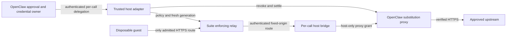

# OpenClaw integration research and first-delivery proposal

> Research and initial design recorded on 2026-10-02, followed by adversarial review, a supervised Bicep stdio MCP prototype and one-session OpenClaw Gateway qualification on 2026-10-03 using a deterministic provider. The selected multi-session lifecycle lives in the [OpenClaw workload service design](../openclaw.md). Its shared HTTP implementation passed bounded two-session Gateway qualification on 2026-10-05; model behavior and the complete lifecycle/recovery matrix remain unqualified. Evidence and remaining acceptance work are separated below. The [2026-10-13 first-tool disposition](#first-tool-design-disposition-2026-10-13) supersedes the initial proposal's unresolved design points; accepted decisions now live in the [service design](../openclaw.md#bicep-operation-and-result-contract).

The suite can add focused workload tools, enforced guest networking and reusable conformance scenarios to OpenClaw. Begin with a bounded validation operation through MCP or a thin tool plugin. A complete sandbox backend is a separate feasibility project because its interactive process and workspace contracts exceed the suite's current common execution interface.

## Evidence and scope

The investigation inspected [OpenClaw PR #97086](https://github.com/openclaw/openclaw/pull/97086), its review discussion and merged tree `008f04a65650f364ddbe40f1697f3c1b020bba97`; OpenClaw main at `df93a28f0bc58c41023326a734e3838bb356eea4`; Microsoft MXC tag `v0.9.0`; and suite source at `8161cfdc761557800d18d918a79f2731deb1a488`. The documentation branch starts at `63c0e97dbf39a0d976b07ffb9437317170f1a26d`; the intervening suite change reports credential-expired proxy streams as interrupted. Live OpenClaw documentation was read on 2026-10-02 and may evolve independently of those source snapshots.

The original investigation used source, documentation and published author reports. No OpenClaw or MXC runtime was installed or executed. Subsequent prototype tests are recorded separately below; they do not establish performance, cost, cross-platform compatibility or production readiness. Existing suite tests and upstream reports identify available evidence; they do not qualify the proposed integration.

Three independent reviewers subsequently challenged the proposal at suite commit `386e711bbaf9e0456254db89d71b30aad46d3d56`. Their findings were checked against source, and a controlled asynchronous fake-execution probe confirmed the Bicep cancellation behavior described below. That probe executed the Python wrapper only; it did not launch Docker, Bicep or OpenClaw. The review found four P2 design gaps and no demonstrated P1 vulnerability. The source links in the review section identify the assessed snapshot rather than making claims about future versions.

This record owns the OpenClaw host integration and delivery sequence. It does not design a new MXC backend beneath the suite router. The existing [policy architecture](two-axis-sandbox-policy.md), [Hyperlight research](hyperlight-backend.md) and [backend authoring guide](../backends/writing-a-backend.md) own those different concerns.

## What the MXC integration delivers

PR #97086 merged on 2026-07-13. Historical remaining-gate paragraphs in its body are not current merge blockers. It adds a separately installable Windows ProcessContainer plugin, with readiness checks, policy construction, command launching, a host-side filesystem bridge, packaging and tests. Each command gets an ephemeral container; session or agent scope controls workspace reuse rather than a continuously running container.

The merged plugin pinned MXC SDK `0.7.0` and emitted schema `0.7.0-alpha`. The inspected [current package](https://github.com/openclaw/openclaw/blob/df93a28f0bc58c41023326a734e3838bb356eea4/extensions/mxc/package.json) pins SDK `0.8.0`; the policy builder still emits `0.7.0-alpha`. MXC [v0.9.0](https://github.com/microsoft/mxc/releases/tag/v0.9.0) is a newer prerelease. SDK support for another engine or policy does not make it a capability of OpenClaw's ProcessContainer adapter.

The author reports 109 native Windows extension tests, packed installation, runtime loading and actual ProcessContainer checks for workspace modes and refusal cases. Linux reports distinguish passing tests from Windows-only skips. These are upstream-reported results, not runs reproduced here. See the [repair and evidence report](https://github.com/openclaw/openclaw/pull/97086#issuecomment-4939634739).

## Lessons for adapters

| Constraint | Evidence from the integration | Consequence for this suite |
|---|---|---|
| Preserve each workspace mode | Review found that `none` and `ro` had not correctly distinguished the isolated workspace from the actual agent workspace | Test the meaning of every translated mode; similar option names do not establish equivalence |
| Protect every file route | Commands execute under ProcessContainer, while bridge reads and mutations execute on the host | Apply confinement, no-follow access and race handling independently to the host file plane |
| Refuse unrepresentable restrictions | A writable parent grant cannot safely preserve a nested read-only protected skill root in this configuration | Reject overlapping grants instead of approximating the requested policy |
| Fail closed on explicit configuration | Missing configured policy files or paths previously risked falling back to defaults | Distinguish an omitted optional setting from an explicitly requested setting that cannot be honored |
| Prove the installed package | Checkout execution concealed missing native SDK dependencies in distribution | Install the packed adapter and worker into a clean environment and execute through that installed surface |
| Separate resource lifetimes | Stable runtime metadata coexists with per-command containers | Keep workspace retention, execution ownership, cancellation and disposal separate |
| Keep discovery inert | Non-full registration modes must return before probes and service registration | Import and discovery must not provision a backend or launch a worker |

The primary references are the [workspace and filesystem review](https://github.com/openclaw/openclaw/pull/97086#issuecomment-4931066422), [merged file bridge](https://github.com/openclaw/openclaw/blob/008f04a65650f364ddbe40f1697f3c1b020bba97/extensions/mxc/src/fs-bridge.ts), [policy builder](https://github.com/openclaw/openclaw/blob/008f04a65650f364ddbe40f1697f3c1b020bba97/extensions/mxc/src/mxc-container-config.ts), [packaging review](https://github.com/openclaw/openclaw/pull/97086#issuecomment-4813463771), [registration correction](https://github.com/openclaw/openclaw/pull/97086#issuecomment-4917736996) and [execution implementation](https://github.com/openclaw/openclaw/blob/008f04a65650f364ddbe40f1697f3c1b020bba97/extensions/mxc/src/mxc-backend.ts).

Environment handling also belongs to the contract. The Windows adapter constructs separate launcher and workload environments, handles case-insensitive names and assigns per-command temporary directories. A replacement environment must preserve the OS prerequisites needed to execute without importing application credentials. See [environment construction](https://github.com/openclaw/openclaw/blob/008f04a65650f364ddbe40f1697f3c1b020bba97/extensions/mxc/src/windows-env.ts).

### Configuration on process argv

OpenClaw's temporary launcher payload file does not remove exposure later in the chain: MXC's config-based executor path encodes the request onto process argv. [MXC #626](https://github.com/microsoft/mxc/issues/626#issuecomment-5027041631) was closed because upstream accepted the same-user observation boundary and declined additional transport complexity, not because that path was replaced. The tagged [v0.9.0 helper](https://github.com/microsoft/mxc/blob/v0.9.0/sdk/node/src/helper.ts) still constructs `--config-base64`, and [spawnSandboxFromConfig](https://github.com/microsoft/mxc/blob/v0.9.0/sdk/node/src/sandbox.ts) uses the executor path. The separate native API has different behavior; switching APIs is an adaptation requiring qualification. Credential claims must cover the whole launch chain.

## Existing OpenClaw capabilities and useful additions

OpenClaw already supports Docker/Podman, SSH and OpenShell execution, tool policy and approvals, credential management, and Code Mode with Node and QuickJS executors. A generic execution wrapper or a second approval system would duplicate existing responsibilities. See [sandbox configuration](https://docs.openclaw.ai/gateway/config-agents/sandbox), [OpenShell](https://docs.openclaw.ai/gateway/openshell), [policy](https://docs.openclaw.ai/start/why-openclaw/policy-as-code) and [Code Mode](https://docs.openclaw.ai/tools/code-mode/executors).

| Opportunity | Added value | Constraint and priority |
|---|---|---|
| Bicep validation | Fixed compiler operations, explicit completion/verdict semantics, selected prepared dependencies and closed runtime networking | First delivery; define and qualify one transport and backend |
| Terraform/OpenTofu, draw.io and optional CodeAct tools | Reuse workload-specific validation and explicit artifact delivery | Follow Bicep; retain each kind's constraints and separate proposed file edits from saving them |
| Enforced egress and credential mediation | Apply destination/method/path restrictions around sandboxed work while retaining upstream credentials outside the guest | Separate design; preserve OpenClaw authority and prove a concrete backend configuration |
| Conformance scenarios | Reusable adversarial probes for files, lifecycle, policy, authority and distribution | Early contribution path; a passing subset is not a complete security audit |
| Full sandbox provider | Expose suitable suite backends through OpenClaw's execution/workspace model | Later feasibility decision; interactive process contracts and SDK support are unresolved |

OpenClaw's [secret egress proxy](https://docs.openclaw.ai/gateway/secrets/secret-store-and-egress) already provides destination-bound secrets and per-process grants. Its documented automatic integration covers Gateway-hosted execution, not sandbox or remote-node execution, and cooperative proxy settings can be bypassed by direct sockets. The suite's configured Docker and WSLC topology removes the guest's direct external route and supplies host/method/path rules plus optional gateway credentials. This is a specific integration opportunity, not a superiority claim over every OpenClaw backend: OpenShell also has policy enforcement. The suite's [network contract](../network.md) retains backend-specific DNS, TLS, observation and authority limits. GET-only or path-restricted access is not a confidentiality guarantee. The [2026-10-15 refresh](#egress-and-credential-mediation-disposition-2026-10-15) also accounts for OpenClaw's explicit Crabbox grants and the private SDK boundary.

## Proposed first deliverable: closed-network Bicep validation

The revised proposal exposes one fixed validation operation to OpenClaw, with a Python service calling the existing Bicep kind through the router. Local stdio MCP with uniform policy for one trusted local operator is implemented by the supervised prototype below. The [Gateway qualification](openclaw-gateway-qualification.md) verifies that operation through one OpenClaw session with a deterministic provider; multi-session ownership, actual-model behavior and the complete crash matrix remain unqualified. Keep those limits explicit before expanding to a broader framework-neutral API or additional tools. Bicep is a bounded integration experiment; demand from OpenClaw users has not been established.

The inspected general MCP [materialization path](https://github.com/openclaw/openclaw/blob/df93a28f0bc58c41023326a734e3838bb356eea4/src/agents/agent-bundle-mcp-materialize.ts) forwards cancellation to the [runtime](https://github.com/openclaw/openclaw/blob/df93a28f0bc58c41023326a734e3838bb356eea4/src/agents/agent-bundle-mcp-runtime.ts), whose tool call sends the tool name and arguments without trusted agent/session identity. The first service can generate request-local ownership internally and apply the same policy to every admitted caller. Per-agent authorization and cross-call artifact access remain outside its contract. A tool plugin is an alternative only if a later requirement needs a trusted host integration that MCP does not supply. The proposed operation follows OpenClaw's MCP tool authorization; it does not inherit command, working-directory or file-bound host-exec approvals.

```text
OpenClaw MCP tool authorization
  -> local stdio MCP service with fixed policy
  -> immutable request snapshot and service-generated ownership
  -> SandboxRouter admission
  -> one Docker container per call and prepared Bicep image
  -> bounded completion/verdict and diagnostics for the submitted snapshot
```

Start with Docker, an explicitly admitted `Isolation.CONTAINER` policy and `min_isolation_scope=IsolationScope.CALL`, so every request receives its own physical sandbox. Preserve the suite's default isolation floor; do not silently lower it. A host requiring microVM isolation needs a separately qualified compatible backend before this workload is admitted. No new MXC backend is required for the Bicep prototype.

Use the existing [prepared AVM profile](../../../images/bicep-sandbox/README.md#prepared-avm-profile), an immutable deployed image reference, the host's selected Bicep configuration with the prepared cache location, and `Egress.CLOSED`. The current profile contains a small selected set of pinned modules, not the full AVM catalog. Runtime validation must retain `--no-restore`; an unprepared module must produce an incomplete result without a verdict. Build-time downloads and compiler/image provenance remain separate from runtime network closure.

### Initial contract

| Surface | Proposed boundary |
|---|---|
| Operation | One fixed Bicep validation operation; no shell command argument, deployment or arbitrary compiler flags |
| Inputs | Bounded relative names plus inline UTF-8 contents for `.bicep` and `.bicepparam`; validate the entire supplied set, with no separate entry point or auxiliary JSON/text assets |
| Host policy | Host selects image, compiler configuration, backend, isolation floor, timeouts, transfer budgets and closed networking; model arguments cannot widen them |
| Ownership | Uniform authorization for one trusted local operator; service-generated request identities and call-scoped containers; no model-supplied owner, agent or session authority |
| Results | Diagnostics-only structured response; preserve `completed` separately from verdict, bound compiler text and identify the submitted snapshot, compiler policy and image |
| Files | Copy supplied bytes into an immutable request snapshot in an adapter-owned root; no automatic workspace read, host/guest path translation, repository mount or downloadable artifact |
| Lifecycle | Specify cancellation requested, guest stopped and cleanup completed separately; bound the overall request and recovery; reconcile abandoned owned resources before admitting work after restart |
| Distribution | Explicit Python/runtime/image prerequisites; packed installation and installed execution must be tested |

Plain serialized labels do not reproduce MAF information-flow enforcement in OpenClaw. Result provenance can be preserved as metadata, but any use as authority requires host enforcement. Similarly, sandboxing this workload does not isolate the OpenClaw Gateway or other plugins. OpenClaw's [capability matrix](https://docs.openclaw.ai/gateway/sandboxing/supported-capability-matrix) describes that boundary.

OpenClaw's inspected [MCP metadata validator](https://github.com/openclaw/openclaw/blob/df93a28f0bc58c41023326a734e3838bb356eea4/src/agents/mcp-tool-metadata.ts) supports `outputSchema` and `structuredContent`; its [result projection](https://github.com/openclaw/openclaw/blob/df93a28f0bc58c41023326a734e3838bb356eea4/src/agents/mcp-content.ts) preserves structured results for Code Mode and renders them for ordinary model consumption. Use a shallow fixed schema rather than invent a result transport. The schema should carry a canonical source-set digest and compiler-policy/image identity: the verdict describes those submitted bytes under that profile, not the repository's current state. Canonicalization and the mapping from existing framework results still need design and tests.

### Adversarial review findings

The review supports the narrowed experiment but does not establish an implementation-ready design. The four findings below concern reuse assumptions and missing lifecycle requirements, not exploitable defects demonstrated in an existing OpenClaw adapter.

| Finding | Existing behavior and failure scenario | Required design correction |
|---|---|---|
| Cancellation is not confirmed termination | Bicep `_run_phase` shields the active execution and drains it after cancellation; Docker cancellation of the host CLI alone leaves the guest command running until disposal | Define acknowledgment, execution stop and cleanup completion separately; choose bounded draining or supervised exact-instance disposal and prove its interaction with router cleanup |
| Worker death bypasses cleanup | Docker containers run a persistent `sleep infinity`; worker death bypasses Python `finally`, and `reap` installs no background timer | Assign a recovery owner, dedicated adapter scope/generation and startup reconciliation; define maximum resource lifetime without sweeping unrelated owners or unexpired live work |
| Disposal is not concurrent call isolation | Bicep's spec does not request call scope, and the router defaults to conversation scope; distinct call directories can still share one container | Require call scope with internally generated identities; test simultaneous requests and cleanup ownership rather than inferring separation from disposal policy |
| Entry-point semantics exceed the existing tool | The Bicep tool accepts only `.bicep`/`.bicepparam` and builds and lints every supplied file; supporting JSON is rejected | Adopt whole-set validation initially; separating compilation targets from staged support assets needs a distinct workload API design |

These findings follow from the reviewed [Bicep tool](https://github.com/sokolaidev/maf-extensions/blob/386e711bbaf9e0456254db89d71b30aad46d3d56/packages/maf-sandbox-bicep/src/maf_sandbox_bicep/_tool.py), [Docker execution and reaper](https://github.com/sokolaidev/maf-extensions/blob/386e711bbaf9e0456254db89d71b30aad46d3d56/packages/maf-sandbox-docker/src/maf_sandbox_docker/_backend.py), [router defaults](https://github.com/sokolaidev/maf-extensions/blob/386e711bbaf9e0456254db89d71b30aad46d3d56/packages/maf-sandbox/src/maf_sandbox/_router.py), [call identity and cleanup wrapper](https://github.com/sokolaidev/maf-extensions/blob/386e711bbaf9e0456254db89d71b30aad46d3d56/packages/maf-sandbox/src/maf_sandbox/maf.py) and [isolation-scope contract](https://github.com/sokolaidev/maf-extensions/blob/386e711bbaf9e0456254db89d71b30aad46d3d56/packages/maf-sandbox/src/maf_sandbox/_protocol.py).

The controlled cancellation probe supplied `_run_phase` with a fake `exec` that signaled entry and waited on an event. After cancelling the phase and yielding to the event loop, the phase remained pending and `exec` had received no cancellation. Releasing the fake execution let the phase finish with `CancelledError`. This confirms the wrapper's drain behavior only; guest termination and transport settlement were not measured. In the reviewed code, the default 120-second execution timeout is spent independently for each build/lint phase, so it is not an end-to-end request deadline. The service must also define time reserved for termination and cleanup, and where cleanup failure remains observable after the client has cancelled or disconnected.

Safe staged filenames do not confine paths embedded in compiler source: Bicep supports compile-time file-loading functions. Call scope prevents sibling requests from sharing a filesystem; it does not replace control of the image's readable contents. No sibling-data exfiltration was demonstrated. Similarly, setting a host timeout does not prove recovery after process death. A scoped age-based reaper is an operator maximum-lifetime policy and can remove running work; it must not be treated as an idle-resource detector.

The review did not count already-disclosed choices such as numeric resource limits, framework packaging, result-label enforcement or SDK support as new defects. Resolve them in the first design rather than treating their presence in an issue as implementation evidence. Docker CPU/memory defaults are not finite workload budgets; the host profile must select and verify the actual limits.

### Design decisions and proof required

The first design must resolve the public operation schema, source-set canonicalization, concrete input/output and resource limits, error mapping, total deadline, cancellation acknowledgment, recovery ownership and supported OpenClaw version. Compare direct use of existing framework tools with the smallest supported typed-result interface; do not make a general framework-neutral redesign a prerequisite without showing why the existing surface cannot serve the prototype. The protocol/router modules use the standard library, but the [installed core distribution](../../../packages/maf-sandbox/pyproject.toml) still depends on `agent-framework-core`; the packaged kinds expose framework tools. Do not describe the current distribution as dependency-free or directly embeddable in TypeScript.

Before implementation is called complete, demonstrate valid and invalid Bicep, a missing prepared dependency with no verdict, malformed/incomplete diagnostics, oversized input/output, rejected auxiliary assets, path escapes and file replacement, concurrent call isolation, timeout/cancellation, cleanup failure, and clean installed-package execution. Match the result's digest to the submitted bytes and prove that later workspace edits do not change what the verdict claims. Verify actual guest networking is closed and compiler policy is applied. A denied external request alone does not prove an allowlist, but this initial workload deliberately requests no outbound destinations. Keep model behavior, service control fields, runtime evidence and CI results distinguishable.

Cancellation tests must interrupt an active compiler phase and measure guest stop and exact-container removal, not just host-future cancellation. Crash tests must kill the worker or Gateway during acquisition, staging, execution and disposal, then verify that recovery removes owned containers and staging roots without deleting another service's resources. Supervised prototype use may precede that recovery qualification; unattended use must wait. A real OpenClaw call through the installed service must establish successful, invalid, incomplete and cancellation outcomes before expanding the workstream.

No automatic workspace access, artifact download, persistent result store, formatting, Terraform plan/apply/destroy, general CodeAct, network credentials, guest host-tools, interactive shell, warm reuse, remote multi-tenant service or complete OpenClaw backend is included in this first delivery. Subsequent designs must establish their own authority and lifecycle boundaries. The five design workstreams are investigation options, not a commitment to implement all of them.

## Supervised prototype

The [experimental source sample](../../../samples/experimental/openclaw_bicep/README.md) implements local stdio MCP using the existing packaged Bicep tool. It fixes the initial choices: inline whole-set sources, one active request, call-scoped Docker, closed networking, immutable image selection, a host-supplied compiler configuration and diagnostics-only structured results. The README owns the concrete limits, canonical source-set digest, operator startup procedure and supported dependency pins. There is no new public framework-neutral runner or published adapter package.

The sample retains a durable random owner scope under an exclusive local process lock and reconciles that scope before serving requests. Every call settles before a final scope sweep; cleanup failure removes the verdict and poisons admission. Cancellation during cleanup was reproduced in adversarial implementation review and corrected by draining a separately shielded cleanup task. Subsequent PR review found that repeated direct `Task.cancel()` could still interrupt a drain and release admission early. Ten regression cases reproduced the gap; worker, cleanup and shutdown now wait through repeated cancellation before propagating it, retaining admission and the local owner lock until settlement. The cases distinguish compiler cancellation, request deadline, cancellation during purge and unsuccessful purge. The 120-second deadline requests cancellation; it is not a hard maximum container lifetime.

Local MCP stdio execution on Windows with Docker Engine 29.8.0 serving Linux guests demonstrated valid and invalid compiler verdicts, an uncached registry module returning incomplete without a verdict, selected prepared AVM resolution and container cleanup. The prepared image was local ID `sha256:0bda3505a331713614b847025ce35199f3dda5a81ea2a661130525226dbc0265`, reporting Bicep CLI 0.46.1 (`545b338e2c`); this records a tested local image, not published-image provenance. The compiler cases also passed in an isolated environment using the sample's published suite pins and MCP 1.26.0 without workspace-package fallback.

A separate live test sent MCP cancellation after observing an active Bicep process, then verified removal of its exact container. Inspection confirmed network mode `none`, 1 GiB memory, one CPU, 128 PIDs, all capabilities dropped and a nonempty call label. Startup recovery removed an intentionally abandoned container in the retained owner scope while another owner's container remained running; that other container also survived cancellation. This is a targeted stale-resource recovery test, not a process-kill test at every lifecycle transition or a complete networking audit.

Those initial checks were service/backend observations. The subsequent [Gateway qualification](openclaw-gateway-qualification.md) executed OpenClaw 2026.9.7's real agent path with a deterministic local provider and published Python dependencies: valid, invalid and incomplete outcomes, result identities, bearer-token refusal, explicit tool-policy denials, active-compiler client disconnection, exact-container removal and successful post-disconnect admission passed in one session. This is host plumbing evidence without LLM reasoning. Worker death at each lifecycle boundary and an independent maximum-lifetime recovery owner remain unqualified. The sample is for supervised evaluation only; it does not close the design issue.

Host execution exposed two integration details. OpenClaw retained the compact JSON mirror alongside its structured-result projection; SDK-style two-space JSON formatting removes that duplicate content item, verified through the real Gateway after the correction. More substantially, OpenClaw caches a separate stdio service per session. A second session conflicts with the prototype's exclusive retained owner directory and fails to start; weakening that lock would invalidate cleanup ownership. That stdio configuration is limited to one active OpenClaw session per owner directory; the subsequently implemented shared HTTP service has [bounded two-session evidence](openclaw-gateway-qualification.md#two-session-http-execution-2026-10-05). [#1665](https://github.com/sokolaidev/maf-extensions/issues/1665) owns the multi-session service design rather than treating one trusted operator as one worker process.

## MCP server choice and Microsoft Agent Framework usage

This follow-up inspected Microsoft Agent Framework (MAF) at `e9857bd75a21843803431a2e7dfa41ee9b017ac7`, published package metadata and public user reports on 2026-10-02. MAF does not require a particular server framework: Python applications consume external servers through `MCPStdioTool` or `MCPStreamableHTTPTool`, while .NET applications use the official C# MCP SDK. These are client integration choices, distinct from the library implementing the server. The [MAF MCP guide](https://learn.microsoft.com/en-us/agent-framework/agents/tools/local-mcp-tools) documents both language paths.

| Server option | Evidence and fit |
|---|---|
| Official Python SDK low-level `Server` | The initial prototype used `mcp==1.26.0`, explicit schemas and `stdio_server`. MAF's own [`Agent.as_mcp_server()`](https://github.com/microsoft/agent-framework/blob/e9857bd75a21843803431a2e7dfa41ee9b017ac7/python/packages/core/agent_framework/_agents.py) also constructs the low-level server. That convenience exposes a model-running agent as a tool; it does not replace the deterministic Bicep validator. |
| SDK-bundled `mcp.server.fastmcp.FastMCP` | Selected for the revised prototype, retaining its `mcp==1.26.0` pin. MAF's official [FastMCP hosting sample](https://github.com/microsoft/agent-framework/blob/e9857bd75a21843803431a2e7dfa41ee9b017ac7/python/samples/04-hosting/mcp/fastmcp_app.py) uses this import and declares `mcp>=1.27.0,<2`. Its [local integration-test server](https://github.com/microsoft/agent-framework/blob/e9857bd75a21843803431a2e7dfa41ee9b017ac7/python/scripts/local_mcp_streamable_http_server.py) uses the same facade; the [CI action](https://github.com/microsoft/agent-framework/blob/e9857bd75a21843803431a2e7dfa41ee9b017ac7/.github/actions/setup-local-mcp-server/action.yml) starts it and calls a discovered tool through MAF. Function annotations generate schemas and simplify registration. |
| Standalone `fastmcp.FastMCP` | The independently maintained framework adds composition, middleware, proxies and authentication integrations. [FastMCP 4.0.10](https://pypi.org/project/fastmcp/4.0.10/) was the current published release inspected. It depends on `fastmcp-slim[client,server]==4.0.10`, whose client/server extras require `mcp>=2,<3`; it is a different dependency decision from the SDK-bundled facade. |

There is real, limited user evidence for standalone FastMCP: [MAF issue #3099](https://github.com/microsoft/agent-framework/issues/3099) describes FastMCP 2.13.1 deployed on Azure Container Apps and difficulties registering its HTTP tools through declarative Foundry agents. That establishes reported usage, not a successful end-to-end qualification or population share. [Issue #7866](https://github.com/microsoft/agent-framework/issues/7866) reports duplicate content when MAF consumed servers returning both text and structured output, including a reported FastMCP-backed service. It reinforces the need to test client-side result projection. Neither official samples nor selected issue reports establish what most MAF users deploy.

The dependency boundary is material. Published [`agent-framework-hosting-mcp==1.0.0a260918`](https://pypi.org/pypi/agent-framework-hosting-mcp/1.0.0a260918/json) requires `mcp>=1.11,<2`; [`agent-framework-core==1.20.0`](https://pypi.org/pypi/agent-framework-core/1.20.0/json) requires `mcp>=1.24,<2` for its `all` extra. Those requirements cannot share an environment with standalone FastMCP 4's SDK 2 requirement, and the prototype itself pins SDK 1.26.0. MAF tracks Python SDK 2 migration in [#7446](https://github.com/microsoft/agent-framework/issues/7446) and protocol-era support in [#8245](https://github.com/microsoft/agent-framework/issues/8245). Do not infer that the base core package always installs MCP, or that separate client/server processes must share package versions. FastMCP's [migration documentation](https://gofastmcp.com/getting-started/upgrading/from-fastmcp-3#protocol-version-support) describes compatibility with earlier protocol eras; compatibility with our exact MAF/OpenClaw clients still needs execution evidence.

MAF's alpha [hosting package](https://github.com/microsoft/agent-framework/blob/e9857bd75a21843803431a2e7dfa41ee9b017ac7/python/packages/hosting-mcp/README.md) provides `AgentMCPTool`, `WorkflowMCPTool` and argument/result conversion helpers. It leaves the server, transport, authentication, session trust, concurrency and deployment to the application. Consider it when exposing an actual agent or workflow; it adds little to the fixed compiler operation and does not own sandbox isolation or cleanup.

A direct local probe connected `MCPStdioTool` from installed `agent-framework-core==1.19.0` and `mcp==1.26.0` to the prototype at `4ff04e4846a212eee484baea284dd55f646ab9e0`, using workspace suite packages and the prepared Docker image above. Discovery returned only `bicep_validate`. Valid and syntactically invalid inputs each produced one MAF content item containing the structured result, with the expected verdict and confirmed cleanup. An initial probe incorrectly expected a missing local module to be incomplete; the observed `BCP091` result was completed/invalid. A separate probe of an uncached registry module returned incomplete with no verdict, confirmed cleanup and zero containers remaining in its retained owner scope. These were direct client probes without a model, not an agent conversation or an OpenClaw test; no standalone FastMCP server was executed.

The revised prototype selects SDK-bundled FastMCP for MAF compatibility and generated input/output schemas. Typed Pydantic models replace the handwritten schemas, while a narrow `BoundedFastMCP` subclass rejects raw arguments before FastMCP's JSON coercion and suppresses framework validation errors that could echo source content. The subclass supplies the pre-JSON bounded reader through the pinned SDK's private `_mcp_server` transport because its public `run_stdio_async()` accepts no custom stdin. This is explicit version coupling, not a general FastMCP transport API. Immutable source snapshots, Docker restrictions and cancellation/cleanup ownership remain application responsibilities. Standalone FastMCP 4 still requires a deliberate SDK/dependency migration or a separate service environment.

FastMCP qualification covers generated schemas, rejection of extra fields and stringified arrays, bounded validation errors, structured cleanup failures, and oversized frames through the actual stdio adapter. The live compiler test now uses MAF's `MCPStdioTool` for valid/invalid, uncached registry and prepared AVM cases; each produces one content item with the expected structured result. The live SDK-client cancellation and scoped startup-recovery test also passed after the migration. A separate MAF-client probe launched the revised service through `uv run --script` using published dependencies, confirmed valid and uncached-registry outcomes, and found no remaining owned containers. The original Gateway evidence above qualifies one-session stdio execution. The 2026-10-05 record adds two-session shared HTTP outcomes, admission and accepted cancellation; the complete lifecycle/recovery matrix remains outstanding.

## Multi-session lifecycle decision

The follow-up on 2026-10-03 selected a separately supervised stateful Streamable HTTP service for the next implementation. The [owning design](../openclaw.md) specifies its lifecycle and acceptance; this comparison records why it was selected. One trusted operator still supplies uniform policy, but each OpenClaw session can retain its own MCP connection without launching another cleanup owner. The selected scope separates a reusable MCP service from explicitly registered workload bindings: transport, admission and resource supervision must not depend on Bicep. Bicep remains the first real binding; two synthetic bindings will test the extension boundary. Additional kinds still require their own authority, input/output and lifecycle qualification, especially artifact delivery and persistent conversation state.

| Option | Benefit | Cost and decision |
|---|---|---|
| Shared loopback Streamable HTTP | Existing OpenClaw and MAF clients can share one process, admission slot and retained Docker owner. | Requires authenticated ingress, session caps/retirement and explicit cancellation/disconnect behavior. Selected and implemented by #1680; bounded two-session Gateway checks passed on 2026-10-05, with full lifecycle/recovery qualification still open. |
| Disjoint per-session stdio workers | Preserves the existing transport and separates process failure. | Needs trusted launch identities, a durable registry, recovery for abandoned workers and aggregate admission across processes. OpenClaw does not supply trusted session identity in tool arguments. This adds a shared supervisor without eliminating lifecycle design; deferred. |
| OpenClaw plugin-owned shared worker | Can use host tool context and Gateway lifecycle hooks. | The pinned public API exposes `registerService`, `registerTool` and session context, so this is a real alternative. It adds TypeScript/plugin packaging and Gateway coupling; sharing with MAF still needs a service boundary. Deferred until a requirement needs trusted OpenClaw-specific context. |

The source audit used OpenClaw release revision `c074824a27c96d3983043f9eeb33823cd1772d8c`, its installed npm 2026.9.7 distribution and TypeScript MCP SDK 1.30.0. Its [MCP lifecycle wrapper](https://github.com/openclaw/openclaw/blob/c074824a27c96d3983043f9eeb33823cd1772d8c/src/agents/mcp-client-lifecycle.ts) sends session DELETE during disposal; its [runtime](https://github.com/openclaw/openclaw/blob/c074824a27c96d3983043f9eeb33823cd1772d8c/src/agents/agent-bundle-mcp-runtime.ts) forwards request cancellation to `client.callTool`. The [plugin API](https://github.com/openclaw/openclaw/blob/c074824a27c96d3983043f9eeb33823cd1772d8c/src/plugins/plugin-api.types.ts) and [tool context](https://github.com/openclaw/openclaw/blob/c074824a27c96d3983043f9eeb33823cd1772d8c/src/plugins/tool-types.ts) establish the third option's available surfaces, not qualification of a plugin implementation.

Installed MAF core 1.19.0's `MCPStreamableHTTPTool` accepts static authorization headers and defaults to terminating its session on close; the [versioned source](https://github.com/microsoft/agent-framework/blob/python-1.19.0/python/packages/core/agent_framework/_mcp.py) and [usage documentation](https://learn.microsoft.com/en-us/agent-framework/agents/tools/local-mcp-tools) support that client choice. Python MCP 1.26.0 already supplies FastMCP's stateful HTTP app. Its [session manager](https://github.com/modelcontextprotocol/python-sdk/blob/v1.26.0/src/mcp/server/streamable_http_manager.py) creates a fresh session per request in stateless mode, so a later cancellation notification has no matching in-flight request there. Stateful mode preserves per-session request routing but retains records of explicitly terminated transports. The selected service must bound and retire that SDK state; selecting FastMCP does not supply this policy.

The [MCP transport specification](https://modelcontextprotocol.io/specification/2025-11-25/basic/transports) separates HTTP disconnection from cancellation and requires Origin validation. The shared design therefore preserves supervision after a lost response stream, uses explicit cancellation for a live request and authenticates loopback requests before dispatch. It does not transfer the stdio process-exit contract to an HTTP socket.

A local loopback-only probe on Windows with Python 3.13, MCP 1.26.0 and MAF core 1.19.0 exercised an unmodified FastMCP HTTP app with a synthetic event-blocked tool and JSON responses. Two initialized sessions both issued request ID 42; cancelling A produced its cancellation error while B remained active and then completed after release. DELETE returned 200 for both, and reuse of the deleted ID returned 404. A third connection through `MCPStreamableHTTPTool` discovered and called the tool and projected its structured result into one content item. After all three clients closed, the manager still contained three records, all marked terminated. This confirms the need for bounded retirement rather than assuming DELETE frees registry capacity.

The probe can be reproduced by creating `FastMCP(..., json_response=True)`, registering an async tool returning `dict[str, str]` and blocked on an `asyncio.Event` with separate started events for each test caller, serving its `streamable_http_app()` on an ephemeral loopback port, and issuing initialize/initialized, equal-ID tools/call, cancellation and DELETE messages from two HTTP clients. Observe the remaining task before releasing it, then call through MAF and count the pinned manager's `_server_instances` after close. The probe intentionally inspected private SDK state; it is transport evidence only. It exercised no Bicep containers, authentication middleware, session eviction implementation, OpenClaw HTTP configuration or Gateway turns. The [two-session acceptance matrix](../openclaw.md#acceptance-before-enabling-multiple-gateway-sessions) is still required before claiming shared-service support.

## Subsequent designs

For additional workload tools, assess [Terraform](../kinds/terraform.md), [draw.io](../kinds/drawio.md) and [CodeAct](../kinds/codeact.md) independently. Formatting returns proposed content for a separate authorized save. Diagram validation is not sanitization of every embedded reference. General code execution requires a larger authority and artifact contract than a fixed validator. Avoid duplicating OpenClaw Code Mode without a concrete confined-workload benefit.

The [2026-10-15 egress disposition](#egress-and-credential-mediation-disposition-2026-10-15) records the authority mapping, conditional relay architecture, lifecycle and qualification plan for #1640. Supported OpenClaw delegation is the first prerequisite; generic MCP credentials do not establish per-agent authority.

The [2026-10-16 conformance disposition](#conformance-and-upgrade-qualification-disposition-2026-10-16) selects the installed Bicep runner first, bounded fault qualification next and conditional native workspace/file qualification separately. Native evidence belongs to each exact installed backend/version combination; the source refresh supersedes the earlier optional MXC 0.9 upgrade proposal. Creating issues here does not authorize publishing a third-party PR.

The full-backend design must map OpenClaw execution specifications, filesystem bridge, manager, workspace retention and lifecycle generations to the suite. The current common interface returns final execution results and does not provide a complete PTY/stdin/background-process/streaming-session contract. The [Deep Agents adapter](../../../packages/maf-sandbox-deepagents/README.md) is a useful precedent with explicit limitations. Native Hyperlight guest-to-host callbacks remain tracked separately by [#369](https://github.com/sokolaidev/maf-extensions/issues/369).

Current OpenClaw [SDK documentation](https://docs.openclaw.ai/plugins/sdk-subpaths) marks `plugin-sdk/sandbox` private-local, although [host hooks](https://docs.openclaw.ai/plugins/sdk-overview/host-hooks#sandbox-backends) describe registration. Verify the installed public interface and obtain a supported extension direction before committing to a third-party backend. July's official-plugin imports are not evidence of a stable current third-party contract.

## First-tool design disposition (2026-10-13)

This audit inspected repository `b5e756d6a8c80cd7095a3f7878e708611c04b0c5`, the original #1638 requirements, the source sample and the [completed finite qualification](openclaw-qualification-closure-audit.md#consolidated-closure-reconciliation-2026-10-12). #1882 is merged and #1676 is closed. The first-tool design is complete: the accepted contract now lives in [the owning service document](../openclaw.md#bicep-operation-and-result-contract), with delivered implementation and qualification tracked separately from further adoption. This is source/evidence reconciliation, with no new runtime execution or release.

| #1638 requirement | Accepted decision and disposition |
|---|---|
| Fixed operation, whole-source-set schema and limits | `bicep_validate` accepts only the bounded inline file list. Canonical snapshot identity, strict name/byte limits and the absence of entry-point, shell, deployment and auxiliary-file inputs are specified in the owning design and implemented by `snapshot`/typed models. |
| Host policy, isolation, image and prepared cache | Trusted startup owns every policy value. The Bicep composition explicitly accepts container/call isolation, immutable image selection, selected prepared AVM modules, closed networking and `--no-restore`; it does not weaken the router default. |
| Trusted owner and session/call context | One retained operator owner, independent stateful HTTP sessions, host-minted call identity and one shared admission slot. Protocol IDs route cancellation but do not supply trusted per-agent identity or tenancy. #1665/#1677 designed this boundary; #1675/#1680 implemented it. |
| Results and failures | The owning design specifies all result fields and status/error mappings, including incomplete versus invalid, diagnostic overflow, cleanup failure, refusal without a result and cancellation without a delivered result. #1651 implements the projection; #1676's evidence checks its real host path. |
| Files, staging and replacement races | The accepted tool receives inline bytes, copies an immutable snapshot into a new in-memory store and mounts no host workspace. Host filesystem link/replacement attacks are excluded by that surface, not claimed solved for a general file bridge. Guest compiler reads and trusted operator files remain explicit limits. Future file/artifact access requires #1639/#1641 acceptance. |
| Cancellation, disposal and recovery | The shared lifecycle retains admission/ownership until work and cleanup settle, poisons uncertain reuse and recovers only the retained scope. #1676 is complete via #1882. Active MAF client futures can outlast service retirement until timeout; no maximum lifetime or independent watchdog is claimed. |
| Python/MAF integration and supported baseline | Retain SDK-bundled FastMCP, existing kind/router and MAF callable/projection with version-sensitive refusal. A framework-neutral API or dependency split is outside this first increment. The design records the historical qualified versions and requires requalification of changed dependencies/private APIs. |
| Clean installed artifacts and continued adoption | The existing executions installed published dependencies but ran source adapter modules. #1898 implements an installable worker and qualifies it outside the checkout; #1641 owns reusable conformance/upgrade design. There is no released adapter wheel today and no claim that dependency installation already proves one. |

### Acceptance and follow-up ownership

The original valid/invalid/incomplete, identity/projection, cancellation/isolation, disposal and selected recovery observations are credited to the candidates in the Gateway record and #1850/#1851 follow-ups, not to this audit commit or one final image. Malformed framework shape and oversized input/result refusal also have offline source tests. Existing Docker network-mode inspection and prepared/unprepared module results remain their recorded evidence; they are not generalized connectivity tests. #1898 adds a behavioral in-guest denial probe with a reachable control for its selected packaged-worker baseline.

The original demand for link/reparse/hardlink and replacement-race rejection applies to any filesystem surface admitted by the design. The fixed inline-only source contract admits no model-selected host file surface; trusted image/config/owner/token storage is an operator boundary. This is a deliberate scope decision, not proof of atomic confinement for future workspace mounts or artifact retrieval. Those extensions remain in #1639/#1641.

| Remaining work | Disposition and owner |
|---|---|
| Installable worker, repeatable clean installation and supported-version upgrade checks | Implement next in [#1898](https://github.com/sokolaidev/maf-extensions/issues/1898), under [#1641](https://github.com/sokolaidev/maf-extensions/issues/1641). The issue includes artifact, runtime, networking, lifecycle and evidence acceptance; release is separately gated. |
| Additional workload schemas, persistent state and artifact delivery | Design separately in #1639; no new kind is enabled by this decision. |
| Credential mediation, allowed-network operation, remote identity and host authority | Design separately in #1640. Uniform local authorization and closed guest networking remain the first-tool boundary. |
| Reusable adversarial file tests, other platforms, broader faults, independent watchdog and actual-model scenarios | Prioritize explicitly in #1641. Deferred from the supervised first increment; they are not new blockers for closed #1676. No implementation commitment or production claim is implied. |
| Full OpenClaw backend/interactive execution | Feasibility remains #1642; it is not a prerequisite for the MCP worker. |

The design issue can close because its schemas, lifecycle/error mapping, transport/backend choices, compatibility prerequisites and scoped implementation/qualification follow-ups are now explicit. Closing it does not close #1637 or #1639–#1642, publish a worker, approve unattended use or stop adoption. The next concrete deliverable is #1898.

## Installed adoption delivery (2026-10-13)

The [packaged worker](../../../packages/maf-sandbox-mcp/README.md) implements #1898 with a fixed entry point and the reusable runtime/binding boundary. The [installed qualification](openclaw-gateway-qualification.md#installed-worker-qualification-2026-10-13) records artifact/import identity, the deliberate MAF 1.20.0 baseline, 43 transport cases, 109 SDK retirements, five real Bicep/MAF ownership cases, instrumented and direct-console Gateway execution, prepared-module resolution and the bounded network denial control. The earlier first-tool disposition remains its dated design snapshot.

This delivers a locally qualified wheel, not a published package or unattended-service guarantee. Adoption continues under #1637; #1641 retains reusable conformance, platform/fault/model prioritization and upgrade policy, while #1639/#1640/#1642 retain their distinct design decisions. The pending MAF client timeout after service retirement remains documented. No historical qualification report or image identity is rewritten.

## Egress and credential mediation disposition (2026-10-15)

**Decision: proceed with a bounded delegation-contract probe; defer a supported credential adapter until that probe establishes a public integration boundary.** A conditional Docker relay is the next implementation candidate. This continues adoption without introducing more workload tools under #1639 or changing closed-network Bicep validation. #1640 is a design deliverable, not runtime qualification.

This refresh inspected OpenClaw `27721b8fec4bd5593bb0ba609b4ab1257f9613c1` and suite `d6a512c2b3d77500a3d16921779dc96fced3dee7`. Live OpenClaw documentation was checked on 2026-10-15. The earlier snapshots above remain historical evidence. No OpenClaw credential flow, proxy chain or sandbox network was executed for this design.

### Current contracts and the integration gap

OpenClaw's [secret documentation at the assessed revision](https://github.com/openclaw/openclaw/blob/27721b8fec4bd5593bb0ba609b4ab1257f9613c1/docs/gateway/secrets/secret-store-and-egress.md) now describes explicit Crabbox model and setup grants alongside automatic Gateway-hosted exec. The automatic path still excludes sandbox and remote-node exec; proxy configuration alone does not prevent direct sockets. Setup selects protected store entries; the model route resolves a configured API-key SecretRef. This supersedes any interpretation that OpenClaw has no remote credential bridge. Identity-scoped store secrets remain unsupported.

The [SDK subpath catalog](https://github.com/openclaw/openclaw/blob/27721b8fec4bd5593bb0ba609b4ab1257f9613c1/docs/plugins/sdk-subpaths.md) explicitly excludes `secret-egress-runtime` from the third-party API. Its [export module](https://github.com/openclaw/openclaw/blob/27721b8fec4bd5593bb0ba609b4ab1257f9613c1/src/plugin-sdk/secret-egress-runtime.ts) calls both helpers private official-plugin runtime, and the [private-local list](https://github.com/openclaw/openclaw/blob/27721b8fec4bd5593bb0ba609b4ab1257f9613c1/scripts/lib/plugin-sdk-private-local-only-subpaths.json) includes it. Finding a source export is not proof that a clean installed third-party plugin may use it.

The [job helper](https://github.com/openclaw/openclaw/blob/27721b8fec4bd5593bb0ba609b4ab1257f9613c1/src/secrets/job-egress.ts) returns sentinels, host-only proxy authentication, a public CA bundle and a revocation callback. The [model helper](https://github.com/openclaw/openclaw/blob/27721b8fec4bd5593bb0ba609b4ab1257f9613c1/src/secrets/model-egress.ts) provides a narrower model context and cancellation signal. Neither is the suite's bearer-grant interface. The [OpenShell integration](https://docs.openclaw.ai/gateway/openshell) already accepts backend policy and provider configuration; evaluate that existing route before proposing equivalent enforcement.

The suite's [host credential contract](../hosts.md#credentials-for-guest-http-requests), [network contract](../network.md) and [grant implementation](../../../packages/maf-sandbox/src/maf_sandbox/credentials.py) support fresh Docker/WSLC generations with exact HTTPS bearer origins, method/path limits and independent expiry. `CredentialRequest` contains the key, kind, runtime instance, generation, audience set and deadline; it does not contain an OpenClaw approval or policy digest. `CredentialGrant.token` is a real bearer value. Passing an OpenClaw sentinel or proxy password as that token is not an adapter. The existing provider has no general remote revocation callback; disposal and the gateway's independent deadline bound authority. Do not claim synchronous OpenClaw cancellation merely from those existing interfaces.

### Selected architecture and trust boundary

Prefer retaining substitution in OpenClaw and adding an enforced route around it. Do not read its database, copy long-lived keys into Python configuration, create another secret store, or forward a Gateway-wide API token into a guest. The conditional relay must be a generic delegated HTTP transport capability with an OpenClaw-specific host binding; it must not overload `CredentialGrant` or introduce an OpenClaw import into the dependency-free protocol. The implementation issue must settle that interface before changing package contracts.



The arrows describe proposed responsibilities, not an available deployment. The suite relay terminates guest TLS to enforce method/path policy before forwarding through the host-owned OpenClaw proxy; OpenClaw retains the upstream key and performs substitution. The relay must remove guest proxy-authentication and credential headers and synthesize only the selected credential placeholder in the configured header. Keep that placeholder in the relay; the initial guest profile receives neither a sentinel nor owner proxy authentication. Arbitrary secret substitution in guest URLs, headers or bodies is outside this first profile. The relay-to-owner hop must authenticate the exact grant, verify its configured trust, and offer no generic CONNECT tunnel bypassing method/path checks. A container cannot use the host's loopback proxy directly: a per-call host bridge must expose only the selected owner grant to the isolated relay, authenticate its generation, and forward to the configured loopback proxy. Bind that endpoint to a dedicated private interface reachable by the relay only, keep owner proxy authentication on the host, and reject guest/direct callers. The final transport/address-policy checks must survive this extra hop. The present iron-proxy credential gateway does not implement this chain.

Initially all trusted components run on one operator-controlled host with an isolated guest network. A loopback listener alone is not authentication: use an OS-protected local channel or a separately authenticated endpoint whose credential never enters the guest. Remote delegation, multiple credential-owner hosts and multi-tenant service operation are deferred. The existing MCP service token grants uniform operator access; MCP session IDs and request IDs are transport routing data. They cannot supply the authenticated owner, agent or business approval for this design.

Trust the Gateway approval/credential owner, host adapter, runtime manager, enforcing relay and selected upstream. Treat model arguments, guest code, supplied headers, proxy environment overrides and network replies as untrusted. Same-user host compromise, runtime-admin access and a malicious authorized upstream are outside the guest boundary. An upstream can reflect a credential or act on an accepted request; egress rules cannot undo that or guarantee confidentiality. Host tools, model traffic, output sinks and runtime management are separate network/authority channels.

### Authority mapping and admission

The trusted adapter must receive an authenticated host context after OpenClaw authorizes the concrete operation. Until a supported hook supplies it, refuse credential-backed execution. Do not invent identity fields from tool arguments or treat permission to call an MCP tool as authorization to spend any stored secret. Where OpenClaw supplies only team credentials, record that principal honestly: per-call mediation does not turn a team API key into a user's delegated identity.

| Input | Trusted source and binding | Refusal |
|---|---|---|
| Owner and scope | Host authorization context; opaque mapping including tenant and user where distinct | Missing identity or a team-wide scope used to claim user-specific authority |
| Conversation, agent and call | Authenticated host context plus host-minted call nonce; map to `SandboxKey.thread_id`, `agent_id` and `call_id` | Model-provided identity, duplicate/replayed admission, or another owner's handle |
| Operation and policy | Operator-approved named profile, approval reference and digest of the exact operation inputs, destination rules, credential selection and limits | Changed inputs after approval, policy widening, unknown profile or stale policy revision |
| Credential selection | Approved owner-side SecretRef/handle and principal class; no secret value in the request | Model-selected secret, unsupported auth scheme or missing owner authorization |
| Runtime | Backend-created instance ID, fresh generation and proxy boot identity, bound after resource creation and before guest start | Missing/mismatched generation, adoption of old resources, or restart reuse |
| Destination | Exact HTTPS origin plus explicit methods and path rules; audience identifies authority, not just a hostname | Wildcards for credentials, redirects outside policy, unsupported ports/paths/protocols |
| Lifetime | Earliest of approval validity, owner grant deadline, configured relay lifetime and workload retention | Expired/nonfinite deadline, renewal, or missing independent orphan cutoff |

Maintain the approval/policy/handle association in the adapter's per-call state; those fields are not additions already present in `CredentialRequest`. Authenticate and integrity-protect the whole association across the control channel. A proposed one-use opaque delegation handle is consumed atomically for one live generation; it is not a bearer credential for a guest. Repeated HTTP requests within that generation remain possible until it closes. Exact-once business effects require upstream idempotency/authorization, not merely a nonce or an HTTP method allowlist.

Host configuration fixes the backend, image digests, local credential-owner endpoint/trust, operation profiles, audience-to-origin mapping, methods/paths, bounded bodies/results, maximum grant duration and cleanup policy. The initial qualification profile uses one exact public HTTPS origin on port 443, one selected credential header and finite foreground execution. No model-controlled URL, proxy endpoint, CA, audience, timeout extension or fallback backend is admitted. An internal test fixture may emulate the public service on an explicitly isolated private route; that is not public-network qualification.

Require call isolation, `ALLOWLIST`, `EGRESS_METHODS`, `EGRESS_PATHS`, and explicit attached-authority scope/channel/retention permission before provisioning. A delegated relay must independently satisfy the declared attachment contract before advertising it. A failed import, unsupported owner API, unavailable proxy, unsupported policy or failed trust check is a refusal, never unrestricted execution. Bicep continues to select a separate credential-free backend with closed networking.

### Grant lifecycle and interrupted results

The proposed host record is `prepared -> active -> closing -> closed`, with `cleanup_pending` when settlement is uncertain. `prepared` reserves an approved operation without exposing a spendable guest route. Create fresh resources, bind the exact generation, acquire a finite owner grant, install the relay policy and deadline, and recheck cancellation/approval before guest start. Cancellation during any preparation step closes what was created; a late callback cannot activate a cancelled call.

Normal completion, cancellation, timeout, approval withdrawal and transport-owner shutdown first fence new credential use and abort active forwarding, then settle guest and proxy cleanup. A lost MCP response stream alone is not cancellation: retain the supervisor until explicit cancellation or its fixed deadline. Close/revoke are idempotent and generation-specific so an old callback cannot revoke a sibling. A policy/secret change closes affected active grants before admitting new work under the new revision; a refreshed secret snapshot alone is not revocation.

The initial relay must cap authority at 300 seconds or a shorter owner/approval deadline, never renew it, and enforce a monotonic cutoff inside the isolated relay even if every host supervisor disappears. Start that cap before grant installation and guest launch; preparation time cannot extend it. This is a proposed integration bound, not an OpenClaw helper guarantee. On owner/relay restart, discard all old handles and refuse automatic replay. Failure to acknowledge revocation means authority loss is unconfirmed until an independently established cutoff; report that uncertainty rather than saying cancellation was immediate. Keep resources quarantined from reuse while cleanup is incomplete. A later sweep needs the recorded ownership/generation and must not remove sibling work.

On expiry/revocation, terminate existing upstream streams as well as subsequent requests. Bytes already sent cannot be recalled, and a truncated response must not be promoted to a completed success because the guest swallowed a socket error. The host result and audit record, not guest stdout, own the following proposed fields; these are not changes to the Bicep result schema:

| Field | Proposed values and interpretation |
|---|---|
| `completion` | `complete`, `refused`, `interrupted`; complete requires a fully settled response and confirmed cleanup |
| `reason` | `ok`, `authority_unavailable`, `policy_denied`, `grant_expired`, `grant_revoked`, `cancelled`, `upstream_failed`, `cleanup_incomplete`; use a bounded enum, no raw secret-bearing exception |
| `upstream_effect` | `not_sent` only when the trusted relay proves no bytes were sent; otherwise `may_have_occurred`, including response loss and cancellation |
| `authority_end` | `confirmed` or `unconfirmed`, with the fixed expiry retained in the protected host record |
| `cleanup` | `complete` or `pending`; pending prevents reuse and successful completion |
| `response_complete` | Boolean from relay framing/termination, never inferred solely from process exit code |

If cancellation prevents delivery of a tool result, retain this outcome in the host audit. Do not retry a possibly accepted operation automatically. The relay bounds input/output and forwarded bytes and rejects oversized or unsupported request forms. Logs contain opaque correlation IDs, policy digest, generation fingerprint, rule decision, byte counts, termination reason and cleanup state. Exclude keys, sentinels, proxy credentials, CA private material, request/response bodies and secret-bearing URLs/query strings. Redaction and audit completeness require tests; logs alone do not prove enforcement.

### Network constraints and alternatives

Use the [existing network semantics](../network.md) rather than silently strengthening their claims. Docker/WSLC resolve and check the selected address per dial, but permitted private addresses are not universally blocked. DNS behavior is not fully confined by CONNECT. The relay chain introduces another resolver and dialer: the final owner-side dial must enforce the same resolved-address policy, or the initial profile is refused. OpenClaw's hostname-only authorization is insufficient evidence for that condition. Explicitly deny loopback, link-local, metadata and runtime/proxy interface destinations at the final hop and qualify IPv4, IPv6, rebinding and reconnect behavior. The proposed public-origin profile additionally refuses private destination ranges, except the explicitly isolated qualification fixture; this is an adapter requirement, not a claim about the existing general allowlist. General private-service support requires a separately approved address policy.

TLS interception requires a guest-scoped public trust bundle; neither CA private key enters the guest. Verify both relay-to-owner and final upstream TLS. Certificate pinning failures are incompatibility refusals, never bypass hosts or disabled verification. Redirects are separate requests and must pass origin/method/path checks anew; no authorization follows an unapproved redirect. Path matching must account for encoded separators, dot segments, prefixes and upstream normalization; query/body contents are not authorized by a path rule. Restrict the initial chain to qualified HTTP request forms; refuse raw CONNECT tunnels, upgrades/WebSockets, QUIC/UDP and alternate protocols. Direct sockets, proxy-variable removal and IPv6 routes need independent denial probes. Removing a TCP route does not establish DNS confidentiality.

| Candidate | Disposition |
|---|---|
| Existing OpenClaw host proxy | Keep where cooperative host execution is sufficient; adding another proxy alone adds no confinement |
| Existing OpenShell policy/provider route | Prefer when it meets the workload; qualify its concrete policy and credential lifecycle rather than claiming suite-wide superiority |
| Docker delegated relay | Conditional first implementation: fresh call resources, explicit method/path enforcement and independent cutoff, with installed end-to-end evidence |
| WSLC delegated relay | Reuse the eventual generic contract only after separate network, teardown and platform qualification; Docker evidence does not transfer |
| MXC, Hyperlight, ACAS and Docker Sandboxes | No credential-adapter support inferred; their policy/channel contracts and available paths differ |
| Copy OpenClaw keys into `CredentialGrant` | Decline as the default: expands plaintext ownership and loses upstream revocation unless a supported delegation API explicitly authorizes and controls that export |
| Chain the current proxies unchanged | Decline: no qualified delegated transport, immediate revocation bridge or shared final-dial address enforcement exists in this assessment |

### Qualification and next deliverables

Every runtime claim must name installed OpenClaw/adapter/wheel versions, backend/runtime versions, proxy image digests, OS, topology, approved profile and evidence artifacts. A pinned source-only helper experiment is exploratory and must say so. Use a controlled HTTPS service with a synthetic secret and observable request counters; do not use production credentials or add a public general-purpose tool just to test this design.

| Case group | Required positive and negative evidence |
|---|---|
| Public integration boundary | Clean installed third-party loading and authenticated context/approval/cancellation capture; missing/private-only exports refuse before provisioning |
| Allowed control | Approved HTTPS method/path succeeds with expected synthetic credential at the upstream, complete response and cleanup; an unavailable upstream or blocked-all configuration cannot pass |
| Destination and operation | Wrong host, port, scheme, audience, method, path, encoded path, redirect, credential header and unknown profile fail; upstream counters prove denied cases were not forwarded |
| Network bypass | Direct IPv4/IPv6 socket, removed proxy env, raw CONNECT, alternate protocol, DNS/rebinding and forbidden final-hop address attempts; use reachable controls to distinguish enforcement from broken routing |
| Identity and replay | Wrong owner/agent/session/call, altered policy/input digest, consumed handle, stale generation, restart, and concurrent sibling calls; cancellation of one leaves the other usable |
| Authority lifetime | Expiry before activation, during upload, after upstream acceptance and during response streaming; owner withdrawal/cancellation fences access and reports partial responses honestly |
| Failure and recovery | Owner/relay/adapter crash, network partition, cancellation during provisioning, lost response stream, failed revoke acknowledgement, failed cleanup and orphan expiry after host loss |
| Credential confinement | Inspect guest files/env/argv, errors, logs, artifacts and snapshot exclusions; no upstream key, owner proxy auth or CA private key; a hostile allowed upstream remains an explicit limit |
| Installed compatibility | Independent Docker run first, WSLC run separately; reinstall/upgrade rejection and capability refusal; record skipped cases without translating them into support |

First deliverable: **[#1951](https://github.com/sokolaidev/maf-extensions/issues/1951)** implements a bounded supported-API/authority probe and records an implement/defer decision. It may demonstrate the private official-plugin path as a clearly labeled control, but must not ship that path as supported third-party integration or open an upstream PR without maintainer confirmation. If no supported API exists, retain the blocker with the concrete required contract; proceed with the other OpenClaw design PBIs rather than copying private internals.

Conditional implementation: **[#1952](https://github.com/sokolaidev/maf-extensions/issues/1952)** implements the generic delegated relay and synthetic Docker qualification only after the API, identity, final-dial address enforcement and revocation prerequisites are satisfied. Keep WSLC support gated on its own evidence. #1641 owns reusable conformance packaging and upgrade policy; #1642 owns full backend feasibility; #1639 remains deferred. Closing #1640 records this design and its follow-up ownership, not a working credential integration or a stop to adoption.

## Installed credential-delegation probe (2026-10-15)

**Decision: defer the supported credential adapter in #1952; #1951 completes the installed compatibility/refusal probe.** OpenClaw 2026.10.3's egress facade imports successfully from an external npm project, but its own packaged SDK catalog explicitly says it is private to official plugins. Importability does not supply a supported third-party authority contract. Continue the OpenClaw design sequence with #1641 and #1642; #1639 remains deferred. This decision does not stop adoption or reopen the completed Bicep work.

The [probe](../../../scripts/experiments/openclaw_delegation_probe.py), [Node import observer](../../../scripts/experiments/openclaw_delegation_import.mjs) and [retained result](../../../scripts/experiments/openclaw_delegation_result.json) record Windows AMD64 with Node 26.8.1. A fresh npm project outside the checkout installed the [OpenClaw 2026.10.3 registry artifact](https://registry.npmjs.org/openclaw/2026.10.3), with lifecycle scripts and optional dependencies disabled. The probe verified the pinned SHA-512 integrity and every one of the artifact's 13,937 regular files against the installation: 257,692,083 bytes. The tarball SHA-256 is `761685d010d96645d1deabe19299ecde263eac3f2489a17322f48c461a1130a5`. The JSON also retains package metadata, SDK documentation, lockfile and artifact-order file-tree hashes; it contains no host paths or credential values. Dependency bytes are not included in the OpenClaw file-tree claim; npm installed them separately and the lockfile hash identifies that resolution.

### Measured boundary and source findings

| Check | Result and limit |
|---|---|
| External public import control | `openclaw/plugin-sdk/plugin-entry` imports and exports `definePluginEntry`; this establishes SDK resolution in the clean npm project, not Gateway plugin registration |
| Egress facade import | `openclaw/plugin-sdk/secret-egress-runtime` imports and exports only `withConfiguredModelEgress`; the export mapping has JavaScript but no `types` entry |
| Support classification | The packaged SDK subpath catalog labels that facade private and not a third-party API; this explicit statement, not absence of types alone, determines the refusal |
| Difference from the #1640 source snapshot | The released facade does not export `withSetupSecretEgress`; the newer inspected upstream source did. Do not apply source-main helper coverage to this released artifact |
| Discovery observations | No attempts at the instrumented process/network/file-write operations; the isolated temporary home stayed empty. The report is written synchronously at process exit after pending timers and `beforeExit` work; nonsettling imports hit the parent timeout. Guard hits after reporting force a nonzero child exit, which the parent rejects even if an exit listener catches the guard exception. These JavaScript guards are observation/refusal controls, not an OS sandbox or exhaustive side-effect detector |
| Synthetic owner admission | `private_official_plugin_api` before the synthetic owner callback; zero fixture credential requests. No actual owner grant, sandbox resource or Gateway was created |
| Failure controls | Tests reject changed artifact bytes, altered installed files, archive escape paths, missing exports and unknown support/version declarations; import fixtures exercise blocked process creation, network connection and file writing, plus ambient-secret/Node-option exclusion |
| Runtime authority/network matrix | Not executed: no authenticated Gateway context, live credential, expiry/revocation stream, replay, orphan cutoff or final upstream connection. The recorded refusal does not count as successful egress enforcement |

The released tool-context declarations include host-supplied `agentId`, session identifiers, trusted requester/owner fields and `assertInvocationCurrent`; context version 2 requires that current-authority guard. These are useful building blocks, so the result is not that OpenClaw has no trusted plugin context. They do not, by themselves, bind a selected secret and operation-input/policy digest to an external runtime generation or provide the delegated relay's revocation and final-dial contract. This is declaration inspection, not a live callback test.

The release's public `secret-ref-runtime`/`secret-input-runtime` declarations expose resolved secret values or prepared plugin credentials. They are not substitutes for owner-held proxy delegation: using them would deliberately expand plaintext ownership and would still require an operation authorization/revocation design. The private model helper's installed implementation accepts an optional abort signal, returns a sentinel, host proxy environment and public CA bundle, and revokes its internal grant during cleanup/cancellation. Its callable shape does not expose the generation-bound approval, independent finite deadline, revocation acknowledgement or final-dial policy hook needed here. No private helper was invoked to acquire a credential.

### Reproduce and interpret the result

Use a Node version in the release's engine range (`>=24.16.0 <25 || >=26.1.0`) and a fresh external project. From the repository, the following PowerShell creates only an isolated installation and result file; it neither configures a Gateway nor starts a sandbox. Installation can take several minutes. The probe itself does not install dependencies, execute lifecycle scripts or invoke the credential helper.

```powershell
$probeRoot = Join-Path ([IO.Path]::GetTempPath()) ("maf-delegation-" + [guid]::NewGuid())
New-Item -ItemType Directory -Path $probeRoot | Out-Null
'{"name":"maf-delegation-probe","version":"0.0.0","private":true,"type":"module"}' | Set-Content (Join-Path $probeRoot package.json) -Encoding utf8
$archive = Join-Path $probeRoot openclaw.tgz
Invoke-WebRequest https://registry.npmjs.org/openclaw/-/openclaw-2026.10.3.tgz -OutFile $archive
npm install --prefix $probeRoot --ignore-scripts --omit=optional --no-audit --no-fund --registry=https://registry.npmjs.org $archive
if ($LASTEXITCODE -ne 0) { throw "OpenClaw installation failed" }
uv run python scripts/experiments/openclaw_delegation_probe.py --project $probeRoot --archive $archive --output (Join-Path $probeRoot result.json)
```

Exit zero means the probe completed, including a measured `defer`; it does not mean the adapter is supported. A failed public control, integrity mismatch, unsupported Node engine, observed import side effect or malformed probe output fails the probe instead of being counted as evidence for a missing API. Changed API prose or exports remain `support_not_established` until deliberately qualified. Keep the resulting JSON; preserve the installation separately if the exact transitive lockfile is needed. The pinned artifact must be reassessed deliberately for a different release.

The recorded installation omits bundled-plugin postinstall setup and optional native dependencies because neither SDK import needs them. It therefore makes no full OpenClaw CLI, Gateway registration, third-party plugin lifecycle, native backend, Linux, real-model or production claim. The synthetic owner is a refusal spy, not an emulator proving OpenClaw authorization. Negative tests of the probe establish its reporting/admission behavior only; the conditional runtime matrix remains unqualified.

### Required upstream contract and reopening gate

The missing deliverable is a documented third-party, owner-held delegation API with the following contract. This is a concrete upstream request recorded here, not a submitted upstream issue or PR:

1. Supply authenticated caller/session/agent/call context and approval bound to the exact operation-input digest and policy revision. Reject caller-chosen identity, credential selection and broadened policy; distinguish team credentials from user delegation.
2. Issue a one-use opaque handle through a protected local channel, bind it to a fresh runtime/gateway generation and exact HTTPS origin/method/path profile, and retain the upstream secret and owner proxy authentication on the owner host. Admission, failed preparation and stale handle/restart behavior must be specified.
3. Enforce a finite, nonrenewable deadline independently after supervisor loss. Expose idempotent revocation with acknowledgement, cancellation before cleanup, active-stream termination and an honest unconfirmed outcome when the owner cannot be reached. Effects already accepted upstream remain possible.
4. Preserve resolved-address enforcement at the actual upstream dial, including redirects, reconnects, IPv4/IPv6 and DNS changes. A check at the first relay does not authorize an unchecked final connection.
5. Provide a supported installed plugin entry and versioned contract tests: allowed request succeeds; wrong authority/policy/destination/method/path, direct routes and stale grants fail; sibling grants remain isolated; logs and guest artifacts contain no upstream credential or owner proxy authentication.

#1952 remains blocked until that public contract or an explicitly accepted alternative satisfies these requirements and passes installed end-to-end qualification. Source exports, raw secret readers, a local fake owner or a passing import alone cannot reopen it. Reuse the already recorded conditional architecture; do not create another authorization store, ship private SDK imports, or relax final-hop/expiry requirements to make the probe green.

## Conformance and upgrade qualification disposition (2026-10-16)

**Decision: implement a repository-local, profile-driven qualification runner, beginning with the installed Bicep worker in [#1972](https://github.com/sokolaidev/maf-extensions/issues/1972).** The design for #1641 is complete; the reusable runner is not implemented by this record. Add bounded owner-loss qualification in [#1973](https://github.com/sokolaidev/maf-extensions/issues/1973) after that runner, and keep Windows/MXC workspace and host-file qualification conditional in [#1974](https://github.com/sokolaidev/maf-extensions/issues/1974). Reuse the existing service and tests; add neither a new workload tool nor a shipped conformance package. This does not reopen #1676, #1898 or #1932, enable #1952, or replace #1642's full-backend feasibility decision.

### Evidence inventory and current source boundary

This design inspected suite main `28170aba345aa85cc08d8f9f1a077a6b082e03c8`, the existing checkers and dated qualification records. No OpenClaw/native runtime or model was executed for this design. Historical results retain their original artifact, host, image, dependency manifest and instrumentation scope; a new runner cannot upgrade their attribution by parsing them into a new format.

| Existing evidence or code | Reuse | Boundary that must survive |
|---|---|---|
| [Core conformance subjects and probes](../../../packages/maf-sandbox/src/maf_sandbox/conformance.py) | Reuse probe intent, capability declarations, independent planting/observation, and compatible predicates for execution, file transfer, reach, disposal and egress | These APIs consume a suite `Sandbox`/subject. An OpenClaw tool is not automatically such a subject. The POSIX subject needs guest utilities; native Windows needs its own planting/observation. Existing symlink probes do not constitute a complete hardlink/reparse/replacement-race suite |
| [Docker conformance observers](../../../packages/maf-sandbox-docker/src/maf_sandbox_docker/conformance.py) | Reuse independent engine observations where the selected Docker subject actually supports them | An engine fingerprint complements, rather than replaces, checks of host-file operations, authority and the requested tool result |
| [Installed worker checker](../../../tests/fixtures/openclaw_installed_worker_check.py), [transport checker](../../../tests/fixtures/openclaw_published_transport_check.py), [ownership checker](../../../tests/fixtures/openclaw_bicep_ownership_check.py) and [Gateway lifecycle checker](../../../tests/fixtures/openclaw_gateway_lifecycle_check.py) | Wrap the checkers or extract shared assertions without weakening them; retain their finite case inventories, installed-origin checks, correlated events and independent cleanup observations | A synthetic binding/socket/ASGI result, actual compiler execution, MAF-client result and Gateway observation remain different evidence classes. Do not remove existing version guards just to admit a new manifest |
| [Installed review-candidate qualification](openclaw-gateway-qualification.md#review-candidate-requalification-2026-10-13) and [closure reconciliation](openclaw-qualification-closure-audit.md#consolidated-closure-reconciliation-2026-10-12) | Preserve the 43 transport cases, five Bicep/MAF cases and finite Gateway acceptance as reference requirements and separately attributed historical results | The records intentionally combine different candidates/images where stated. Their `complete_matrix: false` values, Windows baseline and active-MAF-client settlement limit remain unchanged; they are not one fresh full-candidate campaign |
| [Deterministic end-to-end sample](../../../samples/experimental/openclaw_bicep_e2e/README.md) and its [result evaluator](../../../samples/experimental/openclaw_bicep_e2e/_evidence.py) | Reuse isolated configuration, deterministic Gateway plumbing, source/config/image binding and result/cleanup assertions | Two deterministic turns do not establish model reasoning, arbitrary workspace access, another platform or the complete service lifecycle |
| [Credential-delegation probe](../../../scripts/experiments/openclaw_delegation_probe.py) and [retained result](../../../scripts/experiments/openclaw_delegation_result.json) | Reuse pinned artifact verification, explicit refusal and discovery controls, including delayed and post-report guard attempts | OpenClaw 2026.10.3 is qualified here only for the installed import/refusal observation. It is not the 2026.9.7 Gateway baseline, a supported credential API or an exhaustive OS-level side-effect sandbox |

The upstream source refresh is pinned at `2ade584167ac2e130b876d0f37b31ba5ff539697`: the [MXC package](https://github.com/openclaw/openclaw/blob/2ade584167ac2e130b876d0f37b31ba5ff539697/extensions/mxc/package.json) now declares SDK `0.9.0` and plugin API `>=2026.10.4`, while its [policy builder](https://github.com/openclaw/openclaw/blob/2ade584167ac2e130b876d0f37b31ba5ff539697/extensions/mxc/src/mxc-container-config.ts) still emits `0.7.0-alpha`. Its [registration](https://github.com/openclaw/openclaw/blob/2ade584167ac2e130b876d0f37b31ba5ff539697/extensions/mxc/src/plugin.ts) returns before readiness/backend setup in non-full mode and remains Windows-only; its [host file bridge](https://github.com/openclaw/openclaw/blob/2ade584167ac2e130b876d0f37b31ba5ff539697/extensions/mxc/src/fs-bridge.ts) uses root-scoped file helpers and rejects hardlinks on reads. These are source observations, not publication, loading, race-safety or native-execution proof. The earlier optional SDK 0.9 upgrade proposal is superseded by qualification of an exact installed plugin/SDK/schema/native-binary tuple; neither compatibility nor incompatibility follows from the version strings alone.

The [SDK catalog](https://docs.openclaw.ai/plugins/sdk-subpaths) read on 2026-10-16 labels `plugin-sdk/sandbox` private-local. The official plugin's use of it does not authorize a third-party adapter. #1974 may exercise an installed official plugin through a supported operator surface; if it cannot reach a required behavior or observe its premise, that case is unqualified. #1642 still owns whether a new suite backend can use a supported extension API. No upstream PR is authorized by this design.

### Harness boundary and claim selection

The runner is test tooling outside the shipped packages. It owns fresh test state, artifact acquisition, finite deadlines, scenario selection and evidence collection. A subject adapter translates only the selected subject's operations: discovery, preparation, a tool call or supported native command, an admitted file operation, interruption, observation and disposal. The Bicep adapter uses the installed console/MCP/Gateway surfaces; it must not synthesize arbitrary execution or file access by bypassing the workload. A Windows/MXC adapter uses the installed official subject and native observers. Neither adapter is a production backend or a credential owner.

A versioned profile declares its required cases, claim scope, supported surfaces, expected capabilities, prerequisites, resource limits and subject adapter before discovery starts. An operator selects that profile and the expected candidate manifest independently of the subject's report. Capability discovery may reject a mismatch, but may not silently narrow the selected claims. A missing promised capability or missing native prerequisite is unqualified, not a successful skip. A case is not applicable only when the profile explicitly excludes that surface with a reason; for example, the Bicep inline contract has no host file bridge, so its file rows confer no confinement coverage.

Separate the tested route from the fixture/control route. A trusted observer may plant disposable hostile layouts and inspect engine/host state, but the attack itself must traverse the subject's real public operation. An internal SDK call, fake provider, source checkout import or observer cleanup cannot stand in for that operation. Use an independently reachable benign target/control before crediting a denial. The fixture's ability to establish the attack premise is evidence too; lack of link privileges, absent files or an unreachable endpoint cannot manufacture a pass.

Each campaign uses fresh configuration and uniquely owned temporary resources, with an unrelated sentinel outside the owned set. Capture the owner/resource association before mutations, and dispose only that recorded set. No broad daemon prune, shared Gateway reset or user workspace fixture is permitted. The evaluator reads bounded host-observed records and expected predicates; model/guest assertions, a zero process exit, or absence of an error alone never establish correctness or cleanup. Mutating operations require before/after independent observations. A cleanup failure keeps the campaign failed/unqualified even if a later test supervisor removes the leftovers.

### Prioritized scenario and control matrix

P0 is the first installed-bicep profile in #1972. P1 is the additional finite fault profile in #1973. P2 is the conditional native profile in #1974. These priorities order implementation; they are not security levels. Workspace expectations follow the candidate-specific [workspace access contract](https://docs.openclaw.ai/gateway/sandboxing/workspace-access), including effective role restrictions and explicit read-only skill roots. The selected profile expands each row into stable case IDs and explicit required controls, retaining the existing individual transport/ownership case identities.

| Cases | Required behavior and control | Profile and disposition |
|---|---|---|
| I1: installed identity and engine entry | Verify npm/wheel/native/launcher bytes, dependency manifest and loaded module origins outside the checkout; invoke the installed entry and actual compiler/native engine. Missing configured assets or dependencies fail before qualification, with no source fallback | P0; native artifact/engine variant in P2 |
| I2: discovery | Import and non-full discovery cause no worker/backend creation or credential request. Observe configured guarded operations, process/listener/resource inventory and delayed/exit activity; a never-settling import times out. Explicitly bound the observation surface | P0; full native registration is a separate positive control in P2 |
| I3: requested policy | Malformed input, unknown capability, missing explicitly configured policy/path and unsupported restrictions refuse before execution/allocation. Pair with a successful valid request and unchanged resource counts on refusal; never substitute default/permissive policy | P0 workload variants; P2 native policy variants |
| B1: Gateway result semantics | Two real sessions execute valid, invalid and incomplete Bicep cases through deterministic Gateway turns. Verify exact source/config/image identity and one correctly projected result; compiler failure is distinct from transport/tool failure | P0; retain prepared-module and installed-console attribution |
| B2: admission and ownership | A holds global admission; B is refused without allocation, then succeeds after A's confirmed disposal. Equal IDs in distinct sessions do not cross-cancel; repeated matching cancellation retains admission through cleanup; an unrelated owner survives | P0; reuse the five ownership cases and their independent observations |
| B3: transport and result loss | Execute the 43-case published transport inventory against the selected installed candidate. Keep socket and direct-ASGI evidence separate; verify bounded requests/results, SDK/adapter retirement, disconnect without implicit cancellation, completed-but-undelivered results and no automatic replay | P0; active client-future settlement is reported separately from service settlement |
| N1: closed runtime networking | Use a controlled endpoint first shown reachable from the fixture's allowed control route, then observe denial through the guest's restricted route with actual compiler work still succeeding; record DNS/TLS/address scope | P0; no allowlist, arbitrary Internet, method/path or credential claim follows |
| L1: abrupt actor loss | Independently stop the owned client, Gateway or worker at pre-admission, active execution, completed-result and disposal barriers. Record actual dispatch, surviving sibling, lock/generation, residual resource and result state; do not infer non-execution from lost replies | P1, added evidence rather than reopening graceful-cancellation closure |
| L2: bounded recovery | Exercise scoped disposal refusal/unavailability and recovery. A new owner cannot advertise safe readiness until the selected recovery policy proves old owned resources settled; stale generations cannot cancel/reuse fresh resources. Use monotonic event barriers and finite deadlines | P1; a failed expectation creates a focused defect, not a relaxed predicate |
| W1: workspace modes | Pin the candidate's effective policy: `none` permits private workspace writes without exposing the agent workspace; `ro` exposes the agent workspace read-only; `rw` permits agent workspace writes unless a role policy caps it. Prove permitted marker access and prohibited mutations through command and host-file routes; account separately for explicitly granted skill/mount roots | P2; Bicep inline profile is explicitly not applicable |
| W2: protected roots and lifetime | A writable parent cannot override a protected read-only child: reject unrepresentable policy before execution. Check distinct agent/session roots, case normalization and prefix siblings, and separately observe command-container disposal versus retained workspace lifetime | P2; SDK engine coverage is not inherited |
| F1: path and link confinement | Exercise absolute/relative traversal, missing parents, symlinks, junctions/reparse points and hardlinks across admitted read/write/list/create/delete operations. Prove the outside marker/link is reachable without the tested restriction, then independently verify it remains unchanged | P2; use native Windows planting/observation, not the POSIX utility subject |
| F2: replacement and rename | Replace a parent or leaf between authorization and access using controlled barriers; test both rename endpoints, existing destinations, cross-root and protected-root moves. Require refusal or handle-bound safe access and unchanged outside markers | P2; unavailable deterministic controls mean unqualified race coverage. A stress loop or check-then-open check is not atomic-confinement proof |
| X1: execution bounds | Verify exact byte/output caps, timeout and completion/result distinction, descendant/resource observation, environment isolation and stale runtime generations through a real engine. Run destructive timeout probes last or acquire a fresh owned subject | P0 workload bounds; generic native execution/descendant variants belong to P2 and #1642's capability decision |
| A1: delegated authority and enforced egress | Allowed request plus wrong authority/policy/origin/method/path, direct routes, stale grants, sibling isolation, withdrawal, stream interruption, independent expiry and final-dial controls | Blocked under #1952; an importable private API or synthetic owner is not an applicable runtime pass |

### Evidence format and acceptance rules

Use a new versioned envelope around retained observations; do not rewrite old reports or promote their `complete_matrix` flags. The first runner must implement a strict schema and evaluator for these fields. The names below are the proposed evidence contract, not an existing package API.

| Record | Required contents |
|---|---|
| Campaign | `schema_version`, unpredictable `campaign_id`, `profile_id`, `profile_revision`, `plan_sha256`, runner/adapter commit and hashes, expected candidate digest, start/end timestamps and monotonic duration, finite limits, explicit requested claims and aggregate outcome |
| Candidate | OpenClaw and plugin archive versions/integrities; worker wheel digest and published-versus-candidate source; full resolved Python/Node manifest/lock hashes; loaded module origins checked locally; Node/Python/OS/architecture; backend/daemon/native binary and policy-schema identity; immutable image digest; normalized policy/configuration digests |
| Case attempt | Stable `case_id` and revision, distinct `attempt_id`, candidate/profile binding, prerequisite/control references, observed actor/session/call/resource aliases and event sequence, expected predicate, measured outcome, bounded reason code, and artifact references. Retries get new attempts and retain prior failures |
| Artifact inventory | Relative owned names, byte lengths, SHA-256, producer/evidence class and redaction policy. Separate synthetic fixture, installed transport, real engine, Gateway and external-host observations. A hash binds bytes; it does not prove their truth or turn a private report into public reproducible evidence |
| Cleanup | Expected owned resources, independently observed survivors/removals, unrelated sentinel result, product versus harness cleanup, unresolved work and final process/listener state. Never collapse unknown cleanup to confirmed |

The expected manifest and plan are inputs from the selected operator profile, not values the report may choose for itself. Canonical hashes cover schema-normalized nonsecret contract fields; exclude raw credentials and host-specific launch values, checking them locally where needed. Normalization must not erase policy-relevant differences. Match them against observations and verify every referenced artifact before evaluation. Reject duplicate/missing case IDs, missing required fields, unknown schema/profile revisions, invalid types, nonfinite durations, oversized/truncated records, stale campaign aliases, mismatched candidates, missing controls and uncorrelated observations. A previous successful file left in an output directory is not evidence for a new campaign: start with a fresh owned directory and never reuse a prior final summary. Retain failed/interrupted attempts with their incomplete status; publish a final summary atomically only after evaluation, including failed or unqualified outcomes. Partial output cannot satisfy qualification.

For the initial format, cap the summary including the candidate manifest at 1 MiB, event records collectively at 16 MiB, each auxiliary log at 8 MiB and the complete evidence bundle at 64 MiB. Refuse a bundle that exceeds a bound rather than truncating required proof; changing bounds requires a new profile revision. Artifact references must stay under the campaign's evidence root without traversal or link escapes. Keep raw credential-bearing configuration, source, host paths and infrastructure identifiers out of public records. Use random per-campaign aliases for correlation; omit secrets rather than publishing their hashes. Keep private raw evidence separately under the operator's retention policy and state when it is unavailable to readers.

Case outcomes are `pass`, `fail`, `unqualified` or `not_applicable`. `unqualified` includes missing native prerequisites, a failed positive control, unavailable observation or incomplete cleanup evidence. `not_applicable` requires a profile-defined surface exclusion and is never counted as a passed attack. The aggregate is `qualified_for_profile` only if every required applicable case and its controls pass on that candidate and cleanup is confirmed; any observed violation yields `failed`, otherwise a missing requirement yields `unqualified`. Failed or unqualified qualification exits nonzero. Successful execution of a refusal-only discovery profile may record a supported-API decision of `defer`; it cannot produce `qualified_for_profile` for a runtime credential profile. There is no global security score or implicit production approval.

### Candidate selection, CI and upgrade gates

The first P0 target is explicit: OpenClaw 2026.9.7, the last recorded Gateway baseline, with published `maf-sandbox-mcp` 0.1.0. [PyPI metadata](https://pypi.org/pypi/maf-sandbox-mcp/0.1.0/json) checked on 2026-10-16 identifies wheel SHA-256 `1228f030135da4e3c5797ec76e19c34275fb7bba20fbc55d3d42d6cc43955529` and a core requirement `>=0.50.0,<0.51`. The earlier installed qualification used a different candidate wheel and core 0.48.0; its MAF 1.20.0 manifest must not be pasted onto the published wheel. #1972 resolves and locks a compatible full dependency set and qualifies that combination afresh. Unavailable or incompatible artifacts stop the target as unqualified. OpenClaw 2026.10.3 discovery evidence and source 2026.10.4 metadata do not silently update this target.

| Execution lane | Required proof and limit |
|---|---|
| Ordinary PR CI | Offline schema/evaluator negative tests, bounded adapter fixtures, source layering and packaging checks. Cover all-denied controls, source fallback, transplanted/stale evidence, duplicate IDs, missing cleanup and self-narrowed profiles. Tests of a validator do not qualify the subject |
| Opt-in installed P0 | Fresh external environment; full installed artifact and origin checks; deterministic provider with real Gateway/MCP/MAF/Docker/compiler routes as attributed per case. First qualify Windows/Docker; Linux is a separately selected, initially unqualified profile. No model key or native MXC host required |
| Opt-in P1 | Same fixed candidate plus controlled actor-loss/disposal faults and independent observer/supervisor. Record all attempts and residual resources. Test-supervisor cleanup does not establish independent product recovery |
| Opt-in native P2 | Exact Windows/MXC installed tuple, required host preparation and native controls; positive execution and filesystem premises before denials. No Linux skip is Windows qualification; no ProcessContainer result qualifies other MXC engines |
| Credential/model extensions | #1952 remains blocked on supported delegation. Actual-model sample execution requires a separately selected provider/configuration and budget; deterministic results are not model evidence. These lanes are excluded from current qualification claims |

A dependency, OpenClaw/plugin release, host/kernel/daemon/native binary, image, policy/schema or adapter semantic change creates a new candidate identity and requires a fresh complete selected profile. Do not widen supported ranges or mark a version accepted because resolution/import alone passes. Compare the previous accepted report with the candidate's fresh report, retain both, and require a recorded maintainer adoption decision. Missing prerequisites or regressions defer that candidate; restore the prior explicitly selected tuple without replaying interrupted operations. Metadata-only changes may receive installation evidence plus an explicit unchanged-runtime comparison, but are not called runtime requalification. This is an adoption gate, not a package publication or deployment automation.

### Deferred scope and delivery order

[#1972](https://github.com/sokolaidev/maf-extensions/issues/1972) is the first implementation deliverable and remains independent of native MXC and credentials. [#1973](https://github.com/sokolaidev/maf-extensions/issues/1973) follows its candidate/evidence contract. [#1974](https://github.com/sokolaidev/maf-extensions/issues/1974) is conditional on that runner, a supported installed operator surface and a suitable disposable Windows host; it qualifies the existing official plugin rather than implementing the full suite backend. Keep new workload file/artifact delivery deferred in #1639 and enforced delegation blocked in #1952. #1642 remains the next broader design PBI.

Other platforms, arbitrary backends, indefinite/concurrent stress, host power loss, an independent production watchdog, actual-model reasoning, prompt-injection resistance and remote multi-tenant authority are explicitly deferred, not acceptance requirements being silently waived. No unattended-service claim is made. #1637 retains prioritization of those extensions; a future maintainer decision must give each selected extension a finite contract and implementation/qualification owner before broadening the profile. Independent credential expiry after supervisor loss is already a required, blocked #1952 contract, not replaced by the test supervisor in #1973. Historical client-timeout and filesystem check-then-access limits stay visible.

This disposition closes #1641's design scope because the reusable boundaries, prioritized scenarios, evidence rules, upgrade policy and implementation owners are explicit. It ships no runner, native adapter or new runtime qualification, and it does not stop OpenClaw adoption.

**Implementation update (2026-10-16):** #1972 now supplies the repository-local runner, independent evaluator and a [fresh published-candidate Windows report](openclaw-gateway-qualification.md#reviewed-v2-conformance-campaign-2026-10-16). The reviewed v2 profile binds dependency/native files and correlated source/control evidence. It passed on OpenClaw 2026.9.7, worker 0.1.0, core 0.50.0 and MAF 1.21.0, with all transport/ownership cases and two deterministic Gateway sessions. This leaves #1973 as the next implementation increment and #1642 as the next broader design; the deferred and blocked decisions above are unchanged.

## Status

The [2026-10-12 consolidated reconciliation](openclaw-qualification-closure-audit.md#consolidated-closure-reconciliation-2026-10-12) covers every original #1676 acceptance row using the separately recorded Gateway, Bicep/MAF and published transport evidence. Both finite follow-ups are merged. Qualification is complete for that supervised, selected baseline; the first-tool design is complete and #1898 delivers the separately qualified installed worker. Historical reports and their `complete_matrix: false` values are unchanged.

The Bicep workstream has a locally qualified installed worker and its historical source prototype; the other integration opportunities remain proposed. On 2026-10-15, [PyPI 0.1.0 metadata](https://pypi.org/project/maf-sandbox-mcp/0.1.0/) reports the worker wheel and sdist uploaded at 20:22 UTC. This index check updates publication status only; the published artifact was not installed or requalified in the #1640 design work, and the dated pre-publication reports above are unchanged. Closing a design issue requires its decisions and acceptance follow-ups, not a claim that a generic MCP test qualifies the OpenClaw host integration.

| Decision | State | Tracking |
|---|---|---|
| OpenClaw integration direction and delivery sequence | Open; research recorded | [#1637](https://github.com/sokolaidev/maf-extensions/issues/1637) (open) |
| Installed worker | Published 0.1.0; fresh fixed-profile Windows qualification recorded separately under #1972 | [#1898](https://github.com/sokolaidev/maf-extensions/issues/1898) (closed) by [#1920](https://github.com/sokolaidev/maf-extensions/pull/1920) (merged) |
| First closed-network Bicep validation tool | Design complete; source implementation and finite qualification delivered; installed worker delivered separately in #1898 | [#1638](https://github.com/sokolaidev/maf-extensions/issues/1638) (closed) by [#1901](https://github.com/sokolaidev/maf-extensions/pull/1901) (merged) |
| MCP service ownership across OpenClaw sessions | Finite acceptance reconciled across recorded Gateway evidence, five Bicep/MAF cases and 43 published transport cases with 109 SDK retirements; qualification complete. Active MAF callers can remain pending until their request timeout after service retirement; broader stress, crash and platform scenarios remain unqualified | [#1665](https://github.com/sokolaidev/maf-extensions/issues/1665) (closed) by [#1677](https://github.com/sokolaidev/maf-extensions/pull/1677) (merged); [#1675](https://github.com/sokolaidev/maf-extensions/issues/1675) (closed) by [#1680](https://github.com/sokolaidev/maf-extensions/pull/1680) (merged); [#1676](https://github.com/sokolaidev/maf-extensions/issues/1676) (closed) by [#1882](https://github.com/sokolaidev/maf-extensions/pull/1882) (merged); [#1850](https://github.com/sokolaidev/maf-extensions/issues/1850) (closed) by [#1865](https://github.com/sokolaidev/maf-extensions/pull/1865) (merged); [#1851](https://github.com/sokolaidev/maf-extensions/issues/1851) (closed) by [#1870](https://github.com/sokolaidev/maf-extensions/pull/1870) (merged) |
| Additional workload tools and artifact delivery | Open; deferred for now by maintainer priority | [#1639](https://github.com/sokolaidev/maf-extensions/issues/1639) (open) |
| Enforced egress and credential mediation | Design complete; #1951 records installed private-API refusal, #1952 remains conditional on supported authority and enforcement | [#1640](https://github.com/sokolaidev/maf-extensions/issues/1640) (closed) by [#1955](https://github.com/sokolaidev/maf-extensions/pull/1955) (merged) |
| Supported credential delegation probe | Installed probe complete; private API refusal, runtime adapter deferred | [#1951](https://github.com/sokolaidev/maf-extensions/issues/1951) (closed) by [#1960](https://github.com/sokolaidev/maf-extensions/pull/1960) (merged) |
| Enforced delegated Docker relay | Open; blocked by the installed private-API finding and unqualified authority/revocation/final-dial contract | [#1952](https://github.com/sokolaidev/maf-extensions/issues/1952) (open) |
| Conformance and installed-package qualification | Design complete; installed runner #1972 delivered, fault profile #1973 next, native profile #1974 conditional | [#1641](https://github.com/sokolaidev/maf-extensions/issues/1641) (closed) by [#1977](https://github.com/sokolaidev/maf-extensions/pull/1977) (merged) |
| Installed Bicep conformance runner | Implemented; fresh published-candidate Windows profile qualified | [#1972](https://github.com/sokolaidev/maf-extensions/issues/1972) (closed) by [#1983](https://github.com/sokolaidev/maf-extensions/pull/1983) (merged) |
| Bounded owner-loss qualification | Open; follows the runner and its exact candidate | [#1973](https://github.com/sokolaidev/maf-extensions/issues/1973) (open) |
| Native MXC workspace and host-file qualification | Open; conditional installed Windows profile | [#1974](https://github.com/sokolaidev/maf-extensions/issues/1974) (open) |
| Full sandbox provider | Open; feasibility and supported SDK decision required | [#1642](https://github.com/sokolaidev/maf-extensions/issues/1642) (open) |
