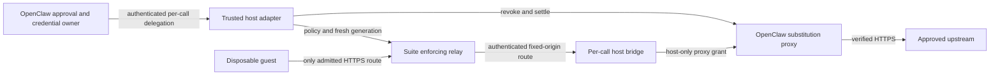
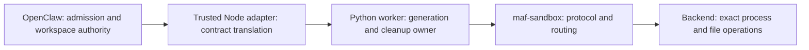

# OpenClaw integration research and first-delivery proposal

> Research and initial design recorded on 2026-10-02, followed by adversarial review, a supervised Bicep stdio MCP prototype and one-session OpenClaw Gateway qualification on 2026-10-03 using a deterministic provider. The selected multi-session lifecycle lives in the [OpenClaw workload service design](../openclaw.md). Its shared HTTP implementation passed bounded two-session Gateway qualification on 2026-10-05; model behavior and the complete lifecycle/recovery matrix remain unqualified. Evidence and remaining acceptance work are separated below. The [2026-10-13 first-tool disposition](#first-tool-design-disposition-2026-10-13) supersedes the initial proposal's unresolved design points; accepted decisions now live in the [service design](../openclaw.md#bicep-operation-and-result-contract).

The suite can add focused workload tools, enforced guest networking and reusable conformance scenarios to OpenClaw. Begin with a bounded validation operation through MCP or a thin tool plugin. A complete sandbox backend is a separate feasibility project because its interactive process and workspace contracts exceed the suite's current common execution interface.

## Evidence and scope

The investigation inspected [OpenClaw PR #97086](https://github.com/openclaw/openclaw/pull/97086), its review discussion and merged tree `008f04a65650f364ddbe40f1697f3c1b020bba97`; OpenClaw main at `df93a28f0bc58c41023326a734e3838bb356eea4`; Microsoft MXC tag `v0.9.0`; and suite source at `8161cfdc761557800d18d918a79f2731deb1a488`. The documentation branch starts at `63c0e97dbf39a0d976b07ffb9437317170f1a26d`; the intervening suite change reports credential-expired proxy streams as interrupted. Live OpenClaw documentation was read on 2026-10-02 and may evolve independently of those source snapshots.

The original investigation used source, documentation and published author reports. No OpenClaw or MXC runtime was installed or executed. Subsequent prototype tests are recorded separately below; they do not establish performance, cost, cross-platform compatibility or production readiness. Existing suite tests and upstream reports identify available evidence; they do not qualify the proposed integration.

Three independent reviewers subsequently challenged the proposal at suite commit `386e711bbaf9e0456254db89d71b30aad46d3d56`. Their findings were checked against source, and a controlled asynchronous fake-execution probe confirmed the Bicep cancellation behavior described below. That probe executed the Python wrapper only; it did not launch Docker, Bicep or OpenClaw. The review found four P2 design gaps and no demonstrated P1 vulnerability. The source links in the review section identify the assessed snapshot rather than making claims about future versions.

This record owns the OpenClaw host integration and delivery sequence. It does not design a new MXC backend beneath the suite router. The existing [policy architecture](two-axis-sandbox-policy.md), [Hyperlight research](hyperlight-backend.md) and [backend authoring guide](../backends/writing-a-backend.md) own those different concerns.

## What the MXC integration delivers

PR #97086 merged on 2026-07-13. Historical remaining-gate paragraphs in its body are not current merge blockers. It adds a separately installable Windows ProcessContainer plugin, with readiness checks, policy construction, command launching, a host-side filesystem bridge, packaging and tests. Each command gets an ephemeral container; session or agent scope controls workspace reuse rather than a continuously running container.

The merged plugin pinned MXC SDK `0.7.0` and emitted schema `0.7.0-alpha`. The inspected [current package](https://github.com/openclaw/openclaw/blob/df93a28f0bc58c41023326a734e3838bb356eea4/extensions/mxc/package.json) pins SDK `0.8.0`; the policy builder still emits `0.7.0-alpha`. MXC [v0.9.0](https://github.com/microsoft/mxc/releases/tag/v0.9.0) is a newer prerelease. SDK support for another engine or policy does not make it a capability of OpenClaw's ProcessContainer adapter.

The author reports 109 native Windows extension tests, packed installation, runtime loading and actual ProcessContainer checks for workspace modes and refusal cases. Linux reports distinguish passing tests from Windows-only skips. These are upstream-reported results, not runs reproduced here. See the [repair and evidence report](https://github.com/openclaw/openclaw/pull/97086#issuecomment-4939634739).

## Lessons for adapters

| Constraint | Evidence from the integration | Consequence for this suite |
|---|---|---|
| Preserve each workspace mode | Review found that `none` and `ro` had not correctly distinguished the isolated workspace from the actual agent workspace | Test the meaning of every translated mode; similar option names do not establish equivalence |
| Protect every file route | Commands execute under ProcessContainer, while bridge reads and mutations execute on the host | Apply confinement, no-follow access and race handling independently to the host file plane |
| Refuse unrepresentable restrictions | A writable parent grant cannot safely preserve a nested read-only protected skill root in this configuration | Reject overlapping grants instead of approximating the requested policy |
| Fail closed on explicit configuration | Missing configured policy files or paths previously risked falling back to defaults | Distinguish an omitted optional setting from an explicitly requested setting that cannot be honored |
| Prove the installed package | Checkout execution concealed missing native SDK dependencies in distribution | Install the packed adapter and worker into a clean environment and execute through that installed surface |
| Separate resource lifetimes | Stable runtime metadata coexists with per-command containers | Keep workspace retention, execution ownership, cancellation and disposal separate |
| Keep discovery inert | Non-full registration modes must return before probes and service registration | Import and discovery must not provision a backend or launch a worker |

The primary references are the [workspace and filesystem review](https://github.com/openclaw/openclaw/pull/97086#issuecomment-4931066422), [merged file bridge](https://github.com/openclaw/openclaw/blob/008f04a65650f364ddbe40f1697f3c1b020bba97/extensions/mxc/src/fs-bridge.ts), [policy builder](https://github.com/openclaw/openclaw/blob/008f04a65650f364ddbe40f1697f3c1b020bba97/extensions/mxc/src/mxc-container-config.ts), [packaging review](https://github.com/openclaw/openclaw/pull/97086#issuecomment-4813463771), [registration correction](https://github.com/openclaw/openclaw/pull/97086#issuecomment-4917736996) and [execution implementation](https://github.com/openclaw/openclaw/blob/008f04a65650f364ddbe40f1697f3c1b020bba97/extensions/mxc/src/mxc-backend.ts).

Environment handling also belongs to the contract. The Windows adapter constructs separate launcher and workload environments, handles case-insensitive names and assigns per-command temporary directories. A replacement environment must preserve the OS prerequisites needed to execute without importing application credentials. See [environment construction](https://github.com/openclaw/openclaw/blob/008f04a65650f364ddbe40f1697f3c1b020bba97/extensions/mxc/src/windows-env.ts).

### Configuration on process argv

OpenClaw's temporary launcher payload file does not remove exposure later in the chain: MXC's config-based executor path encodes the request onto process argv. [MXC #626](https://github.com/microsoft/mxc/issues/626#issuecomment-5027041631) was closed because upstream accepted the same-user observation boundary and declined additional transport complexity, not because that path was replaced. The tagged [v0.9.0 helper](https://github.com/microsoft/mxc/blob/v0.9.0/sdk/node/src/helper.ts) still constructs `--config-base64`, and [spawnSandboxFromConfig](https://github.com/microsoft/mxc/blob/v0.9.0/sdk/node/src/sandbox.ts) uses the executor path. The separate native API has different behavior; switching APIs is an adaptation requiring qualification. Credential claims must cover the whole launch chain.

## Existing OpenClaw capabilities and useful additions

OpenClaw already supports Docker/Podman, SSH and OpenShell execution, tool policy and approvals, credential management, and Code Mode with Node and QuickJS executors. A generic execution wrapper or a second approval system would duplicate existing responsibilities. See [sandbox configuration](https://docs.openclaw.ai/gateway/config-agents/sandbox), [OpenShell](https://docs.openclaw.ai/gateway/openshell), [policy](https://docs.openclaw.ai/start/why-openclaw/policy-as-code) and [Code Mode](https://docs.openclaw.ai/tools/code-mode/executors).

| Opportunity | Added value | Constraint and priority |
|---|---|---|
| Bicep validation | Fixed compiler operations, explicit completion/verdict semantics, selected prepared dependencies and closed runtime networking | First delivery; define and qualify one transport and backend |
| Terraform/OpenTofu, draw.io and optional CodeAct tools | Reuse workload-specific validation and explicit artifact delivery | Follow Bicep; retain each kind's constraints and separate proposed file edits from saving them |
| Enforced egress and credential mediation | Apply destination/method/path restrictions around sandboxed work while retaining upstream credentials outside the guest | Separate design; preserve OpenClaw authority and prove a concrete backend configuration |
| Conformance scenarios | Reusable adversarial probes for files, lifecycle, policy, authority and distribution | Early contribution path; a passing subset is not a complete security audit |
| Full sandbox provider | Expose suitable suite backends through OpenClaw's execution/workspace model | Later feasibility decision; interactive process contracts and SDK support are unresolved |

OpenClaw's [secret egress proxy](https://docs.openclaw.ai/gateway/secrets/secret-store-and-egress) already provides destination-bound secrets and per-process grants. Its documented automatic integration covers Gateway-hosted execution, not sandbox or remote-node execution, and cooperative proxy settings can be bypassed by direct sockets. The suite's configured Docker and WSLC topology removes the guest's direct external route and supplies host/method/path rules plus optional gateway credentials. This is a specific integration opportunity, not a superiority claim over every OpenClaw backend: OpenShell also has policy enforcement. The suite's [network contract](../network.md) retains backend-specific DNS, TLS, observation and authority limits. GET-only or path-restricted access is not a confidentiality guarantee. The [2026-10-15 refresh](#egress-and-credential-mediation-disposition-2026-10-15) also accounts for OpenClaw's explicit Crabbox grants and the private SDK boundary.

## Proposed first deliverable: closed-network Bicep validation

The revised proposal exposes one fixed validation operation to OpenClaw, with a Python service calling the existing Bicep kind through the router. Local stdio MCP with uniform policy for one trusted local operator is implemented by the supervised prototype below. The [Gateway qualification](openclaw-gateway-qualification.md) verifies that operation through one OpenClaw session with a deterministic provider; multi-session ownership, actual-model behavior and the complete crash matrix remain unqualified. Keep those limits explicit before expanding to a broader framework-neutral API or additional tools. Bicep is a bounded integration experiment; demand from OpenClaw users has not been established.

The inspected general MCP [materialization path](https://github.com/openclaw/openclaw/blob/df93a28f0bc58c41023326a734e3838bb356eea4/src/agents/agent-bundle-mcp-materialize.ts) forwards cancellation to the [runtime](https://github.com/openclaw/openclaw/blob/df93a28f0bc58c41023326a734e3838bb356eea4/src/agents/agent-bundle-mcp-runtime.ts), whose tool call sends the tool name and arguments without trusted agent/session identity. The first service can generate request-local ownership internally and apply the same policy to every admitted caller. Per-agent authorization and cross-call artifact access remain outside its contract. A tool plugin is an alternative only if a later requirement needs a trusted host integration that MCP does not supply. The proposed operation follows OpenClaw's MCP tool authorization; it does not inherit command, working-directory or file-bound host-exec approvals.

```text
OpenClaw MCP tool authorization
  -> local stdio MCP service with fixed policy
  -> immutable request snapshot and service-generated ownership
  -> SandboxRouter admission
  -> one Docker container per call and prepared Bicep image
  -> bounded completion/verdict and diagnostics for the submitted snapshot
```

Start with Docker, an explicitly admitted `Isolation.CONTAINER` policy and `min_isolation_scope=IsolationScope.CALL`, so every request receives its own physical sandbox. Preserve the suite's default isolation floor; do not silently lower it. A host requiring microVM isolation needs a separately qualified compatible backend before this workload is admitted. No new MXC backend is required for the Bicep prototype.

Use the existing [prepared AVM profile](../../../images/bicep-sandbox/README.md#prepared-avm-profile), an immutable deployed image reference, the host's selected Bicep configuration with the prepared cache location, and `Egress.CLOSED`. The current profile contains a small selected set of pinned modules, not the full AVM catalog. Runtime validation must retain `--no-restore`; an unprepared module must produce an incomplete result without a verdict. Build-time downloads and compiler/image provenance remain separate from runtime network closure.

### Initial contract

| Surface | Proposed boundary |
|---|---|
| Operation | One fixed Bicep validation operation; no shell command argument, deployment or arbitrary compiler flags |
| Inputs | Bounded relative names plus inline UTF-8 contents for `.bicep` and `.bicepparam`; validate the entire supplied set, with no separate entry point or auxiliary JSON/text assets |
| Host policy | Host selects image, compiler configuration, backend, isolation floor, timeouts, transfer budgets and closed networking; model arguments cannot widen them |
| Ownership | Uniform authorization for one trusted local operator; service-generated request identities and call-scoped containers; no model-supplied owner, agent or session authority |
| Results | Diagnostics-only structured response; preserve `completed` separately from verdict, bound compiler text and identify the submitted snapshot, compiler policy and image |
| Files | Copy supplied bytes into an immutable request snapshot in an adapter-owned root; no automatic workspace read, host/guest path translation, repository mount or downloadable artifact |
| Lifecycle | Specify cancellation requested, guest stopped and cleanup completed separately; bound the overall request and recovery; reconcile abandoned owned resources before admitting work after restart |
| Distribution | Explicit Python/runtime/image prerequisites; packed installation and installed execution must be tested |

Plain serialized labels do not reproduce MAF information-flow enforcement in OpenClaw. Result provenance can be preserved as metadata, but any use as authority requires host enforcement. Similarly, sandboxing this workload does not isolate the OpenClaw Gateway or other plugins. OpenClaw's [capability matrix](https://docs.openclaw.ai/gateway/sandboxing/supported-capability-matrix) describes that boundary.

OpenClaw's inspected [MCP metadata validator](https://github.com/openclaw/openclaw/blob/df93a28f0bc58c41023326a734e3838bb356eea4/src/agents/mcp-tool-metadata.ts) supports `outputSchema` and `structuredContent`; its [result projection](https://github.com/openclaw/openclaw/blob/df93a28f0bc58c41023326a734e3838bb356eea4/src/agents/mcp-content.ts) preserves structured results for Code Mode and renders them for ordinary model consumption. Use a shallow fixed schema rather than invent a result transport. The schema should carry a canonical source-set digest and compiler-policy/image identity: the verdict describes those submitted bytes under that profile, not the repository's current state. Canonicalization and the mapping from existing framework results still need design and tests.

### Adversarial review findings

The review supports the narrowed experiment but does not establish an implementation-ready design. The four findings below concern reuse assumptions and missing lifecycle requirements, not exploitable defects demonstrated in an existing OpenClaw adapter.

| Finding | Existing behavior and failure scenario | Required design correction |
|---|---|---|
| Cancellation is not confirmed termination | Bicep `_run_phase` shields the active execution and drains it after cancellation; Docker cancellation of the host CLI alone leaves the guest command running until disposal | Define acknowledgment, execution stop and cleanup completion separately; choose bounded draining or supervised exact-instance disposal and prove its interaction with router cleanup |
| Worker death bypasses cleanup | Docker containers run a persistent `sleep infinity`; worker death bypasses Python `finally`, and `reap` installs no background timer | Assign a recovery owner, dedicated adapter scope/generation and startup reconciliation; define maximum resource lifetime without sweeping unrelated owners or unexpired live work |
| Disposal is not concurrent call isolation | Bicep's spec does not request call scope, and the router defaults to conversation scope; distinct call directories can still share one container | Require call scope with internally generated identities; test simultaneous requests and cleanup ownership rather than inferring separation from disposal policy |
| Entry-point semantics exceed the existing tool | The Bicep tool accepts only `.bicep`/`.bicepparam` and builds and lints every supplied file; supporting JSON is rejected | Adopt whole-set validation initially; separating compilation targets from staged support assets needs a distinct workload API design |

These findings follow from the reviewed [Bicep tool](https://github.com/sokolaidev/maf-extensions/blob/386e711bbaf9e0456254db89d71b30aad46d3d56/packages/maf-sandbox-bicep/src/maf_sandbox_bicep/_tool.py), [Docker execution and reaper](https://github.com/sokolaidev/maf-extensions/blob/386e711bbaf9e0456254db89d71b30aad46d3d56/packages/maf-sandbox-docker/src/maf_sandbox_docker/_backend.py), [router defaults](https://github.com/sokolaidev/maf-extensions/blob/386e711bbaf9e0456254db89d71b30aad46d3d56/packages/maf-sandbox/src/maf_sandbox/_router.py), [call identity and cleanup wrapper](https://github.com/sokolaidev/maf-extensions/blob/386e711bbaf9e0456254db89d71b30aad46d3d56/packages/maf-sandbox/src/maf_sandbox/maf.py) and [isolation-scope contract](https://github.com/sokolaidev/maf-extensions/blob/386e711bbaf9e0456254db89d71b30aad46d3d56/packages/maf-sandbox/src/maf_sandbox/_protocol.py).

The controlled cancellation probe supplied `_run_phase` with a fake `exec` that signaled entry and waited on an event. After cancelling the phase and yielding to the event loop, the phase remained pending and `exec` had received no cancellation. Releasing the fake execution let the phase finish with `CancelledError`. This confirms the wrapper's drain behavior only; guest termination and transport settlement were not measured. In the reviewed code, the default 120-second execution timeout is spent independently for each build/lint phase, so it is not an end-to-end request deadline. The service must also define time reserved for termination and cleanup, and where cleanup failure remains observable after the client has cancelled or disconnected.

Safe staged filenames do not confine paths embedded in compiler source: Bicep supports compile-time file-loading functions. Call scope prevents sibling requests from sharing a filesystem; it does not replace control of the image's readable contents. No sibling-data exfiltration was demonstrated. Similarly, setting a host timeout does not prove recovery after process death. A scoped age-based reaper is an operator maximum-lifetime policy and can remove running work; it must not be treated as an idle-resource detector.

The review did not count already-disclosed choices such as numeric resource limits, framework packaging, result-label enforcement or SDK support as new defects. Resolve them in the first design rather than treating their presence in an issue as implementation evidence. Docker CPU/memory defaults are not finite workload budgets; the host profile must select and verify the actual limits.

### Design decisions and proof required

The first design must resolve the public operation schema, source-set canonicalization, concrete input/output and resource limits, error mapping, total deadline, cancellation acknowledgment, recovery ownership and supported OpenClaw version. Compare direct use of existing framework tools with the smallest supported typed-result interface; do not make a general framework-neutral redesign a prerequisite without showing why the existing surface cannot serve the prototype. The protocol/router modules use the standard library, but the [installed core distribution](../../../packages/maf-sandbox/pyproject.toml) still depends on `agent-framework-core`; the packaged kinds expose framework tools. Do not describe the current distribution as dependency-free or directly embeddable in TypeScript.

Before implementation is called complete, demonstrate valid and invalid Bicep, a missing prepared dependency with no verdict, malformed/incomplete diagnostics, oversized input/output, rejected auxiliary assets, path escapes and file replacement, concurrent call isolation, timeout/cancellation, cleanup failure, and clean installed-package execution. Match the result's digest to the submitted bytes and prove that later workspace edits do not change what the verdict claims. Verify actual guest networking is closed and compiler policy is applied. A denied external request alone does not prove an allowlist, but this initial workload deliberately requests no outbound destinations. Keep model behavior, service control fields, runtime evidence and CI results distinguishable.

Cancellation tests must interrupt an active compiler phase and measure guest stop and exact-container removal, not just host-future cancellation. Crash tests must kill the worker or Gateway during acquisition, staging, execution and disposal, then verify that recovery removes owned containers and staging roots without deleting another service's resources. Supervised prototype use may precede that recovery qualification; unattended use must wait. A real OpenClaw call through the installed service must establish successful, invalid, incomplete and cancellation outcomes before expanding the workstream.

No automatic workspace access, artifact download, persistent result store, formatting, Terraform plan/apply/destroy, general CodeAct, network credentials, guest host-tools, interactive shell, warm reuse, remote multi-tenant service or complete OpenClaw backend is included in this first delivery. Subsequent designs must establish their own authority and lifecycle boundaries. The five design workstreams are investigation options, not a commitment to implement all of them.

## Supervised prototype

The [experimental source sample](../../../samples/experimental/openclaw_bicep/README.md) implements local stdio MCP using the existing packaged Bicep tool. It fixes the initial choices: inline whole-set sources, one active request, call-scoped Docker, closed networking, immutable image selection, a host-supplied compiler configuration and diagnostics-only structured results. The README owns the concrete limits, canonical source-set digest, operator startup procedure and supported dependency pins. There is no new public framework-neutral runner or published adapter package.

The sample retains a durable random owner scope under an exclusive local process lock and reconciles that scope before serving requests. Every call settles before a final scope sweep; cleanup failure removes the verdict and poisons admission. Cancellation during cleanup was reproduced in adversarial implementation review and corrected by draining a separately shielded cleanup task. Subsequent PR review found that repeated direct `Task.cancel()` could still interrupt a drain and release admission early. Ten regression cases reproduced the gap; worker, cleanup and shutdown now wait through repeated cancellation before propagating it, retaining admission and the local owner lock until settlement. The cases distinguish compiler cancellation, request deadline, cancellation during purge and unsuccessful purge. The 120-second deadline requests cancellation; it is not a hard maximum container lifetime.

Local MCP stdio execution on Windows with Docker Engine 29.8.0 serving Linux guests demonstrated valid and invalid compiler verdicts, an uncached registry module returning incomplete without a verdict, selected prepared AVM resolution and container cleanup. The prepared image was local ID `sha256:0bda3505a331713614b847025ce35199f3dda5a81ea2a661130525226dbc0265`, reporting Bicep CLI 0.46.1 (`545b338e2c`); this records a tested local image, not published-image provenance. The compiler cases also passed in an isolated environment using the sample's published suite pins and MCP 1.26.0 without workspace-package fallback.

A separate live test sent MCP cancellation after observing an active Bicep process, then verified removal of its exact container. Inspection confirmed network mode `none`, 1 GiB memory, one CPU, 128 PIDs, all capabilities dropped and a nonempty call label. Startup recovery removed an intentionally abandoned container in the retained owner scope while another owner's container remained running; that other container also survived cancellation. This is a targeted stale-resource recovery test, not a process-kill test at every lifecycle transition or a complete networking audit.

Those initial checks were service/backend observations. The subsequent [Gateway qualification](openclaw-gateway-qualification.md) executed OpenClaw 2026.9.7's real agent path with a deterministic local provider and published Python dependencies: valid, invalid and incomplete outcomes, result identities, bearer-token refusal, explicit tool-policy denials, active-compiler client disconnection, exact-container removal and successful post-disconnect admission passed in one session. This is host plumbing evidence without LLM reasoning. Worker death at each lifecycle boundary and an independent maximum-lifetime recovery owner remain unqualified. The sample is for supervised evaluation only; it does not close the design issue.

Host execution exposed two integration details. OpenClaw retained the compact JSON mirror alongside its structured-result projection; SDK-style two-space JSON formatting removes that duplicate content item, verified through the real Gateway after the correction. More substantially, OpenClaw caches a separate stdio service per session. A second session conflicts with the prototype's exclusive retained owner directory and fails to start; weakening that lock would invalidate cleanup ownership. That stdio configuration is limited to one active OpenClaw session per owner directory; the subsequently implemented shared HTTP service has [bounded two-session evidence](openclaw-gateway-qualification.md#two-session-http-execution-2026-10-05). [#1665](https://github.com/sokolaidev/maf-extensions/issues/1665) owns the multi-session service design rather than treating one trusted operator as one worker process.

## MCP server choice and Microsoft Agent Framework usage

This follow-up inspected Microsoft Agent Framework (MAF) at `e9857bd75a21843803431a2e7dfa41ee9b017ac7`, published package metadata and public user reports on 2026-10-02. MAF does not require a particular server framework: Python applications consume external servers through `MCPStdioTool` or `MCPStreamableHTTPTool`, while .NET applications use the official C# MCP SDK. These are client integration choices, distinct from the library implementing the server. The [MAF MCP guide](https://learn.microsoft.com/en-us/agent-framework/agents/tools/local-mcp-tools) documents both language paths.

| Server option | Evidence and fit |
|---|---|
| Official Python SDK low-level `Server` | The initial prototype used `mcp==1.26.0`, explicit schemas and `stdio_server`. MAF's own [`Agent.as_mcp_server()`](https://github.com/microsoft/agent-framework/blob/e9857bd75a21843803431a2e7dfa41ee9b017ac7/python/packages/core/agent_framework/_agents.py) also constructs the low-level server. That convenience exposes a model-running agent as a tool; it does not replace the deterministic Bicep validator. |
| SDK-bundled `mcp.server.fastmcp.FastMCP` | Selected for the revised prototype, retaining its `mcp==1.26.0` pin. MAF's official [FastMCP hosting sample](https://github.com/microsoft/agent-framework/blob/e9857bd75a21843803431a2e7dfa41ee9b017ac7/python/samples/04-hosting/mcp/fastmcp_app.py) uses this import and declares `mcp>=1.27.0,<2`. Its [local integration-test server](https://github.com/microsoft/agent-framework/blob/e9857bd75a21843803431a2e7dfa41ee9b017ac7/python/scripts/local_mcp_streamable_http_server.py) uses the same facade; the [CI action](https://github.com/microsoft/agent-framework/blob/e9857bd75a21843803431a2e7dfa41ee9b017ac7/.github/actions/setup-local-mcp-server/action.yml) starts it and calls a discovered tool through MAF. Function annotations generate schemas and simplify registration. |
| Standalone `fastmcp.FastMCP` | The independently maintained framework adds composition, middleware, proxies and authentication integrations. [FastMCP 4.0.10](https://pypi.org/project/fastmcp/4.0.10/) was the current published release inspected. It depends on `fastmcp-slim[client,server]==4.0.10`, whose client/server extras require `mcp>=2,<3`; it is a different dependency decision from the SDK-bundled facade. |

There is real, limited user evidence for standalone FastMCP: [MAF issue #3099](https://github.com/microsoft/agent-framework/issues/3099) describes FastMCP 2.13.1 deployed on Azure Container Apps and difficulties registering its HTTP tools through declarative Foundry agents. That establishes reported usage, not a successful end-to-end qualification or population share. [Issue #7866](https://github.com/microsoft/agent-framework/issues/7866) reports duplicate content when MAF consumed servers returning both text and structured output, including a reported FastMCP-backed service. It reinforces the need to test client-side result projection. Neither official samples nor selected issue reports establish what most MAF users deploy.

The dependency boundary is material. Published [`agent-framework-hosting-mcp==1.0.0a260918`](https://pypi.org/pypi/agent-framework-hosting-mcp/1.0.0a260918/json) requires `mcp>=1.11,<2`; [`agent-framework-core==1.20.0`](https://pypi.org/pypi/agent-framework-core/1.20.0/json) requires `mcp>=1.24,<2` for its `all` extra. Those requirements cannot share an environment with standalone FastMCP 4's SDK 2 requirement, and the prototype itself pins SDK 1.26.0. MAF tracks Python SDK 2 migration in [#7446](https://github.com/microsoft/agent-framework/issues/7446) and protocol-era support in [#8245](https://github.com/microsoft/agent-framework/issues/8245). Do not infer that the base core package always installs MCP, or that separate client/server processes must share package versions. FastMCP's [migration documentation](https://gofastmcp.com/getting-started/upgrading/from-fastmcp-3#protocol-version-support) describes compatibility with earlier protocol eras; compatibility with our exact MAF/OpenClaw clients still needs execution evidence.

MAF's alpha [hosting package](https://github.com/microsoft/agent-framework/blob/e9857bd75a21843803431a2e7dfa41ee9b017ac7/python/packages/hosting-mcp/README.md) provides `AgentMCPTool`, `WorkflowMCPTool` and argument/result conversion helpers. It leaves the server, transport, authentication, session trust, concurrency and deployment to the application. Consider it when exposing an actual agent or workflow; it adds little to the fixed compiler operation and does not own sandbox isolation or cleanup.

A direct local probe connected `MCPStdioTool` from installed `agent-framework-core==1.19.0` and `mcp==1.26.0` to the prototype at `4ff04e4846a212eee484baea284dd55f646ab9e0`, using workspace suite packages and the prepared Docker image above. Discovery returned only `bicep_validate`. Valid and syntactically invalid inputs each produced one MAF content item containing the structured result, with the expected verdict and confirmed cleanup. An initial probe incorrectly expected a missing local module to be incomplete; the observed `BCP091` result was completed/invalid. A separate probe of an uncached registry module returned incomplete with no verdict, confirmed cleanup and zero containers remaining in its retained owner scope. These were direct client probes without a model, not an agent conversation or an OpenClaw test; no standalone FastMCP server was executed.

The revised prototype selects SDK-bundled FastMCP for MAF compatibility and generated input/output schemas. Typed Pydantic models replace the handwritten schemas, while a narrow `BoundedFastMCP` subclass rejects raw arguments before FastMCP's JSON coercion and suppresses framework validation errors that could echo source content. The subclass supplies the pre-JSON bounded reader through the pinned SDK's private `_mcp_server` transport because its public `run_stdio_async()` accepts no custom stdin. This is explicit version coupling, not a general FastMCP transport API. Immutable source snapshots, Docker restrictions and cancellation/cleanup ownership remain application responsibilities. Standalone FastMCP 4 still requires a deliberate SDK/dependency migration or a separate service environment.

FastMCP qualification covers generated schemas, rejection of extra fields and stringified arrays, bounded validation errors, structured cleanup failures, and oversized frames through the actual stdio adapter. The live compiler test now uses MAF's `MCPStdioTool` for valid/invalid, uncached registry and prepared AVM cases; each produces one content item with the expected structured result. The live SDK-client cancellation and scoped startup-recovery test also passed after the migration. A separate MAF-client probe launched the revised service through `uv run --script` using published dependencies, confirmed valid and uncached-registry outcomes, and found no remaining owned containers. The original Gateway evidence above qualifies one-session stdio execution. The 2026-10-05 record adds two-session shared HTTP outcomes, admission and accepted cancellation; the complete lifecycle/recovery matrix remains outstanding.

## Multi-session lifecycle decision

The follow-up on 2026-10-03 selected a separately supervised stateful Streamable HTTP service for the next implementation. The [owning design](../openclaw.md) specifies its lifecycle and acceptance; this comparison records why it was selected. One trusted operator still supplies uniform policy, but each OpenClaw session can retain its own MCP connection without launching another cleanup owner. The selected scope separates a reusable MCP service from explicitly registered workload bindings: transport, admission and resource supervision must not depend on Bicep. Bicep remains the first real binding; two synthetic bindings will test the extension boundary. Additional kinds still require their own authority, input/output and lifecycle qualification, especially artifact delivery and persistent conversation state.

| Option | Benefit | Cost and decision |
|---|---|---|
| Shared loopback Streamable HTTP | Existing OpenClaw and MAF clients can share one process, admission slot and retained Docker owner. | Requires authenticated ingress, session caps/retirement and explicit cancellation/disconnect behavior. Selected and implemented by #1680; bounded two-session Gateway checks passed on 2026-10-05, with full lifecycle/recovery qualification still open. |
| Disjoint per-session stdio workers | Preserves the existing transport and separates process failure. | Needs trusted launch identities, a durable registry, recovery for abandoned workers and aggregate admission across processes. OpenClaw does not supply trusted session identity in tool arguments. This adds a shared supervisor without eliminating lifecycle design; deferred. |
| OpenClaw plugin-owned shared worker | Can use host tool context and Gateway lifecycle hooks. | The pinned public API exposes `registerService`, `registerTool` and session context, so this is a real alternative. It adds TypeScript/plugin packaging and Gateway coupling; sharing with MAF still needs a service boundary. Deferred until a requirement needs trusted OpenClaw-specific context. |

The source audit used OpenClaw release revision `c074824a27c96d3983043f9eeb33823cd1772d8c`, its installed npm 2026.9.7 distribution and TypeScript MCP SDK 1.30.0. Its [MCP lifecycle wrapper](https://github.com/openclaw/openclaw/blob/c074824a27c96d3983043f9eeb33823cd1772d8c/src/agents/mcp-client-lifecycle.ts) sends session DELETE during disposal; its [runtime](https://github.com/openclaw/openclaw/blob/c074824a27c96d3983043f9eeb33823cd1772d8c/src/agents/agent-bundle-mcp-runtime.ts) forwards request cancellation to `client.callTool`. The [plugin API](https://github.com/openclaw/openclaw/blob/c074824a27c96d3983043f9eeb33823cd1772d8c/src/plugins/plugin-api.types.ts) and [tool context](https://github.com/openclaw/openclaw/blob/c074824a27c96d3983043f9eeb33823cd1772d8c/src/plugins/tool-types.ts) establish the third option's available surfaces, not qualification of a plugin implementation.

Installed MAF core 1.19.0's `MCPStreamableHTTPTool` accepts static authorization headers and defaults to terminating its session on close; the [versioned source](https://github.com/microsoft/agent-framework/blob/python-1.19.0/python/packages/core/agent_framework/_mcp.py) and [usage documentation](https://learn.microsoft.com/en-us/agent-framework/agents/tools/local-mcp-tools) support that client choice. Python MCP 1.26.0 already supplies FastMCP's stateful HTTP app. Its [session manager](https://github.com/modelcontextprotocol/python-sdk/blob/v1.26.0/src/mcp/server/streamable_http_manager.py) creates a fresh session per request in stateless mode, so a later cancellation notification has no matching in-flight request there. Stateful mode preserves per-session request routing but retains records of explicitly terminated transports. The selected service must bound and retire that SDK state; selecting FastMCP does not supply this policy.

The [MCP transport specification](https://modelcontextprotocol.io/specification/2025-11-25/basic/transports) separates HTTP disconnection from cancellation and requires Origin validation. The shared design therefore preserves supervision after a lost response stream, uses explicit cancellation for a live request and authenticates loopback requests before dispatch. It does not transfer the stdio process-exit contract to an HTTP socket.

A local loopback-only probe on Windows with Python 3.13, MCP 1.26.0 and MAF core 1.19.0 exercised an unmodified FastMCP HTTP app with a synthetic event-blocked tool and JSON responses. Two initialized sessions both issued request ID 42; cancelling A produced its cancellation error while B remained active and then completed after release. DELETE returned 200 for both, and reuse of the deleted ID returned 404. A third connection through `MCPStreamableHTTPTool` discovered and called the tool and projected its structured result into one content item. After all three clients closed, the manager still contained three records, all marked terminated. This confirms the need for bounded retirement rather than assuming DELETE frees registry capacity.

The probe can be reproduced by creating `FastMCP(..., json_response=True)`, registering an async tool returning `dict[str, str]` and blocked on an `asyncio.Event` with separate started events for each test caller, serving its `streamable_http_app()` on an ephemeral loopback port, and issuing initialize/initialized, equal-ID tools/call, cancellation and DELETE messages from two HTTP clients. Observe the remaining task before releasing it, then call through MAF and count the pinned manager's `_server_instances` after close. The probe intentionally inspected private SDK state; it is transport evidence only. It exercised no Bicep containers, authentication middleware, session eviction implementation, OpenClaw HTTP configuration or Gateway turns. The [two-session acceptance matrix](../openclaw.md#acceptance-before-enabling-multiple-gateway-sessions) is still required before claiming shared-service support.

## Subsequent designs

For additional workload tools, assess [Terraform](../kinds/terraform.md), [draw.io](../kinds/drawio.md) and [CodeAct](../kinds/codeact.md) independently. Formatting returns proposed content for a separate authorized save. Diagram validation is not sanitization of every embedded reference. General code execution requires a larger authority and artifact contract than a fixed validator. Avoid duplicating OpenClaw Code Mode without a concrete confined-workload benefit.

The [2026-10-15 egress disposition](#egress-and-credential-mediation-disposition-2026-10-15) records the authority mapping, conditional relay architecture, lifecycle and qualification plan for #1640. Supported OpenClaw delegation is the first prerequisite; generic MCP credentials do not establish per-agent authority.

The [2026-10-16 conformance disposition](#conformance-and-upgrade-qualification-disposition-2026-10-16) selects the installed Bicep runner first, bounded fault qualification next and conditional native workspace/file qualification separately. Native evidence belongs to each exact installed backend/version combination; the source refresh supersedes the earlier optional MXC 0.9 upgrade proposal. Creating issues here does not authorize publishing a third-party PR.

The full-backend design must map OpenClaw execution specifications, filesystem bridge, manager, workspace retention and lifecycle generations to the suite. The current common interface returns final execution results and does not provide a complete PTY/stdin/background-process/streaming-session contract. The [Deep Agents adapter](../../../packages/maf-sandbox-deepagents/README.md) is a useful precedent with explicit limitations. Native Hyperlight guest-to-host callbacks remain tracked separately by [#369](https://github.com/sokolaidev/maf-extensions/issues/369).

Current OpenClaw [SDK documentation](https://docs.openclaw.ai/plugins/sdk-subpaths) marks `plugin-sdk/sandbox` private-local, although [host hooks](https://docs.openclaw.ai/plugins/sdk-overview/host-hooks#sandbox-backends) describe registration. Verify the installed public interface and obtain a supported extension direction before committing to a third-party backend. July's official-plugin imports are not evidence of a stable current third-party contract.

## First-tool design disposition (2026-10-13)

This audit inspected repository `b5e756d6a8c80cd7095a3f7878e708611c04b0c5`, the original #1638 requirements, the source sample and the [completed finite qualification](openclaw-qualification-closure-audit.md#consolidated-closure-reconciliation-2026-10-12). #1882 is merged and #1676 is closed. The first-tool design is complete: the accepted contract now lives in [the owning service document](../openclaw.md#bicep-operation-and-result-contract), with delivered implementation and qualification tracked separately from further adoption. This is source/evidence reconciliation, with no new runtime execution or release.

| #1638 requirement | Accepted decision and disposition |
|---|---|
| Fixed operation, whole-source-set schema and limits | `bicep_validate` accepts only the bounded inline file list. Canonical snapshot identity, strict name/byte limits and the absence of entry-point, shell, deployment and auxiliary-file inputs are specified in the owning design and implemented by `snapshot`/typed models. |
| Host policy, isolation, image and prepared cache | Trusted startup owns every policy value. The Bicep composition explicitly accepts container/call isolation, immutable image selection, selected prepared AVM modules, closed networking and `--no-restore`; it does not weaken the router default. |
| Trusted owner and session/call context | One retained operator owner, independent stateful HTTP sessions, host-minted call identity and one shared admission slot. Protocol IDs route cancellation but do not supply trusted per-agent identity or tenancy. #1665/#1677 designed this boundary; #1675/#1680 implemented it. |
| Results and failures | The owning design specifies all result fields and status/error mappings, including incomplete versus invalid, diagnostic overflow, cleanup failure, refusal without a result and cancellation without a delivered result. #1651 implements the projection; #1676's evidence checks its real host path. |
| Files, staging and replacement races | The accepted tool receives inline bytes, copies an immutable snapshot into a new in-memory store and mounts no host workspace. Host filesystem link/replacement attacks are excluded by that surface, not claimed solved for a general file bridge. Guest compiler reads and trusted operator files remain explicit limits. Future file/artifact access requires #1639/#1641 acceptance. |
| Cancellation, disposal and recovery | The shared lifecycle retains admission/ownership until work and cleanup settle, poisons uncertain reuse and recovers only the retained scope. #1676 is complete via #1882. Active MAF client futures can outlast service retirement until timeout; no maximum lifetime or independent watchdog is claimed. |
| Python/MAF integration and supported baseline | Retain SDK-bundled FastMCP, existing kind/router and MAF callable/projection with version-sensitive refusal. A framework-neutral API or dependency split is outside this first increment. The design records the historical qualified versions and requires requalification of changed dependencies/private APIs. |
| Clean installed artifacts and continued adoption | The existing executions installed published dependencies but ran source adapter modules. #1898 implements an installable worker and qualifies it outside the checkout; #1641 owns reusable conformance/upgrade design. There is no released adapter wheel today and no claim that dependency installation already proves one. |

### Acceptance and follow-up ownership

The original valid/invalid/incomplete, identity/projection, cancellation/isolation, disposal and selected recovery observations are credited to the candidates in the Gateway record and #1850/#1851 follow-ups, not to this audit commit or one final image. Malformed framework shape and oversized input/result refusal also have offline source tests. Existing Docker network-mode inspection and prepared/unprepared module results remain their recorded evidence; they are not generalized connectivity tests. #1898 adds a behavioral in-guest denial probe with a reachable control for its selected packaged-worker baseline.

The original demand for link/reparse/hardlink and replacement-race rejection applies to any filesystem surface admitted by the design. The fixed inline-only source contract admits no model-selected host file surface; trusted image/config/owner/token storage is an operator boundary. This is a deliberate scope decision, not proof of atomic confinement for future workspace mounts or artifact retrieval. Those extensions remain in #1639/#1641.

| Remaining work | Disposition and owner |
|---|---|
| Installable worker, repeatable clean installation and supported-version upgrade checks | Implement next in [#1898](https://github.com/sokolaidev/maf-extensions/issues/1898), under [#1641](https://github.com/sokolaidev/maf-extensions/issues/1641). The issue includes artifact, runtime, networking, lifecycle and evidence acceptance; release is separately gated. |
| Additional workload schemas, persistent state and artifact delivery | Design separately in #1639; no new kind is enabled by this decision. |
| Credential mediation, allowed-network operation, remote identity and host authority | Design separately in #1640. Uniform local authorization and closed guest networking remain the first-tool boundary. |
| Reusable adversarial file tests, other platforms, broader faults, independent watchdog and actual-model scenarios | Prioritize explicitly in #1641. Deferred from the supervised first increment; they are not new blockers for closed #1676. No implementation commitment or production claim is implied. |
| Full OpenClaw backend/interactive execution | Feasibility remains #1642; it is not a prerequisite for the MCP worker. |

The design issue can close because its schemas, lifecycle/error mapping, transport/backend choices, compatibility prerequisites and scoped implementation/qualification follow-ups are now explicit. Closing it does not close #1637 or #1639–#1642, publish a worker, approve unattended use or stop adoption. The next concrete deliverable is #1898.

## Installed adoption delivery (2026-10-13)

The [packaged worker](../../../packages/maf-sandbox-mcp/README.md) implements #1898 with a fixed entry point and the reusable runtime/binding boundary. The [installed qualification](openclaw-gateway-qualification.md#installed-worker-qualification-2026-10-13) records artifact/import identity, the deliberate MAF 1.20.0 baseline, 43 transport cases, 109 SDK retirements, five real Bicep/MAF ownership cases, instrumented and direct-console Gateway execution, prepared-module resolution and the bounded network denial control. The earlier first-tool disposition remains its dated design snapshot.

This delivers a locally qualified wheel, not a published package or unattended-service guarantee. Adoption continues under #1637; #1641 retains reusable conformance, platform/fault/model prioritization and upgrade policy, while #1639/#1640/#1642 retain their distinct design decisions. The pending MAF client timeout after service retirement remains documented. No historical qualification report or image identity is rewritten.

## Egress and credential mediation disposition (2026-10-15)

**Decision: proceed with a bounded delegation-contract probe; defer a supported credential adapter until that probe establishes a public integration boundary.** A conditional Docker relay is the next implementation candidate. This continues adoption without introducing more workload tools under #1639 or changing closed-network Bicep validation. #1640 is a design deliverable, not runtime qualification.

This refresh inspected OpenClaw `27721b8fec4bd5593bb0ba609b4ab1257f9613c1` and suite `d6a512c2b3d77500a3d16921779dc96fced3dee7`. Live OpenClaw documentation was checked on 2026-10-15. The earlier snapshots above remain historical evidence. No OpenClaw credential flow, proxy chain or sandbox network was executed for this design.

### Current contracts and the integration gap

OpenClaw's [secret documentation at the assessed revision](https://github.com/openclaw/openclaw/blob/27721b8fec4bd5593bb0ba609b4ab1257f9613c1/docs/gateway/secrets/secret-store-and-egress.md) now describes explicit Crabbox model and setup grants alongside automatic Gateway-hosted exec. The automatic path still excludes sandbox and remote-node exec; proxy configuration alone does not prevent direct sockets. Setup selects protected store entries; the model route resolves a configured API-key SecretRef. This supersedes any interpretation that OpenClaw has no remote credential bridge. Identity-scoped store secrets remain unsupported.

The [SDK subpath catalog](https://github.com/openclaw/openclaw/blob/27721b8fec4bd5593bb0ba609b4ab1257f9613c1/docs/plugins/sdk-subpaths.md) explicitly excludes `secret-egress-runtime` from the third-party API. Its [export module](https://github.com/openclaw/openclaw/blob/27721b8fec4bd5593bb0ba609b4ab1257f9613c1/src/plugin-sdk/secret-egress-runtime.ts) calls both helpers private official-plugin runtime, and the [private-local list](https://github.com/openclaw/openclaw/blob/27721b8fec4bd5593bb0ba609b4ab1257f9613c1/scripts/lib/plugin-sdk-private-local-only-subpaths.json) includes it. Finding a source export is not proof that a clean installed third-party plugin may use it.

The [job helper](https://github.com/openclaw/openclaw/blob/27721b8fec4bd5593bb0ba609b4ab1257f9613c1/src/secrets/job-egress.ts) returns sentinels, host-only proxy authentication, a public CA bundle and a revocation callback. The [model helper](https://github.com/openclaw/openclaw/blob/27721b8fec4bd5593bb0ba609b4ab1257f9613c1/src/secrets/model-egress.ts) provides a narrower model context and cancellation signal. Neither is the suite's bearer-grant interface. The [OpenShell integration](https://docs.openclaw.ai/gateway/openshell) already accepts backend policy and provider configuration; evaluate that existing route before proposing equivalent enforcement.

The suite's [host credential contract](../hosts.md#credentials-for-guest-http-requests), [network contract](../network.md) and [grant implementation](../../../packages/maf-sandbox/src/maf_sandbox/credentials.py) support fresh Docker/WSLC generations with exact HTTPS bearer origins, method/path limits and independent expiry. `CredentialRequest` contains the key, kind, runtime instance, generation, audience set and deadline; it does not contain an OpenClaw approval or policy digest. `CredentialGrant.token` is a real bearer value. Passing an OpenClaw sentinel or proxy password as that token is not an adapter. The existing provider has no general remote revocation callback; disposal and the gateway's independent deadline bound authority. Do not claim synchronous OpenClaw cancellation merely from those existing interfaces.

### Selected architecture and trust boundary

Prefer retaining substitution in OpenClaw and adding an enforced route around it. Do not read its database, copy long-lived keys into Python configuration, create another secret store, or forward a Gateway-wide API token into a guest. The conditional relay must be a generic delegated HTTP transport capability with an OpenClaw-specific host binding; it must not overload `CredentialGrant` or introduce an OpenClaw import into the dependency-free protocol. The implementation issue must settle that interface before changing package contracts.



The arrows describe proposed responsibilities, not an available deployment. The suite relay terminates guest TLS to enforce method/path policy before forwarding through the host-owned OpenClaw proxy; OpenClaw retains the upstream key and performs substitution. The relay must remove guest proxy-authentication and credential headers and synthesize only the selected credential placeholder in the configured header. Keep that placeholder in the relay; the initial guest profile receives neither a sentinel nor owner proxy authentication. Arbitrary secret substitution in guest URLs, headers or bodies is outside this first profile. The relay-to-owner hop must authenticate the exact grant, verify its configured trust, and offer no generic CONNECT tunnel bypassing method/path checks. A container cannot use the host's loopback proxy directly: a per-call host bridge must expose only the selected owner grant to the isolated relay, authenticate its generation, and forward to the configured loopback proxy. Bind that endpoint to a dedicated private interface reachable by the relay only, keep owner proxy authentication on the host, and reject guest/direct callers. The final transport/address-policy checks must survive this extra hop. The present iron-proxy credential gateway does not implement this chain.

Initially all trusted components run on one operator-controlled host with an isolated guest network. A loopback listener alone is not authentication: use an OS-protected local channel or a separately authenticated endpoint whose credential never enters the guest. Remote delegation, multiple credential-owner hosts and multi-tenant service operation are deferred. The existing MCP service token grants uniform operator access; MCP session IDs and request IDs are transport routing data. They cannot supply the authenticated owner, agent or business approval for this design.

Trust the Gateway approval/credential owner, host adapter, runtime manager, enforcing relay and selected upstream. Treat model arguments, guest code, supplied headers, proxy environment overrides and network replies as untrusted. Same-user host compromise, runtime-admin access and a malicious authorized upstream are outside the guest boundary. An upstream can reflect a credential or act on an accepted request; egress rules cannot undo that or guarantee confidentiality. Host tools, model traffic, output sinks and runtime management are separate network/authority channels.

### Authority mapping and admission

The trusted adapter must receive an authenticated host context after OpenClaw authorizes the concrete operation. Until a supported hook supplies it, refuse credential-backed execution. Do not invent identity fields from tool arguments or treat permission to call an MCP tool as authorization to spend any stored secret. Where OpenClaw supplies only team credentials, record that principal honestly: per-call mediation does not turn a team API key into a user's delegated identity.

| Input | Trusted source and binding | Refusal |
|---|---|---|
| Owner and scope | Host authorization context; opaque mapping including tenant and user where distinct | Missing identity or a team-wide scope used to claim user-specific authority |
| Conversation, agent and call | Authenticated host context plus host-minted call nonce; map to `SandboxKey.thread_id`, `agent_id` and `call_id` | Model-provided identity, duplicate/replayed admission, or another owner's handle |
| Operation and policy | Operator-approved named profile, approval reference and digest of the exact operation inputs, destination rules, credential selection and limits | Changed inputs after approval, policy widening, unknown profile or stale policy revision |
| Credential selection | Approved owner-side SecretRef/handle and principal class; no secret value in the request | Model-selected secret, unsupported auth scheme or missing owner authorization |
| Runtime | Backend-created instance ID, fresh generation and proxy boot identity, bound after resource creation and before guest start | Missing/mismatched generation, adoption of old resources, or restart reuse |
| Destination | Exact HTTPS origin plus explicit methods and path rules; audience identifies authority, not just a hostname | Wildcards for credentials, redirects outside policy, unsupported ports/paths/protocols |
| Lifetime | Earliest of approval validity, owner grant deadline, configured relay lifetime and workload retention | Expired/nonfinite deadline, renewal, or missing independent orphan cutoff |

Maintain the approval/policy/handle association in the adapter's per-call state; those fields are not additions already present in `CredentialRequest`. Authenticate and integrity-protect the whole association across the control channel. A proposed one-use opaque delegation handle is consumed atomically for one live generation; it is not a bearer credential for a guest. Repeated HTTP requests within that generation remain possible until it closes. Exact-once business effects require upstream idempotency/authorization, not merely a nonce or an HTTP method allowlist.

Host configuration fixes the backend, image digests, local credential-owner endpoint/trust, operation profiles, audience-to-origin mapping, methods/paths, bounded bodies/results, maximum grant duration and cleanup policy. The initial qualification profile uses one exact public HTTPS origin on port 443, one selected credential header and finite foreground execution. No model-controlled URL, proxy endpoint, CA, audience, timeout extension or fallback backend is admitted. An internal test fixture may emulate the public service on an explicitly isolated private route; that is not public-network qualification.

Require call isolation, `ALLOWLIST`, `EGRESS_METHODS`, `EGRESS_PATHS`, and explicit attached-authority scope/channel/retention permission before provisioning. A delegated relay must independently satisfy the declared attachment contract before advertising it. A failed import, unsupported owner API, unavailable proxy, unsupported policy or failed trust check is a refusal, never unrestricted execution. Bicep continues to select a separate credential-free backend with closed networking.

### Grant lifecycle and interrupted results

The proposed host record is `prepared -> active -> closing -> closed`, with `cleanup_pending` when settlement is uncertain. `prepared` reserves an approved operation without exposing a spendable guest route. Create fresh resources, bind the exact generation, acquire a finite owner grant, install the relay policy and deadline, and recheck cancellation/approval before guest start. Cancellation during any preparation step closes what was created; a late callback cannot activate a cancelled call.

Normal completion, cancellation, timeout, approval withdrawal and transport-owner shutdown first fence new credential use and abort active forwarding, then settle guest and proxy cleanup. A lost MCP response stream alone is not cancellation: retain the supervisor until explicit cancellation or its fixed deadline. Close/revoke are idempotent and generation-specific so an old callback cannot revoke a sibling. A policy/secret change closes affected active grants before admitting new work under the new revision; a refreshed secret snapshot alone is not revocation.

The initial relay must cap authority at 300 seconds or a shorter owner/approval deadline, never renew it, and enforce a monotonic cutoff inside the isolated relay even if every host supervisor disappears. Start that cap before grant installation and guest launch; preparation time cannot extend it. This is a proposed integration bound, not an OpenClaw helper guarantee. On owner/relay restart, discard all old handles and refuse automatic replay. Failure to acknowledge revocation means authority loss is unconfirmed until an independently established cutoff; report that uncertainty rather than saying cancellation was immediate. Keep resources quarantined from reuse while cleanup is incomplete. A later sweep needs the recorded ownership/generation and must not remove sibling work.

On expiry/revocation, terminate existing upstream streams as well as subsequent requests. Bytes already sent cannot be recalled, and a truncated response must not be promoted to a completed success because the guest swallowed a socket error. The host result and audit record, not guest stdout, own the following proposed fields; these are not changes to the Bicep result schema:

| Field | Proposed values and interpretation |
|---|---|
| `completion` | `complete`, `refused`, `interrupted`; complete requires a fully settled response and confirmed cleanup |
| `reason` | `ok`, `authority_unavailable`, `policy_denied`, `grant_expired`, `grant_revoked`, `cancelled`, `upstream_failed`, `cleanup_incomplete`; use a bounded enum, no raw secret-bearing exception |
| `upstream_effect` | `not_sent` only when the trusted relay proves no bytes were sent; otherwise `may_have_occurred`, including response loss and cancellation |
| `authority_end` | `confirmed` or `unconfirmed`, with the fixed expiry retained in the protected host record |
| `cleanup` | `complete` or `pending`; pending prevents reuse and successful completion |
| `response_complete` | Boolean from relay framing/termination, never inferred solely from process exit code |

If cancellation prevents delivery of a tool result, retain this outcome in the host audit. Do not retry a possibly accepted operation automatically. The relay bounds input/output and forwarded bytes and rejects oversized or unsupported request forms. Logs contain opaque correlation IDs, policy digest, generation fingerprint, rule decision, byte counts, termination reason and cleanup state. Exclude keys, sentinels, proxy credentials, CA private material, request/response bodies and secret-bearing URLs/query strings. Redaction and audit completeness require tests; logs alone do not prove enforcement.

### Network constraints and alternatives

Use the [existing network semantics](../network.md) rather than silently strengthening their claims. Docker/WSLC resolve and check the selected address per dial, but permitted private addresses are not universally blocked. DNS behavior is not fully confined by CONNECT. The relay chain introduces another resolver and dialer: the final owner-side dial must enforce the same resolved-address policy, or the initial profile is refused. OpenClaw's hostname-only authorization is insufficient evidence for that condition. Explicitly deny loopback, link-local, metadata and runtime/proxy interface destinations at the final hop and qualify IPv4, IPv6, rebinding and reconnect behavior. The proposed public-origin profile additionally refuses private destination ranges, except the explicitly isolated qualification fixture; this is an adapter requirement, not a claim about the existing general allowlist. General private-service support requires a separately approved address policy.

TLS interception requires a guest-scoped public trust bundle; neither CA private key enters the guest. Verify both relay-to-owner and final upstream TLS. Certificate pinning failures are incompatibility refusals, never bypass hosts or disabled verification. Redirects are separate requests and must pass origin/method/path checks anew; no authorization follows an unapproved redirect. Path matching must account for encoded separators, dot segments, prefixes and upstream normalization; query/body contents are not authorized by a path rule. Restrict the initial chain to qualified HTTP request forms; refuse raw CONNECT tunnels, upgrades/WebSockets, QUIC/UDP and alternate protocols. Direct sockets, proxy-variable removal and IPv6 routes need independent denial probes. Removing a TCP route does not establish DNS confidentiality.

| Candidate | Disposition |
|---|---|
| Existing OpenClaw host proxy | Keep where cooperative host execution is sufficient; adding another proxy alone adds no confinement |
| Existing OpenShell policy/provider route | Prefer when it meets the workload; qualify its concrete policy and credential lifecycle rather than claiming suite-wide superiority |
| Docker delegated relay | Conditional first implementation: fresh call resources, explicit method/path enforcement and independent cutoff, with installed end-to-end evidence |
| WSLC delegated relay | Reuse the eventual generic contract only after separate network, teardown and platform qualification; Docker evidence does not transfer |
| MXC, Hyperlight, ACAS and Docker Sandboxes | No credential-adapter support inferred; their policy/channel contracts and available paths differ |
| Copy OpenClaw keys into `CredentialGrant` | Decline as the default: expands plaintext ownership and loses upstream revocation unless a supported delegation API explicitly authorizes and controls that export |
| Chain the current proxies unchanged | Decline: no qualified delegated transport, immediate revocation bridge or shared final-dial address enforcement exists in this assessment |

### Qualification and next deliverables

Every runtime claim must name installed OpenClaw/adapter/wheel versions, backend/runtime versions, proxy image digests, OS, topology, approved profile and evidence artifacts. A pinned source-only helper experiment is exploratory and must say so. Use a controlled HTTPS service with a synthetic secret and observable request counters; do not use production credentials or add a public general-purpose tool just to test this design.

| Case group | Required positive and negative evidence |
|---|---|
| Public integration boundary | Clean installed third-party loading and authenticated context/approval/cancellation capture; missing/private-only exports refuse before provisioning |
| Allowed control | Approved HTTPS method/path succeeds with expected synthetic credential at the upstream, complete response and cleanup; an unavailable upstream or blocked-all configuration cannot pass |
| Destination and operation | Wrong host, port, scheme, audience, method, path, encoded path, redirect, credential header and unknown profile fail; upstream counters prove denied cases were not forwarded |
| Network bypass | Direct IPv4/IPv6 socket, removed proxy env, raw CONNECT, alternate protocol, DNS/rebinding and forbidden final-hop address attempts; use reachable controls to distinguish enforcement from broken routing |
| Identity and replay | Wrong owner/agent/session/call, altered policy/input digest, consumed handle, stale generation, restart, and concurrent sibling calls; cancellation of one leaves the other usable |
| Authority lifetime | Expiry before activation, during upload, after upstream acceptance and during response streaming; owner withdrawal/cancellation fences access and reports partial responses honestly |
| Failure and recovery | Owner/relay/adapter crash, network partition, cancellation during provisioning, lost response stream, failed revoke acknowledgement, failed cleanup and orphan expiry after host loss |
| Credential confinement | Inspect guest files/env/argv, errors, logs, artifacts and snapshot exclusions; no upstream key, owner proxy auth or CA private key; a hostile allowed upstream remains an explicit limit |
| Installed compatibility | Independent Docker run first, WSLC run separately; reinstall/upgrade rejection and capability refusal; record skipped cases without translating them into support |

First deliverable: **[#1951](https://github.com/sokolaidev/maf-extensions/issues/1951)** implements a bounded supported-API/authority probe and records an implement/defer decision. It may demonstrate the private official-plugin path as a clearly labeled control, but must not ship that path as supported third-party integration or open an upstream PR without maintainer confirmation. If no supported API exists, retain the blocker with the concrete required contract; proceed with the other OpenClaw design PBIs rather than copying private internals.

Conditional implementation: **[#1952](https://github.com/sokolaidev/maf-extensions/issues/1952)** implements the generic delegated relay and synthetic Docker qualification only after the API, identity, final-dial address enforcement and revocation prerequisites are satisfied. Keep WSLC support gated on its own evidence. #1641 owns reusable conformance packaging and upgrade policy; #1642 owns full backend feasibility; #1639 remains deferred. Closing #1640 records this design and its follow-up ownership, not a working credential integration or a stop to adoption.

## Installed credential-delegation probe (2026-10-15)

**Decision: defer the supported credential adapter in #1952; #1951 completes the installed compatibility/refusal probe.** OpenClaw 2026.10.3's egress facade imports successfully from an external npm project, but its own packaged SDK catalog explicitly says it is private to official plugins. Importability does not supply a supported third-party authority contract. Continue the OpenClaw design sequence with #1641 and #1642; #1639 remains deferred. This decision does not stop adoption or reopen the completed Bicep work.

The [probe](../../../scripts/experiments/openclaw_delegation_probe.py), [Node import observer](../../../scripts/experiments/openclaw_delegation_import.mjs) and [retained result](../../../scripts/experiments/openclaw_delegation_result.json) record Windows AMD64 with Node 26.8.1. A fresh npm project outside the checkout installed the [OpenClaw 2026.10.3 registry artifact](https://registry.npmjs.org/openclaw/2026.10.3), with lifecycle scripts and optional dependencies disabled. The probe verified the pinned SHA-512 integrity and every one of the artifact's 13,937 regular files against the installation: 257,692,083 bytes. The tarball SHA-256 is `761685d010d96645d1deabe19299ecde263eac3f2489a17322f48c461a1130a5`. The JSON also retains package metadata, SDK documentation, lockfile and artifact-order file-tree hashes; it contains no host paths or credential values. Dependency bytes are not included in the OpenClaw file-tree claim; npm installed them separately and the lockfile hash identifies that resolution.

### Measured boundary and source findings

| Check | Result and limit |
|---|---|
| External public import control | `openclaw/plugin-sdk/plugin-entry` imports and exports `definePluginEntry`; this establishes SDK resolution in the clean npm project, not Gateway plugin registration |
| Egress facade import | `openclaw/plugin-sdk/secret-egress-runtime` imports and exports only `withConfiguredModelEgress`; the export mapping has JavaScript but no `types` entry |
| Support classification | The packaged SDK subpath catalog labels that facade private and not a third-party API; this explicit statement, not absence of types alone, determines the refusal |
| Difference from the #1640 source snapshot | The released facade does not export `withSetupSecretEgress`; the newer inspected upstream source did. Do not apply source-main helper coverage to this released artifact |
| Discovery observations | No attempts at the instrumented process/network/file-write operations; the isolated temporary home stayed empty. The report is written synchronously at process exit after pending timers and `beforeExit` work; nonsettling imports hit the parent timeout. Guard hits after reporting force a nonzero child exit, which the parent rejects even if an exit listener catches the guard exception. These JavaScript guards are observation/refusal controls, not an OS sandbox or exhaustive side-effect detector |
| Synthetic owner admission | `private_official_plugin_api` before the synthetic owner callback; zero fixture credential requests. No actual owner grant, sandbox resource or Gateway was created |
| Failure controls | Tests reject changed artifact bytes, altered installed files, archive escape paths, missing exports and unknown support/version declarations; import fixtures exercise blocked process creation, network connection and file writing, plus ambient-secret/Node-option exclusion |
| Runtime authority/network matrix | Not executed: no authenticated Gateway context, live credential, expiry/revocation stream, replay, orphan cutoff or final upstream connection. The recorded refusal does not count as successful egress enforcement |

The released tool-context declarations include host-supplied `agentId`, session identifiers, trusted requester/owner fields and `assertInvocationCurrent`; context version 2 requires that current-authority guard. These are useful building blocks, so the result is not that OpenClaw has no trusted plugin context. They do not, by themselves, bind a selected secret and operation-input/policy digest to an external runtime generation or provide the delegated relay's revocation and final-dial contract. This is declaration inspection, not a live callback test.

The release's public `secret-ref-runtime`/`secret-input-runtime` declarations expose resolved secret values or prepared plugin credentials. They are not substitutes for owner-held proxy delegation: using them would deliberately expand plaintext ownership and would still require an operation authorization/revocation design. The private model helper's installed implementation accepts an optional abort signal, returns a sentinel, host proxy environment and public CA bundle, and revokes its internal grant during cleanup/cancellation. Its callable shape does not expose the generation-bound approval, independent finite deadline, revocation acknowledgement or final-dial policy hook needed here. No private helper was invoked to acquire a credential.

### Reproduce and interpret the result

Use a Node version in the release's engine range (`>=24.16.0 <25 || >=26.1.0`) and a fresh external project. From the repository, the following PowerShell creates only an isolated installation and result file; it neither configures a Gateway nor starts a sandbox. Installation can take several minutes. The probe itself does not install dependencies, execute lifecycle scripts or invoke the credential helper.

```powershell
$probeRoot = Join-Path ([IO.Path]::GetTempPath()) ("maf-delegation-" + [guid]::NewGuid())
New-Item -ItemType Directory -Path $probeRoot | Out-Null
'{"name":"maf-delegation-probe","version":"0.0.0","private":true,"type":"module"}' | Set-Content (Join-Path $probeRoot package.json) -Encoding utf8
$archive = Join-Path $probeRoot openclaw.tgz
Invoke-WebRequest https://registry.npmjs.org/openclaw/-/openclaw-2026.10.3.tgz -OutFile $archive
npm install --prefix $probeRoot --ignore-scripts --omit=optional --no-audit --no-fund --registry=https://registry.npmjs.org $archive
if ($LASTEXITCODE -ne 0) { throw "OpenClaw installation failed" }
uv run python scripts/experiments/openclaw_delegation_probe.py --project $probeRoot --archive $archive --output (Join-Path $probeRoot result.json)
```

Exit zero means the probe completed, including a measured `defer`; it does not mean the adapter is supported. A failed public control, integrity mismatch, unsupported Node engine, observed import side effect or malformed probe output fails the probe instead of being counted as evidence for a missing API. Changed API prose or exports remain `support_not_established` until deliberately qualified. Keep the resulting JSON; preserve the installation separately if the exact transitive lockfile is needed. The pinned artifact must be reassessed deliberately for a different release.

The recorded installation omits bundled-plugin postinstall setup and optional native dependencies because neither SDK import needs them. It therefore makes no full OpenClaw CLI, Gateway registration, third-party plugin lifecycle, native backend, Linux, real-model or production claim. The synthetic owner is a refusal spy, not an emulator proving OpenClaw authorization. Negative tests of the probe establish its reporting/admission behavior only; the conditional runtime matrix remains unqualified.

### Required upstream contract and reopening gate

The missing deliverable is a documented third-party, owner-held delegation API with the following contract. This is a concrete upstream request recorded here, not a submitted upstream issue or PR:

1. Supply authenticated caller/session/agent/call context and approval bound to the exact operation-input digest and policy revision. Reject caller-chosen identity, credential selection and broadened policy; distinguish team credentials from user delegation.
2. Issue a one-use opaque handle through a protected local channel, bind it to a fresh runtime/gateway generation and exact HTTPS origin/method/path profile, and retain the upstream secret and owner proxy authentication on the owner host. Admission, failed preparation and stale handle/restart behavior must be specified.
3. Enforce a finite, nonrenewable deadline independently after supervisor loss. Expose idempotent revocation with acknowledgement, cancellation before cleanup, active-stream termination and an honest unconfirmed outcome when the owner cannot be reached. Effects already accepted upstream remain possible.
4. Preserve resolved-address enforcement at the actual upstream dial, including redirects, reconnects, IPv4/IPv6 and DNS changes. A check at the first relay does not authorize an unchecked final connection.
5. Provide a supported installed plugin entry and versioned contract tests: allowed request succeeds; wrong authority/policy/destination/method/path, direct routes and stale grants fail; sibling grants remain isolated; logs and guest artifacts contain no upstream credential or owner proxy authentication.

#1952 remains blocked until that public contract or an explicitly accepted alternative satisfies these requirements and passes installed end-to-end qualification. Source exports, raw secret readers, a local fake owner or a passing import alone cannot reopen it. Reuse the already recorded conditional architecture; do not create another authorization store, ship private SDK imports, or relax final-hop/expiry requirements to make the probe green.

## Conformance and upgrade qualification disposition (2026-10-16)

**Decision: implement a repository-local, profile-driven qualification runner, beginning with the installed Bicep worker in [#1972](https://github.com/sokolaidev/maf-extensions/issues/1972).** The design for #1641 is complete; the reusable runner is not implemented by this record. Add bounded owner-loss qualification in [#1973](https://github.com/sokolaidev/maf-extensions/issues/1973) after that runner, and keep Windows/MXC workspace and host-file qualification conditional in [#1974](https://github.com/sokolaidev/maf-extensions/issues/1974). Reuse the existing service and tests; add neither a new workload tool nor a shipped conformance package. This does not reopen #1676, #1898 or #1932, enable #1952, or replace #1642's full-backend feasibility decision.

### Evidence inventory and current source boundary

This design inspected suite main `28170aba345aa85cc08d8f9f1a077a6b082e03c8`, the existing checkers and dated qualification records. No OpenClaw/native runtime or model was executed for this design. Historical results retain their original artifact, host, image, dependency manifest and instrumentation scope; a new runner cannot upgrade their attribution by parsing them into a new format.

| Existing evidence or code | Reuse | Boundary that must survive |
|---|---|---|
| [Core conformance subjects and probes](../../../packages/maf-sandbox/src/maf_sandbox/conformance.py) | Reuse probe intent, capability declarations, independent planting/observation, and compatible predicates for execution, file transfer, reach, disposal and egress | These APIs consume a suite `Sandbox`/subject. An OpenClaw tool is not automatically such a subject. The POSIX subject needs guest utilities; native Windows needs its own planting/observation. Existing symlink probes do not constitute a complete hardlink/reparse/replacement-race suite |
| [Docker conformance observers](../../../packages/maf-sandbox-docker/src/maf_sandbox_docker/conformance.py) | Reuse independent engine observations where the selected Docker subject actually supports them | An engine fingerprint complements, rather than replaces, checks of host-file operations, authority and the requested tool result |
| [Installed worker checker](../../../tests/fixtures/openclaw_installed_worker_check.py), [transport checker](../../../tests/fixtures/openclaw_published_transport_check.py), [ownership checker](../../../tests/fixtures/openclaw_bicep_ownership_check.py) and [Gateway lifecycle checker](../../../tests/fixtures/openclaw_gateway_lifecycle_check.py) | Wrap the checkers or extract shared assertions without weakening them; retain their finite case inventories, installed-origin checks, correlated events and independent cleanup observations | A synthetic binding/socket/ASGI result, actual compiler execution, MAF-client result and Gateway observation remain different evidence classes. Do not remove existing version guards just to admit a new manifest |
| [Installed review-candidate qualification](openclaw-gateway-qualification.md#review-candidate-requalification-2026-10-13) and [closure reconciliation](openclaw-qualification-closure-audit.md#consolidated-closure-reconciliation-2026-10-12) | Preserve the 43 transport cases, five Bicep/MAF cases and finite Gateway acceptance as reference requirements and separately attributed historical results | The records intentionally combine different candidates/images where stated. Their `complete_matrix: false` values, Windows baseline and active-MAF-client settlement limit remain unchanged; they are not one fresh full-candidate campaign |
| [Deterministic end-to-end sample](../../../samples/experimental/openclaw_bicep_e2e/README.md) and its [result evaluator](../../../samples/experimental/openclaw_bicep_e2e/_evidence.py) | Reuse isolated configuration, deterministic Gateway plumbing, source/config/image binding and result/cleanup assertions | Two deterministic turns do not establish model reasoning, arbitrary workspace access, another platform or the complete service lifecycle |
| [Credential-delegation probe](../../../scripts/experiments/openclaw_delegation_probe.py) and [retained result](../../../scripts/experiments/openclaw_delegation_result.json) | Reuse pinned artifact verification, explicit refusal and discovery controls, including delayed and post-report guard attempts | OpenClaw 2026.10.3 is qualified here only for the installed import/refusal observation. It is not the 2026.9.7 Gateway baseline, a supported credential API or an exhaustive OS-level side-effect sandbox |

The upstream source refresh is pinned at `2ade584167ac2e130b876d0f37b31ba5ff539697`: the [MXC package](https://github.com/openclaw/openclaw/blob/2ade584167ac2e130b876d0f37b31ba5ff539697/extensions/mxc/package.json) now declares SDK `0.9.0` and plugin API `>=2026.10.4`, while its [policy builder](https://github.com/openclaw/openclaw/blob/2ade584167ac2e130b876d0f37b31ba5ff539697/extensions/mxc/src/mxc-container-config.ts) still emits `0.7.0-alpha`. Its [registration](https://github.com/openclaw/openclaw/blob/2ade584167ac2e130b876d0f37b31ba5ff539697/extensions/mxc/src/plugin.ts) returns before readiness/backend setup in non-full mode and remains Windows-only; its [host file bridge](https://github.com/openclaw/openclaw/blob/2ade584167ac2e130b876d0f37b31ba5ff539697/extensions/mxc/src/fs-bridge.ts) uses root-scoped file helpers and rejects hardlinks on reads. These are source observations, not publication, loading, race-safety or native-execution proof. The earlier optional SDK 0.9 upgrade proposal is superseded by qualification of an exact installed plugin/SDK/schema/native-binary tuple; neither compatibility nor incompatibility follows from the version strings alone.

The [SDK catalog](https://docs.openclaw.ai/plugins/sdk-subpaths) read on 2026-10-16 labels `plugin-sdk/sandbox` private-local. The official plugin's use of it does not authorize a third-party adapter. #1974 may exercise an installed official plugin through a supported operator surface; if it cannot reach a required behavior or observe its premise, that case is unqualified. #1642 still owns whether a new suite backend can use a supported extension API. No upstream PR is authorized by this design.

### Harness boundary and claim selection

The runner is test tooling outside the shipped packages. It owns fresh test state, artifact acquisition, finite deadlines, scenario selection and evidence collection. A subject adapter translates only the selected subject's operations: discovery, preparation, a tool call or supported native command, an admitted file operation, interruption, observation and disposal. The Bicep adapter uses the installed console/MCP/Gateway surfaces; it must not synthesize arbitrary execution or file access by bypassing the workload. A Windows/MXC adapter uses the installed official subject and native observers. Neither adapter is a production backend or a credential owner.

A versioned profile declares its required cases, claim scope, supported surfaces, expected capabilities, prerequisites, resource limits and subject adapter before discovery starts. An operator selects that profile and the expected candidate manifest independently of the subject's report. Capability discovery may reject a mismatch, but may not silently narrow the selected claims. A missing promised capability or missing native prerequisite is unqualified, not a successful skip. A case is not applicable only when the profile explicitly excludes that surface with a reason; for example, the Bicep inline contract has no host file bridge, so its file rows confer no confinement coverage.

Separate the tested route from the fixture/control route. A trusted observer may plant disposable hostile layouts and inspect engine/host state, but the attack itself must traverse the subject's real public operation. An internal SDK call, fake provider, source checkout import or observer cleanup cannot stand in for that operation. Use an independently reachable benign target/control before crediting a denial. The fixture's ability to establish the attack premise is evidence too; lack of link privileges, absent files or an unreachable endpoint cannot manufacture a pass.

Each campaign uses fresh configuration and uniquely owned temporary resources, with an unrelated sentinel outside the owned set. Capture the owner/resource association before mutations, and dispose only that recorded set. No broad daemon prune, shared Gateway reset or user workspace fixture is permitted. The evaluator reads bounded host-observed records and expected predicates; model/guest assertions, a zero process exit, or absence of an error alone never establish correctness or cleanup. Mutating operations require before/after independent observations. A cleanup failure keeps the campaign failed/unqualified even if a later test supervisor removes the leftovers.

### Prioritized scenario and control matrix

P0 is the first installed-bicep profile in #1972. P1 is the additional finite fault profile in #1973. P2 is the conditional native profile in #1974. These priorities order implementation; they are not security levels. Workspace expectations follow the candidate-specific [workspace access contract](https://docs.openclaw.ai/gateway/sandboxing/workspace-access), including effective role restrictions and explicit read-only skill roots. The selected profile expands each row into stable case IDs and explicit required controls, retaining the existing individual transport/ownership case identities.

| Cases | Required behavior and control | Profile and disposition |
|---|---|---|
| I1: installed identity and engine entry | Verify npm/wheel/native/launcher bytes, dependency manifest and loaded module origins outside the checkout; invoke the installed entry and actual compiler/native engine. Missing configured assets or dependencies fail before qualification, with no source fallback | P0; native artifact/engine variant in P2 |
| I2: discovery | Import and non-full discovery cause no worker/backend creation or credential request. Observe configured guarded operations, process/listener/resource inventory and delayed/exit activity; a never-settling import times out. Explicitly bound the observation surface | P0; full native registration is a separate positive control in P2 |
| I3: requested policy | Malformed input, unknown capability, missing explicitly configured policy/path and unsupported restrictions refuse before execution/allocation. Pair with a successful valid request and unchanged resource counts on refusal; never substitute default/permissive policy | P0 workload variants; P2 native policy variants |
| B1: Gateway result semantics | Two real sessions execute valid, invalid and incomplete Bicep cases through deterministic Gateway turns. Verify exact source/config/image identity and one correctly projected result; compiler failure is distinct from transport/tool failure | P0; retain prepared-module and installed-console attribution |
| B2: admission and ownership | A holds global admission; B is refused without allocation, then succeeds after A's confirmed disposal. Equal IDs in distinct sessions do not cross-cancel; repeated matching cancellation retains admission through cleanup; an unrelated owner survives | P0; reuse the five ownership cases and their independent observations |
| B3: transport and result loss | Execute the 43-case published transport inventory against the selected installed candidate. Keep socket and direct-ASGI evidence separate; verify bounded requests/results, SDK/adapter retirement, disconnect without implicit cancellation, completed-but-undelivered results and no automatic replay | P0; active client-future settlement is reported separately from service settlement |
| N1: closed runtime networking | Use a controlled endpoint first shown reachable from the fixture's allowed control route, then observe denial through the guest's restricted route with actual compiler work still succeeding; record DNS/TLS/address scope | P0; no allowlist, arbitrary Internet, method/path or credential claim follows |
| L1: abrupt actor loss | Independently stop the owned client, Gateway or worker at pre-admission, active execution, completed-result and disposal barriers. Record actual dispatch, surviving sibling, lock/generation, residual resource and result state; do not infer non-execution from lost replies | P1, added evidence rather than reopening graceful-cancellation closure |
| L2: bounded recovery | Exercise scoped disposal refusal/unavailability and recovery. A new owner cannot advertise safe readiness until the selected recovery policy proves old owned resources settled; stale generations cannot cancel/reuse fresh resources. Use monotonic event barriers and finite deadlines | P1; a failed expectation creates a focused defect, not a relaxed predicate |
| W1: workspace modes | Pin the candidate's effective policy: `none` permits private workspace writes without exposing the agent workspace; `ro` exposes the agent workspace read-only; `rw` permits agent workspace writes unless a role policy caps it. Prove permitted marker access and prohibited mutations through command and host-file routes; account separately for explicitly granted skill/mount roots | P2; Bicep inline profile is explicitly not applicable |
| W2: protected roots and lifetime | A writable parent cannot override a protected read-only child: reject unrepresentable policy before execution. Check distinct agent/session roots, case normalization and prefix siblings, and separately observe command-container disposal versus retained workspace lifetime | P2; SDK engine coverage is not inherited |
| F1: path and link confinement | Exercise absolute/relative traversal, missing parents, symlinks, junctions/reparse points and hardlinks across admitted read/write/list/create/delete operations. Prove the outside marker/link is reachable without the tested restriction, then independently verify it remains unchanged | P2; use native Windows planting/observation, not the POSIX utility subject |
| F2: replacement and rename | Replace a parent or leaf between authorization and access using controlled barriers; test both rename endpoints, existing destinations, cross-root and protected-root moves. Require refusal or handle-bound safe access and unchanged outside markers | P2; unavailable deterministic controls mean unqualified race coverage. A stress loop or check-then-open check is not atomic-confinement proof |
| X1: execution bounds | Verify exact byte/output caps, timeout and completion/result distinction, descendant/resource observation, environment isolation and stale runtime generations through a real engine. Run destructive timeout probes last or acquire a fresh owned subject | P0 workload bounds; generic native execution/descendant variants belong to P2 and #1642's capability decision |
| A1: delegated authority and enforced egress | Allowed request plus wrong authority/policy/origin/method/path, direct routes, stale grants, sibling isolation, withdrawal, stream interruption, independent expiry and final-dial controls | Blocked under #1952; an importable private API or synthetic owner is not an applicable runtime pass |

### Evidence format and acceptance rules

Use a new versioned envelope around retained observations; do not rewrite old reports or promote their `complete_matrix` flags. The first runner must implement a strict schema and evaluator for these fields. The names below are the proposed evidence contract, not an existing package API.

| Record | Required contents |
|---|---|
| Campaign | `schema_version`, unpredictable `campaign_id`, `profile_id`, `profile_revision`, `plan_sha256`, runner/adapter commit and hashes, expected candidate digest, start/end timestamps and monotonic duration, finite limits, explicit requested claims and aggregate outcome |
| Candidate | OpenClaw and plugin archive versions/integrities; worker wheel digest and published-versus-candidate source; full resolved Python/Node manifest/lock hashes; loaded module origins checked locally; Node/Python/OS/architecture; backend/daemon/native binary and policy-schema identity; immutable image digest; normalized policy/configuration digests |
| Case attempt | Stable `case_id` and revision, distinct `attempt_id`, candidate/profile binding, prerequisite/control references, observed actor/session/call/resource aliases and event sequence, expected predicate, measured outcome, bounded reason code, and artifact references. Retries get new attempts and retain prior failures |
| Artifact inventory | Relative owned names, byte lengths, SHA-256, producer/evidence class and redaction policy. Separate synthetic fixture, installed transport, real engine, Gateway and external-host observations. A hash binds bytes; it does not prove their truth or turn a private report into public reproducible evidence |
| Cleanup | Expected owned resources, independently observed survivors/removals, unrelated sentinel result, product versus harness cleanup, unresolved work and final process/listener state. Never collapse unknown cleanup to confirmed |

The expected manifest and plan are inputs from the selected operator profile, not values the report may choose for itself. Canonical hashes cover schema-normalized nonsecret contract fields; exclude raw credentials and host-specific launch values, checking them locally where needed. Normalization must not erase policy-relevant differences. Match them against observations and verify every referenced artifact before evaluation. Reject duplicate/missing case IDs, missing required fields, unknown schema/profile revisions, invalid types, nonfinite durations, oversized/truncated records, stale campaign aliases, mismatched candidates, missing controls and uncorrelated observations. A previous successful file left in an output directory is not evidence for a new campaign: start with a fresh owned directory and never reuse a prior final summary. Retain failed/interrupted attempts with their incomplete status; publish a final summary atomically only after evaluation, including failed or unqualified outcomes. Partial output cannot satisfy qualification.

For the initial format, cap the summary including the candidate manifest at 1 MiB, event records collectively at 16 MiB, each auxiliary log at 8 MiB and the complete evidence bundle at 64 MiB. Refuse a bundle that exceeds a bound rather than truncating required proof; changing bounds requires a new profile revision. Artifact references must stay under the campaign's evidence root without traversal or link escapes. Keep raw credential-bearing configuration, source, host paths and infrastructure identifiers out of public records. Use random per-campaign aliases for correlation; omit secrets rather than publishing their hashes. Keep private raw evidence separately under the operator's retention policy and state when it is unavailable to readers.

Case outcomes are `pass`, `fail`, `unqualified` or `not_applicable`. `unqualified` includes missing native prerequisites, a failed positive control, unavailable observation or incomplete cleanup evidence. `not_applicable` requires a profile-defined surface exclusion and is never counted as a passed attack. The aggregate is `qualified_for_profile` only if every required applicable case and its controls pass on that candidate and cleanup is confirmed; any observed violation yields `failed`, otherwise a missing requirement yields `unqualified`. Failed or unqualified qualification exits nonzero. Successful execution of a refusal-only discovery profile may record a supported-API decision of `defer`; it cannot produce `qualified_for_profile` for a runtime credential profile. There is no global security score or implicit production approval.

### Candidate selection, CI and upgrade gates

The first P0 target is explicit: OpenClaw 2026.9.7, the last recorded Gateway baseline, with published `maf-sandbox-mcp` 0.1.0. [PyPI metadata](https://pypi.org/pypi/maf-sandbox-mcp/0.1.0/json) checked on 2026-10-16 identifies wheel SHA-256 `1228f030135da4e3c5797ec76e19c34275fb7bba20fbc55d3d42d6cc43955529` and a core requirement `>=0.50.0,<0.51`. The earlier installed qualification used a different candidate wheel and core 0.48.0; its MAF 1.20.0 manifest must not be pasted onto the published wheel. #1972 resolves and locks a compatible full dependency set and qualifies that combination afresh. Unavailable or incompatible artifacts stop the target as unqualified. OpenClaw 2026.10.3 discovery evidence and source 2026.10.4 metadata do not silently update this target.

| Execution lane | Required proof and limit |
|---|---|
| Ordinary PR CI | Offline schema/evaluator negative tests, bounded adapter fixtures, source layering and packaging checks. Cover all-denied controls, source fallback, transplanted/stale evidence, duplicate IDs, missing cleanup and self-narrowed profiles. Tests of a validator do not qualify the subject |
| Opt-in installed P0 | Fresh external environment; full installed artifact and origin checks; deterministic provider with real Gateway/MCP/MAF/Docker/compiler routes as attributed per case. First qualify Windows/Docker; Linux is a separately selected, initially unqualified profile. No model key or native MXC host required |
| Opt-in P1 | Same fixed candidate plus controlled actor-loss/disposal faults and independent observer/supervisor. Record all attempts and residual resources. Test-supervisor cleanup does not establish independent product recovery |
| Opt-in native P2 | Exact Windows/MXC installed tuple, required host preparation and native controls; positive execution and filesystem premises before denials. No Linux skip is Windows qualification; no ProcessContainer result qualifies other MXC engines |
| Credential/model extensions | #1952 remains blocked on supported delegation. Actual-model sample execution requires a separately selected provider/configuration and budget; deterministic results are not model evidence. These lanes are excluded from current qualification claims |

A dependency, OpenClaw/plugin release, host/kernel/daemon/native binary, image, policy/schema or adapter semantic change creates a new candidate identity and requires a fresh complete selected profile. Do not widen supported ranges or mark a version accepted because resolution/import alone passes. Compare the previous accepted report with the candidate's fresh report, retain both, and require a recorded maintainer adoption decision. Missing prerequisites or regressions defer that candidate; restore the prior explicitly selected tuple without replaying interrupted operations. Metadata-only changes may receive installation evidence plus an explicit unchanged-runtime comparison, but are not called runtime requalification. This is an adoption gate, not a package publication or deployment automation.

### Deferred scope and delivery order

[#1972](https://github.com/sokolaidev/maf-extensions/issues/1972) is the first implementation deliverable and remains independent of native MXC and credentials. [#1973](https://github.com/sokolaidev/maf-extensions/issues/1973) follows its candidate/evidence contract. [#1974](https://github.com/sokolaidev/maf-extensions/issues/1974) is conditional on that runner, a supported installed operator surface and a suitable disposable Windows host; it qualifies the existing official plugin rather than implementing the full suite backend. Keep new workload file/artifact delivery deferred in #1639 and enforced delegation blocked in #1952. #1642 remains the next broader design PBI.

Other platforms, arbitrary backends, indefinite/concurrent stress, host power loss, an independent production watchdog, actual-model reasoning, prompt-injection resistance and remote multi-tenant authority are explicitly deferred, not acceptance requirements being silently waived. No unattended-service claim is made. #1637 retains prioritization of those extensions; a future maintainer decision must give each selected extension a finite contract and implementation/qualification owner before broadening the profile. Independent credential expiry after supervisor loss is already a required, blocked #1952 contract, not replaced by the test supervisor in #1973. Historical client-timeout and filesystem check-then-access limits stay visible.

This disposition closes #1641's design scope because the reusable boundaries, prioritized scenarios, evidence rules, upgrade policy and implementation owners are explicit. It ships no runner, native adapter or new runtime qualification, and it does not stop OpenClaw adoption.

**Implementation update (2026-10-17):** #1972 now supplies the repository-local runner, independent evaluator and a [fresh published-candidate Windows report](openclaw-gateway-qualification.md#reviewed-v4-conformance-campaign-2026-10-17). The reviewed v4 profile binds dependency/native files, both network images, six Gateway session/turn outcomes and active/survivor transport exchanges; strict parsing includes embedded tool results, streaming limits cover setup and qualification probes, and failed diagnostics cannot prevent cleanup. It passed on OpenClaw 2026.9.7, worker 0.1.0, core 0.50.0 and MAF 1.21.0, with all transport/ownership cases and two deterministic Gateway sessions. This leaves #1973 as the next implementation increment and #1642 as the next broader design; the deferred and blocked decisions above are unchanged.


### Bounded owner-loss implementation contract (2026-10-19)

The separately selected `owner-loss-windows-v1` runner implements #1973's finite experiment: one unbroken control, twelve actor/phase combinations and two failed-recovery controls. The external client is an actual HTTP caller of the Gateway; the worker is the installed published service. A retained Windows process handle and membership in the test supervisor's job identify the killed actor. The active phase observes and pauses an actual compiler process; request admission, response delivery and owned-container removal have explicit held barriers. The evidence rejects a barrier that ended before the fault, replay after the first settlement snapshot, old-generation replacement calls, and caller/provider records that cannot be joined to the target turn.

A replacement retains the deployment owner under the existing exclusive owner lock and recovers its resources before readiness. The operator rotates the service token; this is a test policy, not automatic token rotation added to the product. Old-token refusal, old-session refusal and stale cancellation/DELETE during fresh work are separate observations. A surviving service needs both the target terminal record and an inactive registry snapshot; a client timeout or successful HTTP response cannot substitute for that evidence.

The denial case reuses the dedicated authorization-enabled Docker daemon with exact resource/client/nonce correlation. The unavailable case uses a private unreachable Docker context. Both require refusal of readiness while cleanup is unavailable, retained orphan inventory, and successful recovery after restoring the scoped control. Parent supervision independently confirms stopped process trees and removes only durably registered resources; uncertain containment stops further fault injection. Every case preserves an unrelated-owner sentinel. Harness removal never counts as worker self-recovery.

Qualification requires a fresh installed-Bicep baseline bound to the same candidate and committed runner, followed by every required fault case and pre/post installed-byte verification. Exploratory runs establish collector mechanics only. The runner retains failed attempts and accepts no incomplete matrix. Host power loss, arbitrary descendant recovery, unattended watchdogs, native MXC, other platforms, credentials and model reasoning remain outside this profile.

**Qualification update (2026-10-20):** The [bounded actor-loss campaign](openclaw-gateway-qualification.md#bounded-actor-loss-qualification-2026-10-20) passed all fifteen required cases after a fresh eight-group installed baseline on the same frozen candidate. Preflight/postflight bytes matched, and the retained copy passed independent evaluation. Gateway/caller loss admitted one call even at the pre-admission barrier; worker loss there admitted none. Worker recovery confirmed cleanup before readiness, fenced old authority and refused readiness while Docker cleanup was unavailable or denied. Independent fallback cleanup reclaimed no worker leftovers. This completes the selected #1973 qualification; #1974 remains conditional, #1952 blocked, #1639 deferred and #1642 the next broader design PBI. No unattended recovery or production adoption is inferred.

## Full sandbox backend disposition (2026-10-20)

**Decision: defer a third-party full OpenClaw backend over `maf-sandbox`.** This completes #1642's feasibility/design scope; it does not stop OpenClaw adoption. The existing bounded MCP integration remains the selected suite contribution. A full backend is not a thin wrapper around `Sandbox.exec`: it would need a supported OpenClaw extension contract, interactive process ownership and a stronger filesystem authorization contract. Do not implement against private exports or silently advertise a reduced implementation as a full backend.

### Installed surface and source evidence

A clean Windows installation of `openclaw@2026.10.5`, Node `26.8.1`, lifecycle scripts disabled, passed the 30-second bounded import probe below with exit code zero. The npm archive's SHA-512 integrity matched the registry value; the selected installed files matched that verified archive. The identities, hashes and observations are retained here in Markdown. This verifies those selected files, not every transitive dependency or runtime path. The full backend was not registered or executed.

| Installed observation | Meaning |
|---|---|
| `openclaw/plugin-sdk/core` imports | Positive control for package resolution |
| `openclaw/plugin-sdk/sandbox` imports; `registerSandboxBackend` is a function | The JavaScript facade is present, not evidence of a supported third-party API |
| Its export has a `default` JavaScript target and no `types` target | Consistent with the release's private runtime facade; no TypeScript consumer compatibility was tested |
| The same installed catalog labels `plugin-sdk/sandbox` private-local and describes production private exports as JavaScript-only helpers for separately published official plugins | Refuse to treat the exported function as this project's supported extension point |
| `openclaw/src/agents/sandbox/backend.js` fails with `ERR_PACKAGE_PATH_NOT_EXPORTED` | A negative resolution control, not an alternative integration mechanism |

There is a documentation tension: the installed and live [host-hooks guide](https://docs.openclaw.ai/plugins/sdk-overview/host-hooks#sandbox-backends) explains backend registration and remote-shell helpers without repeating the catalog's private-local restriction. That is evidence that the mechanism is usable, not a clear third-party support promise. This assessment follows the explicit catalog/inventory boundary and treats support as unresolved until upstream reconciles it; it does not claim registration is technically impossible. The guide's installed hash is recorded below; it was not compared with the archive.

Upstream [openclaw#146282](https://github.com/openclaw/openclaw/issues/146282) remains open at this assessment. Its [author-reported experiment](https://github.com/openclaw/openclaw/issues/146282#issuecomment-5647907965) demonstrates a third-party backend on `2026.9.2` with explicit startup activation, and corrects the original claim that users must manually enable an installed plugin. This is additional evidence of technical feasibility, not our reproduction or a resolution of the SDK classification. Any future consumer probe must test Gateway startup, CLI selection and non-full discovery separately; configuration acceptance alone does not prove that the backend registered.

To reproduce the import observation, create a fresh private npm project with empty user/global npm configuration, install exactly `openclaw@2026.10.5` with `--ignore-scripts --no-audit --no-fund`, and run the following Python launcher from that project. It enforces a 30-second timeout and prints observations to stdout without writing an evidence file. Independently verify the archive integrity and listed installed-file hashes before interpreting the result. Installation with hooks disabled deliberately does not qualify native prerequisites. No Gateway, process execution, PTY, file operation, model or OpenClaw registration lifecycle was exercised.

```python
import subprocess

probe = r'''for (const path of ["openclaw/plugin-sdk/core", "openclaw/plugin-sdk/sandbox", "openclaw/src/agents/sandbox/backend.js"]) { try { const m = await import(path); console.log(JSON.stringify({path,ok:true,registerSandboxBackend:typeof m.registerSandboxBackend,exportCount:Object.keys(m).length})); } catch (e) { console.log(JSON.stringify({path,ok:false,code:e.code})); } }'''
subprocess.run(["node", "--input-type=module", "-e", probe], timeout=30, check=True)
```

The [npm archive](https://registry.npmjs.org/openclaw/-/openclaw-2026.10.5.tgz) contained 103,343,430 bytes and matched integrity `sha512-9rCuXMweqVKZIK3KBtGcLzesz9G6+FmQ30lvwomRhmcNWDcOtlBoqdLbPditoJMuTP55jPqXpt1AA0L8tSzFHg==`. The core import exposed 66 exports; the sandbox facade exposed 31. These counts describe this probe only and are not a compatibility guarantee.

| Path beneath `node_modules` | SHA-256 | Compared with verified archive |
|---|---|---|
| `openclaw/package.json` | `44c4e2ed880440392d10224f0fec7c4f5ad59d93008827586e2acb038a5a21ee` | Yes |
| `openclaw/dist/plugin-sdk/sandbox.js` | `ee3d064f0257356d636c1de71481df3720bedcccd3be358aba93ef15e30adb5c` | Yes |
| `openclaw/dist/backend-DB2-ia5A.mjs` | `ebf735e11f3b5087469a03fa61a38526db5242cbae035dfc5821e71689c575fa` | Yes |
| `openclaw/docs/plugins/sdk-subpaths.md` | `65e36c4b85b0726e9770df757bf9575f1b972f0d4291552728c4dedcffd51dc4` | Yes |
| `openclaw/docs/plugins/sdk-overview/host-hooks.md` | `d5259b64f833648f90a44c81cb660cfb05533b00273047deabbb3693ac2a4435` | No; installed-file observation only |

The detailed compatibility assessment below reads newer OpenClaw source at [`c93e2b73b89ffd333459b0a3d83fcfa3f05a8fdd`](https://github.com/openclaw/openclaw/tree/c93e2b73b89ffd333459b0a3d83fcfa3f05a8fdd), separately from the installed release. Its [private-subpath inventory](https://github.com/openclaw/openclaw/blob/c93e2b73b89ffd333459b0a3d83fcfa3f05a8fdd/scripts/lib/plugin-sdk-private-local-only-subpaths.json) still includes `sandbox`, matching the [current SDK catalog](https://docs.openclaw.ai/plugins/sdk-subpaths) inspected on this date. No claim equates these newer source interfaces with the installed release's behavior. Suite contracts were inspected at [`4a1c5899ebe7133469188975b22cbc9a2c72f45a`](https://github.com/sokolaidev/maf-extensions/tree/4a1c5899ebe7133469188975b22cbc9a2c72f45a).

### Execution compatibility

The source of truth for this comparison is OpenClaw's [backend handle](https://github.com/openclaw/openclaw/blob/c93e2b73b89ffd333459b0a3d83fcfa3f05a8fdd/src/agents/sandbox/backend-handle.types.ts), [exec runtime](https://github.com/openclaw/openclaw/blob/c93e2b73b89ffd333459b0a3d83fcfa3f05a8fdd/src/agents/bash-tools.exec-runtime.ts) and [process supervisor](https://github.com/openclaw/openclaw/blob/c93e2b73b89ffd333459b0a3d83fcfa3f05a8fdd/src/process/supervisor/types.ts), compared with the suite's [protocol](https://github.com/sokolaidev/maf-extensions/blob/4a1c5899ebe7133469188975b22cbc9a2c72f45a/packages/maf-sandbox/src/maf_sandbox/_protocol.py) and optional [bounded execution](https://github.com/sokolaidev/maf-extensions/blob/4a1c5899ebe7133469188975b22cbc9a2c72f45a/packages/maf-sandbox/src/maf_sandbox/bounded_exec.py). These are source findings, not runtime qualification.

| OpenClaw obligation | Current suite contract | Disposition / owner of missing work |
|---|---|---|
| `buildExecSpec` returns local transport argv, environment, cwd, stdin mode, currentness check and finalization token | `exec` awaits a final `ExecResult`; it cannot return a supervised launch specification | Adapter needs a local launcher backed by an owned worker; a final-result wrapper does not satisfy this interface |
| Shell command, per-command cwd/environment, and `runShellCommand` with binary stdin/stdout/stderr and cancellation | `exec` accepts shell text or quoted argv, cwd and timeout; final results preserve raw bytes; no common stdin or per-command environment parameter | Preserve shell/argv distinction and bytes; add explicit process input/environment contracts before admitting those requests |
| PTY request and later stdin interaction | No common PTY, input stream, terminal resize or half-close surface | Refuse interactive requests before allocation; a PTY on the local Python launcher would not give the guest a PTY. In the inspected exec runtime sandbox transports launch as child processes, so the backend must implement the requested guest terminal behavior |
| Background sessions, polling, incremental stdout/stderr and output activity | Final buffered result only; `exec_bounded` limits bytes while receiving but exposes no stream or pollable process handle | Requires a separately designed process-session capability, bounded queues, EOF and exit state, sequence/cursor semantics and retention; do not fabricate streaming from a completed result |
| Overall/no-output deadlines and cancellation | `exec` has a wall-clock execution bound; bounded output is optional; cancellation/transport exit alone does not prove guest termination | Carry a single accepted deadline across queue/acquire/start/output; give cleanup a separate finite allowance. No-output time must observe guest output, not relay heartbeats |
| Process interrupt, force termination, finalization and descendant extinction | Exact sandbox disposal exists, but no portable per-process interrupt or extinction receipt | Backend must own an exact process tree. Interrupt requires current execution authority; termination-only retained custody cannot execute new guest commands. Unknown extinction condemns the generation |
| Persistent execution surviving transport transitions | OpenClaw's newer [persistent-exec contract](https://github.com/openclaw/openclaw/blob/c93e2b73b89ffd333459b0a3d83fcfa3f05a8fdd/src/agents/sandbox/persistent-exec.types.ts) is explicitly outside the public backend SDK and Docker-specific | Do not infer this capability from registration. It needs its own supported contract and qualification; it is not supplied by the suite's `CONVERSATION` reuse |

The [Deep Agents adapter](https://github.com/sokolaidev/maf-extensions/blob/4a1c5899ebe7133469188975b22cbc9a2c72f45a/packages/maf-sandbox-deepagents/src/maf_sandbox_deepagents/_sandbox.py) is a useful bounded-adaptation precedent: it requires `exec_bounded` and condemns an instance after uncertain command completion. Its final-result `execute` surface does not establish compatibility with OpenClaw's interactive supervisor. Likewise, the suite's program channels serve one supervised guest program and host-tool calls; they are not a general terminal/process-session API.

### Filesystem, workspace and scope compatibility

OpenClaw's [filesystem bridge](https://github.com/openclaw/openclaw/blob/c93e2b73b89ffd333459b0a3d83fcfa3f05a8fdd/src/agents/sandbox/fs-bridge.types.ts) distinguishes policy paths, guest paths and the canonical target used by the actual operation. Its documented [workspace modes](https://docs.openclaw.ai/gateway/sandboxing/workspace-access) and [scope selection](https://docs.openclaw.ai/gateway/sandboxing/modes-scope-and-backend) add obligations beyond CRUD. The installed release's copies of those documentation pages were also inspected; their behavior was not exercised.

| Obligation | Existing building block | Required boundary |
|---|---|---|
| `none`, `ro`, `rw`; isolated workspace versus agent workspace; read-only skill/resource overlays | Suite storage base, confined file methods and capability admission | Explicit operator-owned mount projection and precedence. `none` still permits an isolated workspace; it does not mean no files. Refuse unsupported mounts/modes rather than copying extra host content |
| `resolvePath`, canonical policy mapping, authorized reads and pinned mutation destinations | `stat_file`, bounded byte reads, writes and deletion; common checks are not held through final I/O | New atomic backend file primitives or an authority-equivalent mechanism. String normalization and a prior stat cannot implement an authorization token pinned to the actual read/write |
| `readFileWithSource`, exclusive create, directory metadata, mkdir, rename and copy | Optional listing/deletion and byte transfer cover only part of this set; `SandboxEntry` has no modification time and permits unknown size | Do not invent `mtimeMs` or coerce unknown size to zero. Advertise only demonstrated optional operations; no check-then-write emulation of exclusive create or guest-shell emulation that bypasses host policy. Require a source identity from the same read where protected-source policy needs it |
| Session, agent and shared scopes; creator-required isolation | `SandboxKey` and `IsolationScope.CONVERSATION`/`CALL` | Adapter derives a trusted namespace from deployment, admitted principal/profile, OpenClaw scope and workload. Session strings supplied by a caller are not credentials. Agent/shared reuse requires an explicit same-authority policy; reject incompatible creator isolation |
| Managed Git worktree projection, snapshots, reconciliation, retention and quiescence | Suite storage reuse/reset is not OpenClaw's managed-workspace journal | Keep these owned by OpenClaw. The documented local managed-project projection is Docker/Podman-specific; a new backend must refuse it until explicitly supported, never bind the canonical host checkout as a substitute |
| Runtime generation, recovery and exact removal | `instance_id`; `dispose(key, kind, instance_id)` with ownership checks and retained failures | Bind OpenClaw's durable runtime identity to the exact suite instance and engine identity. Broad `dispose_scope` cannot replace generation-specific cleanup. Treat retained cleanup failure as admission-blocking |
| Browser isolation, privileged host paths and delegated credentials | No full OpenClaw browser or general credential projection in this adapter | Refuse unsupported capabilities. Leave credentials to #1952 and browser/host policy to their owners; neither is implied by `EXEC` |

Do not infer transaction semantics from pinned individual file operations. Upstream [openclaw#103611](https://github.com/openclaw/openclaw/issues/103611) remains an open proposal for a lease spanning compound filesystem work. The inspected bridge has no operation-wide lease method. This assessment did not reproduce its reported rollout failure; a future adapter must define partial-copy/rename failure and generation retirement explicitly instead of promising atomic recursive operations.

The suite's existing file contract explicitly permits check-then-access only within its stated reach rule; that is weaker than promising OpenClaw's pinned mutation/source identity under concurrent replacement. A full adapter must close that semantic gap, not merely pass the file bytes through Python. Reset is also a generation change: it must invalidate old process and file authority even when the logical scope name is reused.

### Authority and lifecycle model required before implementation

OpenClaw remains the authority for caller admission, tool approvals, scope selection, workspace grants and plugin retirement. A trusted adapter may translate these decisions; a Python worker owns backend resources and enforces the translated contract. Neither model arguments nor MCP session identifiers choose deployment ownership, backend credentials, images or host roots. An MCP session is not an OpenClaw sandbox runtime identity.

The following is a required ownership split for a future bridge, not shipped architecture:



A future bridge must bind every operation to deployment owner, policy/config digest, admitted scope, runtime generation, exact backend instance and operation ID. OpenClaw's [factory contract](https://github.com/openclaw/openclaw/blob/c93e2b73b89ffd333459b0a3d83fcfa3f05a8fdd/src/agents/sandbox/backend.types.ts) already distinguishes reservation from allocation and provides immediate currentness checks. Persist ownership before effects, then recheck after asynchronous preparation and immediately before launch, stdin delivery, file I/O and publication. A stale response may be discarded; that does not undo an already-started command, so do not replay it automatically.

The lifecycle is reserve → allocate → admit → active → retire → confirm cleanup. Retirement first closes admission and revokes ordinary execution/file/interrupt authority, then settles active work and removes the exact owned resources. Retain a narrowly scoped termination capability and cleanup inventory until extinction is confirmed. On worker/Gateway/plugin restart, fence the old generation before readiness; recover only the retained deployment's inventory and refuse readiness if cleanup cannot be established. Never retarget an old cancellation or deletion at a replacement instance. Registration must also be removed on plugin disable/restart, including eager CLI paths that never started Gateway services; the [official MXC registration](https://github.com/openclaw/openclaw/blob/c93e2b73b89ffd333459b0a3d83fcfa3f05a8fdd/extensions/mxc/src/plugin.ts) demonstrates that obligation.

The existing MCP owner directory, token separation and recovery tests provide reusable design evidence, not authority for a new full backend. Its global admission and exact cleanup are intentionally narrower than background sessions and concurrent file/process operations. A new bridge needs its own independently observed cleanup, stale-generation and sibling-isolation evidence. Host power loss and unattended orphan expiry require an independent owner/watchdog contract; neither a local launcher exiting nor a worker promise establishes it.

### Options and packaging decision

| Option | Added value and cost | Decision |
|---|---|---|
| Existing bounded MCP workload service | Typed workload/result contracts, operator-selected policy and retained finite qualification; no general process/file replacement | Continue the existing adoption path. Additional tools remain deferred under #1639 by maintainer priority |
| TypeScript backend adapter plus Python worker | Could reuse suite routing/policy/backends, but requires the missing public extension, process-session and atomic file contracts plus two runtime lifecycles | Defer. Do not ship a private-API shim or label a bounded command endpoint a full backend |
| A narrower provider-specific integration | Could expose an engine feature through an explicitly supported OpenClaw provider contract | Evaluate only for a concrete unmet need; bypassing suite protocols to reach a backend's private methods provides no portable full-backend claim |
| Existing OpenClaw Docker/Podman, SSH, OpenShell, Crabbox or official MXC | Already owns the corresponding OpenClaw execution/workspace integration; each has different platform, network and filesystem limits | Prefer the relevant native integration when it meets the need. #1974 qualifies the official Windows/MXC boundary rather than duplicating it |

OpenClaw's [capability comparison](https://docs.openclaw.ai/gateway/sandboxing/supported-capability-matrix) specifically distinguishes Docker, SSH and OpenShell; its [backend selector](https://docs.openclaw.ai/gateway/sandboxing/modes-scope-and-backend) additionally lists Podman and Crabbox. These are documented alternatives, not a claim that every feature works on every backend. Native plugins execute with Gateway trust even when their guest execution is sandboxed. A Python bridge adds another trusted host process; it does not isolate the JavaScript plugin from the Gateway.

At the inspected suite commit, `maf-sandbox` is `0.51.1` and its [distribution metadata](https://github.com/sokolaidev/maf-extensions/blob/4a1c5899ebe7133469188975b22cbc9a2c72f45a/packages/maf-sandbox/pyproject.toml) requires Python `>=3.12,<3.15` and `agent-framework-core>=1.22.0,<1.23`. Protocol modules using only the standard library do not make the installed distribution MAF-free. A bridge must either accept and qualify that dependency or separately justify a core packaging split; this design approves no split. The historical MCP campaign's older versions are not silently upgraded by this source assessment.

If reconsidered, the Node adapter should launch an explicitly installed, versioned Python worker in a private environment, negotiate protocol/capabilities before allocation, and refuse incompatible tuples. Installation belongs to the operator, not an automatic plugin-load download. A local control channel must bound frame length, decoded bytes, queues, concurrency and retained history; correlate each response to the admitted generation/operation; separate diagnostics from data; and support backpressure, EOF and cancellation independently of final results. PTY data must remain a terminal stream, not JSON control framing. A local child launched for OpenClaw should be a transport to the owned process, with exact cleanup retained by the worker; its exit code must not substitute for guest extinction. Shared HTTP or remote tenancy would require additional authenticated authority/revocation design, not reuse of an MCP bearer token as universal process authority.

No first full backend is selected for implementation. **If the gates below become true**, suite Docker is the first candidate to assess for a bounded local experiment because existing worker evidence and independent container inspection can help validate ownership. That is not a claim that the Docker backend already supports PTY, process-session handles, atomic file authorization or OpenClaw managed-workspace projection. Hyperlight's runtime-only execution is a different profile; native host callbacks remain under open #369 and its prerequisites. `RUN_CODE` or a callback bridge does not supply shell, filesystem or interactive terminal compatibility.

### Reopening gates, qualification and next deliverable

The first deliverable for this design is the installed support-status probe above, now complete with a defer outcome. Reopening requires all of the following; a successful import alone satisfies none of the missing gates:

1. A released, documented third-party backend contract with registration, removal, authority propagation, supported capabilities and a compatibility/deprecation policy. Re-run the installed probe on an exact artifact and test a separately installed consumer, including non-full registration and disable/restart. An official-plugin-only JavaScript export remains a refusal.
2. A concrete unmet operator need that an existing OpenClaw backend or the bounded MCP service cannot meet. Record the proposed platform, workspace modes, process features and intentional refusals before choosing an implementation.
3. Separate accepted designs for an optional suite process-session capability and atomic authorized file operations, with engine-specific evidence. Keep the current bounded `exec` contract intact. Required semantics include per-command environment/input, streaming/backpressure, exact interruption/termination, source/target identity and generation-specific cleanup.
4. An adapter/worker packaging and lifecycle proposal bound to those accepted contracts. Only then open separately scoped implementation PBIs for core capabilities, one backend, the adapter and qualification; do not create speculative implementation commitments while the public extension gate is closed.

A subsequent qualification plan must freeze OpenClaw/plugin/Python/MAF/backend versions, source and archive identities, native binaries, image digests, host/engine and effective policy. It must cover launch refusal before effects; byte-exact output, invalid UTF-8, split frames and overflow; simultaneous stdout/stderr and slow-reader backpressure; stdin EOF, PTY behavior and signal delivery; foreground/background polling and deadlines; caller/Gateway/worker death at preparation, execution, completion and removal; stale tokens and generation fencing; symlink/rename races against policy paths; exclusive create; `none`/`ro`/`rw` and overlapping mounts; scope reuse/isolation; restart inventory; unavailable/denied cleanup; and an unrelated-owner sentinel. Optional refused features need negative tests, not silently omitted matrix rows. Successful command completion, transport exit and independently confirmed descendant/resource extinction are separate observations.

Use #1641's candidate/evaluator separation and #1973's finite actor-loss method where applicable, but run a new profile: the Bicep campaign cannot qualify an interactive backend. A maintainer must explicitly select every claimed feature/platform and retain failed attempts. No new backend, runtime qualification, performance result, credential support or production acceptance is delivered here.

The next existing adoption PBI is conditional #1974: first establish a supported installed official MXC operator surface and suitable disposable Windows host, then run its workspace/host-file profile. #1952 stays blocked, #1639 stays deferred, and #1637 retains prioritization. No new speculative full-backend implementation issue is opened: this documented defer decision is #1642's permitted design outcome, with explicit evidence and reopening conditions.

## Official MXC qualification preflight (2026-10-21)

**Disposition: the #1974 native profile is unqualified; retain the issue for the missing controls and installed execution evidence.** This is a prerequisite assessment of the official published plugin, not a new `maf-sandbox` backend, a completed filesystem campaign or a reversal of #1642's defer decision. No OpenClaw command workload or hostile filesystem fixture was provisioned. The existing Bicep and actor-loss results do not cover these native rows.

### Selected installed subject

A private npm installation outside the checkout selected `openclaw@2026.10.5` and `@openclaw/mxc-sandbox@2026.10.5` with exact direct versions, empty npm user/global configuration and lifecycle scripts disabled. The plugin bundles `@microsoft/mxc-sdk@0.9.0` and `zod@4.6.5`; the SDK resolves below the plugin's own `node_modules`, not the installation's top-level SDK path. The separately published SDK 1.0.1 was not substituted. Disabling installation scripts is part of this observation and does not establish that every optional native dependency is usable.

Preparation used `npm install --prefix <private-installation> --ignore-scripts --no-audit --no-fund --save-exact openclaw@2026.10.5 @openclaw/mxc-sandbox@2026.10.5`. The npm lock recorded these registry integrity identities. These are artifact identities, not a publisher-authenticity or production-trust assessment:

| Artifact | Registry archive | npm SHA-512 integrity |
|---|---|---|
| OpenClaw 2026.10.5 | [Host archive](https://registry.npmjs.org/openclaw/-/openclaw-2026.10.5.tgz) | `sha512-9rCuXMweqVKZIK3KBtGcLzesz9G6+FmQ30lvwomRhmcNWDcOtlBoqdLbPditoJMuTP55jPqXpt1AA0L8tSzFHg==` |
| Official MXC plugin 2026.10.5 | [Plugin archive](https://registry.npmjs.org/@openclaw/mxc-sandbox/-/mxc-sandbox-2026.10.5.tgz) | `sha512-yz49ojbbyEQVCf0qbmQeM/dkYqFWqBp4Hp5SdYTUUM1IK03c/QjV0VE/OtPmJC3aDBypS3Q1ZAePhbhTu9Cpxg==` |

The following SHA-256 values were calculated from installed bytes. Paths are relative to the installed `@openclaw/mxc-sandbox` package, not this repository:

| Installed asset | Bytes | SHA-256 |
|---|---:|---|
| Plugin `package.json` | 1357 | `9841367e9cd38fb54aa104a7bebb467117ad57aeadeb8911258dddc70796c8d6` |
| `openclaw.plugin.json` | 3583 | `d4264961060829ecdefb37dcf1887d4d040f0a0ebd638a4b981097f58b9b101f` |
| Plugin README | 13631 | `c2b0600bc27fc3001c64c8a4ba915ef30892a26daeb81fc42d7e91ec8ff8646a` |
| Installed runtime entry | 46670 | `bdc382abc7db2e831479f2f287025e13c1452b802e4293329454baa3efd7fe77` |
| Packed `mxc-spawn-launcher.mjs` | 4306 | `4fa0a7005094bcd324f0e58018cb2dad57dee809134bc948b723bfb8e7f98165` |
| Bundled SDK `package.json` | 2248 | `4ea38a9d96ee579ebd26535e3ebf37f4094a99d9ec52aefce2756049c9990882` |
| Bundled x64 `wxc-exec.exe` | 12414776 | `819ecd9b08a8dcb2376d489c0352087468bf56800ab059f57d38901d7743049e` |

The runtime entry is the plugin's `dist/index.js`, and its launcher is beside it. The bundled executor is under `node_modules/@microsoft/mxc-sdk/bin/x64`. The installed runtime emits policy schema `0.7.0-alpha`. No request was executed against that schema, so this record establishes neither compatibility nor incompatibility with SDK 0.9.0. The pinned [upstream plugin source](https://github.com/openclaw/openclaw/tree/27875c27cd14bb8dc488077f18edda5e1b7f98f3/extensions/mxc) was inspected separately; it does not replace installed-release evidence.

### Host and operator observations

The host was Windows x64, display version 25H2, build `26220.9739`, with Node `26.8.1` and `processmodel.dll` present. The operator was not elevated. The exact bundled executor's `--probe` completed with exit 0 under the existing bounded command supervisor. It selected `base-container`, returned `needsDaclAugmentation: false` and no warnings. It reported base-container API and native capture available; guarded capture, `bfscfg` and compiled BFS were unavailable. These fields are native readiness observations, not proof that an OpenClaw command used ProcessContainer or that a filesystem attack was contained.

A read-only `icacls` query of the system-drive root succeeded but did not find either `S-1-15-2-1` or `APPLICATION PACKAGES`, the marker check used by this plugin's advisory. Its readiness code warns that directory listing can fail without host preparation even when basic file access works. No `wxc-host-prep prepare-system-drive` command or ACL change was performed. A future disposable host must establish actual permitted directory access independently; a warning or marker heuristic alone cannot decide the filesystem result.

The installed CLI exposed `plugins install --link`, `plugins inspect --runtime`, and `sandbox explain/list/recreate`. The plugin was linked into isolated configuration after accepting its declared capability surface. Initial attempts without the source acknowledgment or capability consent were refused and are not qualification failures. Installation/discovery exit 0 is not sufficient: the runtime inspection must also have no load errors, and a separate observed command must execute the native engine. The first runtime inspection returned exit 0 but reported `FsSafeError: copy path changed during operation` with diagnostic code `path-mismatch`. A fresh isolated configuration using canonical long Windows paths instead of the temporary-directory short-name alias returned exit 0, `status: loaded`, `imported: true`, no missing declared dependencies and an empty diagnostics list. Metadata-only inspection reported `imported: false`. This retry removes the observed loading blocker for that configuration; it does not isolate the root cause of the first failure, prove full backend registration, or execute a native command.

The observed CLI sequence was `plugins install --link --force --accept-capabilities <installed-plugin-directory>`, `plugins inspect mxc --json`, then `plugins inspect mxc --runtime --json`. These commands ran with the installed host's `openclaw.mjs`, an allowlisted child environment, isolated HOME/profile/application-data/temp roots, a 120-second deadline and 32/64-KiB stdout caps. JSON output was parsed/observed in memory, not saved under experiments. The native command was the exact hashed executor with `--probe`, a 20-second deadline and 16-KiB stdout cap. Both used the existing repository command supervisor's owned Windows Job Object. Each command finished and the supervisor completed its cleanup; the external npm installation and isolated configuration were retained for reproduction. No Gateway, test agent, native command workload or adversarial filesystem fixture was started. The listed seven installed hashes still matched after the inspections.

### Required predicates that preflight cannot satisfy

| Required row | Observed prerequisite or gap | Disposition |
|---|---|---|
| I1: installed identity and native entry | Published host/plugin, bundled SDK/executor and launcher bytes identified; canonical-path runtime inspection loaded; exact executor readiness probe succeeded | Prerequisites only. No ProcessContainer command, schema acceptance or complete loaded dependency manifest qualified |
| I2: inert discovery | Installed entry guards registration with `registrationMode !== "full"`; CLI metadata discovery is available | Static evidence only. No independent observation of all guarded operations, delayed activity or descendants; do not mark inertness passed |
| W1: workspace modes | The installed plugin README and runtime make both isolated `none` and isolated `ro` workspaces read-only; `ro` additionally exposes a distinct agent root read-only. `rw` adds the active agent workspace to writable grants | Conflicts with the selected W1 positive predicate that `none` permits private workspace writes. Keep W1 unqualified; do not silently redefine a denial as a pass |
| W2 and F1: protected roots and hostile layouts | Installed code refuses a writable parent with protected skill roots, but directory access preparation and independent positive native controls were not established | Not run; code inspection does not prove containment, either rename endpoint, or cleanup |
| F2: controlled replacement | Neither the installed plugin configuration nor the inspected operator API documents a parent/leaf barrier between authorization and access | Required deterministic control unavailable in this assessment. No race-confinement claim; no probabilistic loop, source patch or private import substituted |
| X1 and lifecycle | No native command, timeout, descendant or two-session/new-generation workspace campaign ran | Not run; probe exit does not establish descendant extinction or workspace disposal |

The installed host's `openclaw/docs/gateway/sandboxing/workspace-access.md` describes writable private `none` workspaces, whereas the installed official plugin documents a stricter contract. The plugin implementation independently confirms the read-only grants in both its command configuration and file bridge. This is a candidate-specific policy/documentation discrepancy, not a demonstrated escape. The older W1 matrix above remains the selected expectation, with this dated failed prerequisite attached. Additional writable policy paths are installation-wide grants shared by MXC sandboxes; adding one would change the isolation premise and cannot repair that predicate by stealth.

The inspected [operator tools API](https://docs.openclaw.ai/gateway/tools-invoke-http-api) describes public tool dispatch with Gateway authentication and policy. Its installed copy exposes no authorization/access replacement barrier. Before selecting it as the native adapter, verify the exact tool route reaches the MXC sandbox and its file bridge; an HTTP tool with a filesystem name is not proof of that routing. The installed SDK catalog classifies both `plugin-sdk/sandbox` and `plugin-sdk/file-access-runtime` as private-local. Importing those helpers or calling a bridge directly would test a different subject. The absence of a documented control in these inspected surfaces is a bounded finding, not proof that every possible external instrument is impossible.

### Resume conditions

1. Reproduce the successful canonical-path runtime inspection, then establish full backend registration and one independently observed permitted ProcessContainer command using the pinned plugin's supported operator route. Bind the loaded dependency and native bytes before any confinement claim.
2. Resolve the `none` workspace contract explicitly: select and document the official plugin's narrower read-only behavior, or qualify a released candidate that meets writable-private-workspace W1. Do not alter the acceptance predicate merely because this candidate denies access.
3. Use a disposable prepared Windows host and independently demonstrate allowed directory/file operations and every attack prerequisite on owned roots. Keep host ACL preparation separate from plugin configuration and from security conclusions.
4. Obtain a supported deterministic authorization/access barrier or an accepted external control that preserves the installed subject and proves the held phase. Then implement the native adapter/evaluator and run F2 alongside the complete workspace, path, bounds and lifecycle matrix. If that control remains unavailable, retain the unqualified rows explicitly.

#1974 stays open because no complete native qualification or reusable native runner was delivered. #1637 retains this prerequisite work; #1952 remains blocked, #1639 deferred, and the selected bounded MCP integration remains available. Evidence is retained here as Markdown only; no experiment JSON file was added. Temporary npm/config files belong to the external preparation, not a retained qualified campaign.

## Official MXC smoke profile selection (2026-10-21)

The next increment under #1974 is `official-mxc-smoke-windows-v1`, a separate partial profile selected after #2089's preflight. It adopts the official plugin's documented read-only private `none` workspace explicitly; it does not rewrite the historical generic W1 expectation or claim full P2 coverage. `ro` additionally exposes the distinct agent workspace read-only, while `rw` permits agent workspace writes only when protected child roots do not make the policy unrepresentable.

The first deliverable exercises the pinned installed OpenClaw/plugin 2026.10.5 and bundled SDK 0.9.0 through supported Gateway calls. It requires actual native execution evidence, independently observed permitted file access and prohibited mutations, bounded supervised processes, fresh owned fixture/configuration roots, exact candidate/configuration identity and recorded cleanup. A deterministic provider may select fixed tool arguments; it cannot supply the tested execution or filesystem outcome. A tool advertised over HTTP is not assumed to be the sandbox file bridge. Missing tools, failed native setup, unavailable positive controls or cleanup failures make this smoke profile unqualified.

Controlled parent/leaf replacement is outside this smoke profile and remains unqualified under #1974. Full hostile-link/path/rename coverage, byte/output and timeout limits, arbitrary descendants, two-session/new-generation lifetime, real-model behavior and production acceptance remain unfinished. This scope selection permits the finite smoke experiment before those broader controls exist; it does not close #1974 or authorize a host-wide ACL change. Evidence stays in Markdown; npm and Gateway runtime configuration remain outside the checkout.

### Reusable partial smoke runner

[`mxc_smoke.py`](../../../scripts/openclaw_conformance/mxc_smoke.py) runs one selected workspace mode in a fresh external campaign against the prepared npm prefix from #2089. Run all three modes with distinct output roots before considering even this partial profile complete. The runner does not install packages, alter host ACLs or configure a shared Gateway. Its local deterministic provider chooses one fixed call per turn and accepts only the matching call identity, unchanged arguments and actual Gateway tool result; final assistant text cannot satisfy a case.

```powershell
$installation = Join-Path $env:TEMP "oc-1974/installed"
$campaign = Join-Path $env:TEMP ("openclaw-mxc-smoke-" + [guid]::NewGuid().ToString("N"))
uv run --directory scripts python -m openclaw_conformance.mxc_smoke --installation $installation --output $campaign --mode none
```

The installed host/plugin version is 2026.10.5 and SDK version is 0.9.0. The runner checks the plugin entry, manifest, launcher and SDK metadata against the preflight hashes and pins the native x64 executable. Selected host/package-lock/configuration hashes are recorded and compared after successful case execution; this is not a full installed dependency-tree attestation. Runtime configuration JSON, native payloads and Gateway databases stay in the external campaign. `report.md` is the retained result format; no experiment JSON is added.

| Selected-mode case | Required observation |
|---|---|
| Fixture prerequisite | The same finite PowerShell fixture runs unsandboxed against only owned markers, including the outside target, and permits all reads and writes. Markers are restored before starting the Gateway. A failed prerequisite stops the campaign. |
| Native execution | A fixed PowerShell fixture reaches both completion markers and emits a PID independently observed below the exact installed executor in the supervisor's Windows job. A merely advertised tool, readiness probe, final assistant answer or SDK log is insufficient. |
| Native workspace access | The active marker is readable in every mode. Agent-marker reads are denied in `none` and permitted in `ro`/`rw`. Separate active and agent write probes require denial with independently unchanged markers in `none`/`ro`, and permitted writes with matching marker contents in `rw`. The outside marker stays unchanged in every mode. |
| Host file read | The actual `read` result contains the independently planted active-workspace marker. |
| Host file write | `rw` changes the planted file; `none` returns the bridge's read-only refusal and leaves it unchanged. The `ro` host-write route is excluded from this partial smoke because normal OpenClaw tool policy filters it; that exclusion does not qualify the full host-file matrix. |
| Supervision and cleanup | Setup has a 360-second deadline, Gateway readiness 360 seconds, each HTTP turn at most 300 seconds, and the campaign 1,200 seconds before cleanup. The Windows job owns the Gateway descendants and is terminated/observed empty; provider shutdown is checked. Gateway logging has a polled 8 MiB stop threshold, not a strict streaming byte cap or a qualification of hostile output. |

The supported execution route is `/v1/chat/completions`, configured to use the deterministic local provider and the OpenClaw agent runtime, with Code Mode disabled. On this tuple, authenticated `/tools/invoke` returned 404 for both `exec` and `read`; it cannot stand in for the native agent tool route. `sandbox explain --json --agent main` supplies the workspace path before planting, and the runner refuses a path outside the fresh owned root. The documented `mxcBinaryPath` setting names the same hash-checked bundled executable explicitly: without it, the CLI's captured plugin attempted an executor path that failed with `ENOENT`. This is a supported configuration selection, not a replacement SDK or private import.

Development attempts are not qualifying campaigns. A 120-second startup attempt timed out and was cleaned up; a 360-second attempt became ready after about 321 seconds. Its `rw` model turn reached the real plugin but failed before native launch because `.openclaw/sandbox-skills/skills` was protected beneath the writable agent root. A separate `none` development turn reached the native launcher but used PowerShell syntax through the plugin's `cmd.exe` command path and exited 1; the reusable fixture invokes PowerShell explicitly. That native log selected `appcontainer-dacl`, while the standalone readiness probe had reported `base-container`; a probe alone does not establish the isolation implementation used by a command. No host-wide ACL preparation was performed.

The reviewed runner also probes writes to a separate agent-workspace marker, requires its unrestricted positive control, and restores it before the Gateway starts. Focused tests cover the new predicate and the real unrestricted PowerShell fixture. The historical attempts below predate this additional probe; they provide no agent-write observation. The updated three-mode Gateway campaigns have not been rerun.

### Observed smoke results (2026-10-21)

The final three attempts used the runtime sources committed in `bd69b2c0`, the selected installed tuple above, Windows 11 build 26220.9739 on x64, Node 26.8.1 and Python 3.13.12. Each attempt used a fresh owned root and its own Gateway, provider and Windows job. The same finite PowerShell fixture first completed outside the sandbox, including permitted active/agent reads and active/outside writes; the mutable markers were restored before starting the Gateway. These controls establish that the fixture and targets are usable without the sandbox policy. They do not establish that the sandbox permits execution.

| Mode | Native fixture | Host-file observations | Disposition |
|---|---|---|---|
| `none` | `Access is denied.` and exit 1 before the first fixture marker; no verified executor-descendant observation | Active marker read succeeded; write returned `Sandbox path is read-only` and left the planted file unchanged | Native smoke unqualified |
| `ro` | `Access is denied.` and exit 1 before the first fixture marker; no verified executor-descendant observation | Active marker read succeeded; host write remains the declared policy-filtered exclusion | Native smoke unqualified |
| `rw` | Pre-launch writable-parent/read-only-child overlap refusal for the generated `.openclaw/sandbox-skills/skills` subtree, despite empty agent and bundled-skill allowlists | Active marker read and ordinary workspace-file write succeeded | Native smoke unqualified |

Independent host inspection after cleanup found the outside marker and native-write marker unchanged in every mode. The `rw` host-file write contained the selected nonce; the corresponding `none`/`ro` files retained their original content. All three attempts finished without a campaign exception, passed the selected asset/configuration equality checks and reported no cleanup errors. The supervisor observed its owned jobs empty and stopped the provider. These are bounded supervisor observations, not arbitrary descendant/resource or retained-workspace lifecycle qualification.

| Mode | Configuration SHA-256 | Markdown report SHA-256 |
|---|---|---|
| `none` | `1f506d94ed0dd52912ec392606090623a5635c16b0d9a2bd3bbba6367c1dd47e` | `0574a49301c7619d1df7e29022eff997188a75351dbecfaa65862fea993bec67` |
| `ro` | `46f43e910450d9c9aa3fee0a4d96be3b43a361b7ce3ab9dcaababb1b7648d486` | `1967ebdbdbf5000e0c180dfb70e9abcc7400304fba2c8e56c06f678e540844f9` |
| `rw` | `1f73c738a20bb0f8ba2f625c9ab6abf3e50e82dd285950e3c4e2f07fc62d8fea` | `6428907a7a03f4c10275e84c8381f3b2db50d2b95dd984e5197388b3e4376908` |

The generated fixture SHA-256 values were `994b51095d6b4494f87a34692706c31173e77c239a04b63b2b29e49a16149dbb` (`none`), `aecce57e94d9d939f45c11914249275f7e13a91b2dfe57cc82c98fd235ba0260` (`ro`) and `12aa83aab3b7e2677de2384e7327e763d31dd8af5bdfb5ff3c4d06f253359d86` (`rw`). Different fresh paths and nonces make their bytes distinct. The npm lock SHA-256 was `478a3309d40e90e6a26f2dfcb3625b41be44cd38ce16c14439162a116a859946`; the native executable hash remains the preflight value recorded above. Raw reports and runtime files remain private in the external campaigns; this Markdown record retains the measured identities, outcomes and limits.

Excluded development attempts include the earlier command-syntax and executor-resolution failures, the 120-second Gateway startup timeout, and an `ro` CLI setup timeout at 180 seconds while other validation was active. The final runner allows 360 seconds for setup and still requires the same controls. None of those failed prerequisites is counted as a confinement pass.

Local validation passed: `uv sync`, `uv run poe gate` (23,253 tests passed, 932 skipped; Ruff, formatting, Bandit, package/root Pyright and repository checks passed), Markdown block checks and 322 tracker references. A final focused run passed 23 tests, including the Windows process observer and the added unrestricted PowerShell fixture control. Hosted CI and production acceptance are separate from these local results.

The next #1974 increment is native-launch diagnosis on an explicitly prepared disposable Windows subject, followed by a supported resolution of the generated-skills/writable-parent layout. The host-preparation warning and the readiness/runtime isolation-selection difference are useful leads; they do not prove the cause of the access-denied result. Do not change host-wide ACLs or relax read-only grants merely to turn this smoke green. Obtain permitted native execution before extending the hostile-path and lifetime matrix; deterministic parent/leaf replacement remains independently unqualified. The bounded MCP adoption path is unchanged.

## Disposable Windows launch diagnosis (2026-10-22)

PR #2092 merged the partial smoke runner. Native execution remains unqualified in all three recorded modes; its reviewed agent-workspace write control requires a fresh campaign. The next comparison adds `--debug-native` without changing the required process observations, markers, filesystem controls or cleanup predicates. Selected native events and log hashes go into `report.md`; these are runtime diagnostics, never independent execution proof. Extraction inspects at most 16 log files and 64 KiB per file and marks truncation or unreadable logs explicitly.

The earlier excluded development log reported `host_prep_system_drive_missing` and selected `appcontainer-dacl`. Its warning described system-drive root metadata access as a possible prerequisite for command startup. Because that attempt also used the wrong command syntax, it cannot identify the cause of the final `none`/`ro` access-denied results. Host preparation is a hypothesis to test; it does not resolve the separate `rw` protected-skills overlap refusal.

The opt-in `openclaw_mxc` input on the existing Tests workflow compares `none`, `ro` and `rw`, each on separate GitHub-hosted Windows jobs with and without explicit preparation. Each job installs OpenClaw/plugin 2026.10.5 without npm lifecycle scripts, checks the selected plugin/SDK/executor identities, records Windows and runner image versions, and runs fresh owned fixtures. Node is selected as 26.8.1. Transitive npm resolution is fresh: compare retained package-lock and candidate hashes before treating two jobs as equivalent subjects. `windows-latest` can change; image identity must match before drawing a cross-job preparation comparison. An already-prepared baseline or another image/dependency difference makes the comparison inconclusive.

`scripts/openclaw_conformance/mxc_host.py` records readiness and the system-drive ACL output fingerprint. Only the explicitly prepared jobs call the bundled `wxc-host-prep.exe prepare-system-drive`, whose SHA-256 must be `eae22ec72df6b350aebbaa8d18e6790d328d11939bdd7a61ef0a38a62d4dcbd6`; they then repeat readiness and the ACL fingerprint. The fingerprint can establish a change within that job, not equivalent ACLs across machines or correct enforcement. Preparation is restricted by operational checks to GitHub-hosted Windows and paths beneath its temporary directory. These environment checks prevent ordinary accidental use; they are not authenticated host identity or a security boundary. Do not set those variables to bypass the restriction on a personal or persistent host.

The workflow retains only `host.md` and `report.md`. Raw native logs, runtime JSON, configuration and installed packages remain in disposable temporary storage. A failed diagnostic command or unqualified smoke returns nonzero; artifact collection still runs. A preparation exit code, successful readiness probe or SDK teardown event cannot turn a failed native fixture into a pass. The workflow is not selected on push or pull requests.

A local read-only check on Windows build 26220/x64 with Python 3.13.12 and Node 26.8.1 completed the identity checks, ACL fingerprint and exact executor readiness probe. Readiness again reported `base-container`, no DACL augmentation and no warnings. No preparer was executed. This verifies the diagnostic collection path only; it does not resolve the earlier runtime isolation-selection discrepancy or establish native execution.

At delivery of #2095, the comparison harness had not been dispatched or qualified. The operator selected disposable GitHub-hosted Windows runners on 2026-10-22; the resulting trials are recorded below. No workstation ACLs were changed. Compare image/candidate equality, native positive controls, per-mode results and cleanup before updating the qualification disposition. Retain the `rw` safe refusal if the protected generated subtree persists; do not suppress it or widen grants. Full #1974 acceptance, including deterministic replacement and multi-session lifecycle, remains open.

## Hosted system-drive preparation comparison (2026-10-22)

The operator-approved six-case [initial run 39853674592](https://github.com/sokolaidev/maf-extensions/actions/runs/39853674592) used merged commit `8e905bb395c79004cd05407ac040388615d97240`, OpenClaw/plugin 2026.10.5, bundled SDK 0.9.0, Node 26.8.1 and Python 3.12.10. All hosts were Windows Server 2025 build 26100/x64. Runner images differed: `none` used `win25-vs2026/20261007.264.1` for both preparations, `ro` used `win25-vs2026/20261018.275.1` for both, and `rw` used the newer image unprepared and the older image prepared. Do not aggregate those images as one equivalent host.

| Initial case | Observation | Disposition |
|---|---|---|
| Unprepared `none` | Unrestricted fixture passed; native `cmd.exe` route returned access denied without fixture completion or a verified executor descendant; host-file read and denied-write controls passed | Unqualified |
| Unprepared `ro` | Smoke prerequisite timed out before a completed unrestricted fixture or native case; phase not retained | Prerequisite unavailable; unqualified |
| Unprepared `rw` | Unrestricted fixture passed; native route refused the generated read-only skills subtree beneath the writable agent root; ordinary host-file read/write controls passed | Safe refusal; permitted native control unavailable |
| Prepared `none`/`ro`/`rw` | Selected identities and readiness passed, but the preparer exited 1; smoke step did not run | Preparation incomplete; no native result |

The initial unprepared reports share npm lock SHA-256 `8d6cc586db51f456001b46160d4ab57be830196801b114f84d6d050d6d6fb4c5` and the selected package/executor identities recorded above. `none` and `rw` completed the post-case identity comparisons and reported no cleanup errors; `ro` timed out before that comparison and also reported no cleanup errors. Readiness selected `appcontainer-dacl`, with BaseContainer unavailable and BFS not compiled. In the `none` native attempt, diagnostic events reported both `host_prep_system_drive_missing` and `host_prep_null_device_missing`, then a child exit 1 and teardown success. Those events are not independent execution or cleanup qualification.

The initial prepared reports retained no stderr and therefore do not identify the preparer's failure cause. Harness inspection found that its isolated environment omitted the helper's `SystemDrive` input. The follow-up derives that variable from `SYSTEMROOT` and retains only the current command's bounded, redacted stderr in `host.md`, with explicit truncation. It leaves native pass criteria and the requested system-drive-only preparation unchanged. The separate readiness warning recommends NUL-device preparation; that operation has not been added to this comparison.

The six-case [retry 39854889313](https://github.com/sokolaidev/maf-extensions/actions/runs/39854889313) exercised the environment/stderr fix at `e5c9464f7f4faa77b91fa852977e7a1739e16526`. Preparation now exceeded the unchanged 60-second command deadline in all three prepared jobs, after initial readiness and before any prepared ACL fingerprint or native smoke. The reports do not establish whether the preparer changed permissions before cancellation; those hosts are unusable as either prepared or unchanged controls. This also exposed a report gap on capture exceptions: the final follow-up retains the attempted step and bounded stderr even on timeout. That reporting change was absent from these first two campaigns; its separate hosted retry is recorded below.

| Retry case | Runner image version (`win25-vs2026`) | Observation | Disposition |
|---|---|---|---|
| Unprepared `none` | `20261021.278.1` | Smoke prerequisite timed out; phase not retained | Unqualified |
| Prepared `none` | `20261021.278.1` | Host preparation deadline exceeded; smoke not run | Unqualified |
| Unprepared `ro` | `20261021.278.1` | Smoke prerequisite timed out; phase not retained | Unqualified |
| Prepared `ro` | `20261007.264.1` | Host preparation deadline exceeded; smoke not run | Unqualified; host image also differs |
| Unprepared `rw` | `20261018.275.1` | Unrestricted fixture and ordinary host-file read/write controls passed; protected generated-skills overlap refused before native execution | Unqualified |
| Prepared `rw` | `20261021.278.1` | Host preparation deadline exceeded; smoke not run | Unqualified; host image also differs |

All three retry smoke reports retain the same npm lock and selected asset identities as the initial unprepared reports. Only `rw` reached its post-case identity comparison; `none`/`ro` have preflight identities only. Each smoke supervisor reported no cleanup errors. Neither timeout nor a successful job cleanup proves arbitrary descendant/resource cleanup. Both workflow runs correctly failed the native jobs and aggregate gate; their other validation jobs passed. No prepared native result exists, and there is no evidence that system-drive preparation fixes the access denial. The NUL-device warning is an independent lead, not an authorization to widen workload grants or a demonstrated cause.

Markdown evidence remains in the workflow artifacts and external local copies; no experiment JSON was added. The table below binds each retained Markdown file to its downloaded bytes. Artifact names are `openclaw-mxc-<mode>-<preparation>-<run>-1`; `host.md` is under `oc-mxc-host/`, and `report.md` under `oc-mxc-smoke/`. An absent smoke report means the workflow stopped at host diagnostics.

| Run | Case | File | SHA-256 |
|---|---|---|---|
| `39853674592` | `none-prepared` | `host.md` | `2b22b195808820b3718fdb88c87041bf32a1c824218761cd148c05202bbb8dad` |
| `39853674592` | `ro-prepared` | `host.md` | `8556f87fbfc24405dec5f4f54fa9929402fd5db38b946960d3a07d7211d4c138` |
| `39853674592` | `rw-prepared` | `host.md` | `2b22b195808820b3718fdb88c87041bf32a1c824218761cd148c05202bbb8dad` |
| `39853674592` | `none-unprepared` | `host.md` | `d5da3e4109cffbf92ba59b05c0e2ef79ea1c1a8b7dc1dc5b1dc8ccb6a449cb55` |
| `39853674592` | `none-unprepared` | `report.md` | `d709e1549015a5a93e1b317d90fef03b8196f4ef09c2ab4e660d2800bec364c3` |
| `39853674592` | `ro-unprepared` | `host.md` | `5fbbed4d8f6fc8c802cca097e7e30730584a4dc0fdcbf537dd7c5c73cee67fcb` |
| `39853674592` | `ro-unprepared` | `report.md` | `fd4bc6b0086869f8a300cdc8b71550c2422d67e18f6e0f59d89e526a1a576a1e` |
| `39853674592` | `rw-unprepared` | `host.md` | `5fbbed4d8f6fc8c802cca097e7e30730584a4dc0fdcbf537dd7c5c73cee67fcb` |
| `39853674592` | `rw-unprepared` | `report.md` | `493a43eb1c2ad580999e2edf2e0c3d087aee7060ee24484389033ffc83f73c55` |
| `39854889313` | `none-prepared` | `host.md` | `8566d4cb776b3107e5a8205fb25e3c6b727171968ca9553c3f4bb65f58265a30` |
| `39854889313` | `ro-prepared` | `host.md` | `7dc9a321413e0b8e6ef10a9fa50580abe4dd3710059cf946b8ba37df2fcd61a2` |
| `39854889313` | `rw-prepared` | `host.md` | `8566d4cb776b3107e5a8205fb25e3c6b727171968ca9553c3f4bb65f58265a30` |
| `39854889313` | `none-unprepared` | `host.md` | `8f76e2440e2defd5bfed37f4acfb78495c2f18574e01b54b32fed988134d983f` |
| `39854889313` | `none-unprepared` | `report.md` | `510e64a04be5768ed305e9faf35a2f843c25280d546aef99c65c77b5f7bde32a` |
| `39854889313` | `ro-unprepared` | `host.md` | `8f76e2440e2defd5bfed37f4acfb78495c2f18574e01b54b32fed988134d983f` |
| `39854889313` | `ro-unprepared` | `report.md` | `991b07f7ce4f28c1464868e9b3026c8cf8cbc145dc6f3b8088ebd3880c95192f` |
| `39854889313` | `rw-unprepared` | `host.md` | `88593736157f0137c3df8184809ca88d74b9fd611d15f92bd27374e9cd17c4cc` |
| `39854889313` | `rw-unprepared` | `report.md` | `f9e18e843ca03cccd0535d02c9339accf9ddf28842f51855c7ba3752eba68702` |

After these initial two attempts, the next #1974 increment was bounded diagnosis of the preparer timeout and smoke prerequisite timeouts, with command progress/exit evidence and a successful post-preparation check before a native campaign. The follow-ups below retain the preparer progress and refine the host prerequisite. Keep the 60-second host-command and 360-second CLI deadlines explicit; do not silently extend them or convert failures to skips. If a supported NUL-device preparation is subsequently selected, record it as a distinct preparation profile and run fresh controls. The generated-skills overlap still needs a supported workspace-layout resolution. Native execution, deterministic replacement, full hostile filesystem operations and multi-session lifetime remain unqualified; the bounded MCP adoption direction is unchanged.


### Timeout-reporting retry (2026-10-22)

[Run 39859863535](https://github.com/sokolaidev/maf-extensions/actions/runs/39859863535) used `6a34e0a12ba3418e7695906f5c24034f66612cd0`. All six native jobs failed. The prepared reports now identify the attempted preparation step on timeout, but contain no stderr; stdout was still unavailable in this revision. All three preparation commands hit the unchanged deadline, with no prepared smoke. Unprepared `none` and `ro` again reported a smoke prerequisite timeout without retaining its phase; `rw` passed the unrestricted fixture and ordinary host-file controls but refused the protected generated-skills overlap. The smoke reports list no cleanup errors; none qualifies native execution.

Prepared `none`/`rw` and unprepared `none` used image `20261007.264.1`; both `ro` cases used `20261021.278.1`; unprepared `rw` used `20261018.275.1` (all `win25-vs2026`). The unchanged initial ACL fingerprint and fallback readiness warnings do not establish post-timeout permissions. The artifact layout is the same as above.

| Case | File | SHA-256 |
|---|---|---|
| `none-prepared` | `host.md` | `65d63eb025ff06846a17215e8134175fe8533586e28852a18e17b01066228176` |
| `none-unprepared` | `host.md` | `b02f209ecff2c5d982ebf271de79a29d2e3448bc0a4e1ded714ec78520778358` |
| `none-unprepared` | `report.md` | `42a83ff37abd41e8586c6541fa13f402eda34c5c5b9755cc543b57d180cd484e` |
| `ro-prepared` | `host.md` | `42d9188c6d08b4154b1281fa8b99aab983b155c547c7de99414fc606cedc78e0` |
| `ro-unprepared` | `host.md` | `b6c21ff50bff43fa6e406a00b6dafe8996575ac16d811b047a0e4bf86ff25c0d` |
| `ro-unprepared` | `report.md` | `4eaafac7e01387fdb69e7d3787ca9c97b9c345e1948ed488b2ed29d58efaa6b3` |
| `rw-prepared` | `host.md` | `65d63eb025ff06846a17215e8134175fe8533586e28852a18e17b01066228176` |
| `rw-unprepared` | `host.md` | `a73364778b602ae11df56d0d275b2aea31ce8fbbb2c089d4f25f23b1ddaf78c0` |
| `rw-unprepared` | `report.md` | `7513e490ddddaf0a28f5a5e9c97265da3cfee580ab147ccabf6b4388087ad2e3` |

### Preparer timeout source investigation (2026-10-22)

The upstream [MXC issue 648](https://github.com/microsoft/mxc/issues/648) reports descendant ACL rewrites during system-drive preparation despite non-inheriting new ACEs. Its [closing maintainer comment](https://github.com/microsoft/mxc/issues/648#issuecomment-5670240787) says the AppContainer + DACL fallback is being deprecated; closure is not evidence of a fix. The `v0.9.0` tag resolves to `86fb3d2abaf9c431556692037bff881830b543a5`: its [system-drive preparation](https://github.com/microsoft/mxc/blob/86fb3d2abaf9c431556692037bff881830b543a5/src/host/wxc_host_prep/src/system_drive/mod.rs) still calls `apply_explicit_ace`, whose [implementation](https://github.com/microsoft/mxc/blob/86fb3d2abaf9c431556692037bff881830b543a5/src/core/wxc_common/src/filesystem_dacl.rs) uses `SetNamedSecurityInfoW`. This is a source-supported explanation to investigate, not proof that the hosted timeout occurred inside that API; the published binary was hash-identified but not reproducibly rebuilt from the tag.

The helper prints each trustee before applying its ACE, so stdout is necessary to distinguish a launch failure from a wait after entering preparation. The capture supervisor now retains bounded stdout in its refusal exception after owned-process cleanup, and the host report redacts and labels that output as potentially partial. Timeout and overflow still fail; ACL output remains fingerprint-only and incomplete ACL output is not reported as a complete fingerprint. The 60-second deadline, disposable-runner guard and exact helper identity remain unchanged. No timeout extension, replacement ACL writer or additional preparation operation is introduced.

The tagged [OS support matrix](https://github.com/microsoft/mxc/blob/86fb3d2abaf9c431556692037bff881830b543a5/docs/process-container/os-version-support.md) puts BaseContainer behind an enabled PSEC contract, cites internal build validation points rather than a public release-floor commitment, and says BFS is disabled in shipping builds because of host-deadlock risk. Its table still lists AppContainer + DACL, so the deprecation comment and the shipped support table must not be collapsed into a claim that the entire published SDK is unsupported. Runtime readiness and upstream clarification are needed for the replacement profile. The tagged [platform table](https://github.com/microsoft/mxc/blob/86fb3d2abaf9c431556692037bff881830b543a5/README.md#platforms) names Windows 11, while these runners are Windows Server 2025; matching build number 26100 alone does not establish support for the hosted configuration.

This finding makes host isolation capability a qualification prerequisite. More repeated attempts on an image selecting the deprecated fallback cannot establish a supported native baseline. A subsequent native profile needs an explicitly supported isolation mode, a successful readiness/preparation result and fresh independent controls; a Windows runner label alone does not pin an image version or enable BaseContainer. The existing bounded MCP adoption remains independent of this native prerequisite.


### Bounded preparer progress result (2026-10-22)

[Run 39860888435](https://github.com/sokolaidev/maf-extensions/actions/runs/39860888435) exercised stdout retention at `2d9bbdaa78f1cadd20d9a8ab62381d59986c2c7c`. All three prepared reports retain the drive-root heading, metadata mask `0x00120088` and first trustee `ALL APPLICATION PACKAGES` (`S-1-15-2-1`), followed by the 60-second timeout. Neither the second trustee nor `Done.` was observed. Compared with the tagged source, this places the last observed progress immediately before the first `apply_explicit_ace` call. It is consistent with the upstream propagation report, but no call stack or filesystem trace establishes which API was running or which ACLs changed. No post-preparation check or prepared native fixture ran.

All three unprepared cases reported a smoke prerequisite timeout without retaining its phase, including `rw` on image `20261018.275.1`, which had reached the generated-skills refusal on earlier attempts. This rules out treating image version alone as an explanation of the timeout; it does not identify its phase or cause. No unrestricted fixture completed and no native process/filesystem control ran in this campaign. The smoke reports list no cleanup errors and retain preflight identities only. All six native jobs failed. Ordinary pull-request CI remains separate from these opt-in failures.

Prepared `none`/`ro` and unprepared `none` used `20261007.264.1`; prepared `rw` and unprepared `ro` used `20261021.278.1`; unprepared `rw` used `20261018.275.1` (all `win25-vs2026`). Initial readiness again selected AppContainer + DACL with both preparation warnings. The Markdown artifact layout is unchanged.

| Case | File | SHA-256 |
|---|---|---|
| `none-prepared` | `host.md` | `5e587f2d614af409bfe5507503d455791043f50b59a19ed1d14d48198fcaf2d0` |
| `none-unprepared` | `host.md` | `e1672e68099abbbf4a571da4a301e7433ff73d53d4bf12190e85fed731ec8f27` |
| `none-unprepared` | `report.md` | `f6d62e122864bfe59dda6d1710b31698f73b98dc6225ff3c39778a0bc0af9235` |
| `ro-prepared` | `host.md` | `5e587f2d614af409bfe5507503d455791043f50b59a19ed1d14d48198fcaf2d0` |
| `ro-unprepared` | `host.md` | `a335a4e7570fbfdfa14163138dabb834808d4db41ff8a3009e57bab38f0a374f` |
| `ro-unprepared` | `report.md` | `06398a305e8476e4247132c9371caeafeaed5f31945db3fa91407bca18545d49` |
| `rw-prepared` | `host.md` | `a14c898a967d79ad65c8999d71ab6352581880b3923ed815161e3ee0e5034fc9` |
| `rw-unprepared` | `host.md` | `ae560b1c0e7dde6bcd3ad8e56a653946d5b69bcc292037f31c0f2b3b8ed3b453` |
| `rw-unprepared` | `report.md` | `99859f7c8e851f19de41c664dca43027d0826ad32e7ab3e9a3367c8d95c9a5a1` |

The diagnostic increment is complete: the bounded supervisor now preserves the preparer's last progress without weakening timeout, ownership or qualification rules. Do not repeat the same preparation profile or extend its deadline as a qualification strategy. The next native increment must first establish a supported Windows host/isolation combination and resolve the smoke prerequisites with phase-specific bounded command output; the protected generated-skills layout remains unresolved as well. A successful readiness probe alone still cannot qualify native execution. #1974 remains open and the bounded MCP adoption work continues independently.


### Smoke prerequisite phase audit (2026-10-23)

The earlier narrative incorrectly attributed the hosted generic `setup_command_timeout` to the 360-second `sandbox explain` command. The same error code also covers the 30-second unrestricted PowerShell fixture, and the report did not retain the failing command. GitHub's step timestamps for the timed-out unprepared cases are only 55-60 seconds from start to finish: initial `ro` 58 seconds, first retry `none`/`ro` 57/58 seconds, timeout-report retry `none`/`ro` 58/55 seconds, and bounded-progress retry `none`/`ro`/`rw` 60/59/58 seconds. Those observations do not support a 360-second CLI timeout. The narrative above is corrected; original report bytes/hashes are unchanged. The exact failing phase requires new evidence.

An isolated local CLI-only diagnostic against the same selected installed assets returned exit 0 after 187.8 seconds and an owned sandbox workspace explanation. It ran neither the unrestricted fixture nor Gateway/native execution and made no host-preparation call. Its redacted Markdown SHA-256 is `a1f4f7c6c46028e435ddfc4894cb2600e509ab9e5ba424e5df8f7221c5d9a28f`. This demonstrates local CLI completion only; it neither explains the hosted failure nor qualifies the local host.

The runner now retains separate command labels, configured deadlines, elapsed times and bounded redacted stdout/stderr for `sandbox explain` and the unrestricted fixture, including refusal paths. Owned fixture markers are restored even when command capture refuses. The opt-in workflow's `openclaw_mxc_phase=prerequisites` selects only unprepared cases and stops after these two controls, before the Gateway or native workload. A successful diagnostic exit means its prerequisites completed; its report still says native smoke is unqualified. The default `smoke` phase preserves the original prepared/unprepared matrix and pass criteria.

Host selection also remains bounded. The [GitHub-hosted runner reference](https://docs.github.com/en/actions/reference/runners/github-hosted-runners) lists standard Windows 11 runners as ARM64, while standard x64 runners use Server images. The [Windows 11 image inventory](https://github.com/actions/runner-images/blob/main/images/windows/Windows11-VS2026-Arm64-Readme.md) currently records build 26200.9457. This profile pins x64 native assets and explicitly refuses other architectures; ARM64 or emulated x64 is a distinct candidate, not an interchangeable qualification host. The MXC v0.9.0 support matrix does not promise an enabled BaseContainer contract on that build. No new host or isolation mode is qualified by these listings, and no runner label alone supplies the missing runtime capability.


### Hosted prerequisite isolation result (2026-10-23)

The prerequisites-only [run 39864079892](https://github.com/sokolaidev/maf-extensions/actions/runs/39864079892) used `684eedb5` and no preparation case. `sandbox explain` exited 0 for `none`, `ro` and `rw` in 27.250, 23.672 and 27.562 seconds respectively. The following unrestricted PowerShell fixture exceeded its unchanged 30-second deadline in every case (30.015, 30.031 and 30.032 seconds including capture cleanup). This newly instrumented campaign identifies the fixture as the failing prerequisite; it does not retroactively identify every earlier generic timeout.

In `none` and `rw`, retained fixture stdout contains the start/PID, both read markers and all three allowed-write markers, but no final completion marker. In `ro`, no fixture stdout was retained. Partial markers cannot establish a completed control, and no native workload or Gateway was started. All three diagnostic jobs failed and reported no supervisor cleanup errors. The runner restores owned fixture write markers on capture refusal; the earlier immutable report bytes remain unchanged.

| Case | File | SHA-256 |
|---|---|---|
| `none-unprepared` | `host.md` | `d11b3afff87e7183a7045c352a2e559acb7e10b138850a55e4ba2aded102080b` |
| `none-unprepared` | `report.md` | `a13e039e68af58c0199f227542adcd1b0a068a944f009fb4537f566e5e1f08a4` |
| `ro-unprepared` | `host.md` | `3de10294f331a98b135007dee4f63bfe441ccce3fdaeac6db09fc6a0449bdf54` |
| `ro-unprepared` | `report.md` | `eac2e5f739b41050c51d043d988ce1b22a0efc3b76778af467723787daf81c41` |
| `rw-unprepared` | `host.md` | `d11b3afff87e7183a7045c352a2e559acb7e10b138850a55e4ba2aded102080b` |
| `rw-unprepared` | `report.md` | `20b60bba2a96b077dbf77fef98c6e712096979db7811085fbe25fb18b7e8680f` |

The local unrestricted fixture-only check completed in 10.2 seconds with all three writes independently observed and restored (Markdown SHA-256 `c78dd2acd5539522db76608a964b339bab0c9304aec8f691082c6fb13f856da3`). A separate read-only readiness observation on Windows 11 build 26220/AMD64 reports BaseContainer plus native capture, deny-path, enumerate-path and ingress-host-loopback capabilities (Markdown SHA-256 `e80cd928e852c4b736be6022ae0f9e308a8a15ceac24fe637e14474525c51a52`). No host preparation or native workload was run for either observation. The workstation is a capability reference, not the approved disposable qualification environment, and readiness does not prove which isolation implementation the plugin would select for its full policy.

The fixed probe now uses .NET console output and a five-second thread sleep with PowerShell module autoload disabled. [PowerShell documents module autoload](https://learn.microsoft.com/en-us/powershell/module/microsoft.powershell.core/about/about_modules?view=powershell-5.1), and [Start-Sleep belongs to Microsoft.PowerShell.Utility](https://learn.microsoft.com/en-us/powershell/module/microsoft.powershell.utility/start-sleep?view=powershell-5.1). Removing these cmdlet dependencies is a bounded experiment, not proof that module discovery caused the hosted timeout. File operations, independently required markers, the five-second process-observation window and all deadlines are unchanged. A fresh prerequisite comparison is required for this implementation; it cannot promote an earlier failed native result.

### Hosted revised fixture result (2026-10-23)

The prerequisites-only [run 39865612032](https://github.com/sokolaidev/maf-extensions/actions/runs/39865612032) at `9658989b9feb8de4a9e0afcb872d0a9ec37d56af` passed all three unprepared diagnostic jobs. CLI explanation exited 0 in 27.297/27.453/24.203 seconds for `none`/`ro`/`rw`; the revised unrestricted fixture exited 0 in 5.312/5.313/5.281 seconds. All required read/write and completion markers were present, independent host checks confirmed every permitted write, owned marker restoration completed, and selected asset/configuration equality checks passed. Each report records no failure or cleanup error.

The `none` runner used `win25-vs2026` image `20261021.278.1`; `ro` and `rw` used `20261007.264.1`. All were Windows Server 2025 build 26100/AMD64, Python 3.12.10 and Node 26.8.1 with official OpenClaw/plugin 2026.10.5 and bundled SDK 0.9.0. Native readiness still selected AppContainer + DACL with the system-drive and NUL-device warnings. No preparation, Gateway or native workload ran. The reports deliberately retain `Selected-mode smoke: unqualified` alongside the successful unrestricted control.

| Case | File | SHA-256 |
|---|---|---|
| `none-unprepared` | `host.md` | `555f12e4bb7c2445351e9f0256a3aae3344dc4eb1527f190cceb990a004d6e88` |
| `none-unprepared` | `report.md` | `831605e268bf79a55b7141e10a3f60dafc0713d539f6a346dd82425aa86801e3` |
| `ro-unprepared` | `host.md` | `d142e8a7fb1754c6758d020e16c05efd586e951b28ed91725503f6620ab3529c` |
| `ro-unprepared` | `report.md` | `2338e32f4729c480c424a6ac05209aad07e463e50d11366d97c5b84a61a5eae7` |
| `rw-unprepared` | `host.md` | `d142e8a7fb1754c6758d020e16c05efd586e951b28ed91725503f6620ab3529c` |
| `rw-unprepared` | `report.md` | `cc8541b8eacedc7e490e345c81f9c848fa5eba24c46b85dcbd5ded6d82423d67` |

This removes the observed fixture prerequisite blocker for the tested candidate without extending its deadline. The result supports keeping the probe independent of PowerShell cmdlets; it does not identify the exact internal cause of the previous timeout, because fresh runners were used and no module-loading trace was captured. Native behavior of the revised probe is still untested. The next qualification prerequisite remains a disposable supported host/isolation combination; the unchanged preparer is not rerun as a fix, and the generated protected-skills layout still requires a supported resolution. #1974 remains open for permitted native execution, replacement races, hostile filesystem routes, execution bounds and multi-session lifetime.

### Policy compatibility before host selection (2026-10-23)

This records the original LPAC-preserving diagnosis. The [BaseContainer decision below](#basecontainer-direction-and-acceptance-plan-2026-10-23) supersedes its proposed LPAC requirement; the measured 0.9.0 results remain historical evidence.

The next-host recommendation above was incomplete: for the pinned official plugin, host capability alone cannot select BaseContainer. The installed `dist/index.js` (SHA-256 `bdc382abc7db2e831479f2f287025e13c1452b802e4293329454baa3efd7fe77`) unconditionally sets `processContainer.leastPrivilege: true`. The matching [OpenClaw 2026.10.5 config builder](https://github.com/openclaw/openclaw/blob/1b58cb9a1b4f4353e1add63c8506db4d890962e8/extensions/mxc/src/mxc-container-config.ts) does the same. The pinned [MXC BaseContainer selector](https://github.com/microsoft/mxc/blob/86fb3d2abaf9c431556692037bff881830b543a5/src/backends/process_container/common/src/base_container_runner.rs) classifies `least_privilege_mode` as policy-incompatible: PSEC cannot provide the requested LPAC token. The [OS support contract](https://github.com/microsoft/mxc/blob/86fb3d2abaf9c431556692037bff881830b543a5/docs/process-container/os-version-support.md) explicitly sends that request to an AppContainer fallback, regardless of available PSEC APIs. The [plugin configuration](https://github.com/openclaw/openclaw/blob/1b58cb9a1b4f4353e1add63c8506db4d890962e8/extensions/mxc/src/config.ts) and strict [policy-layer schema](https://github.com/openclaw/openclaw/blob/1b58cb9a1b4f4353e1add63c8506db4d890962e8/extensions/mxc/src/sandbox-policy-loader.ts) expose no supported override for this field; policy files accept filesystem additions and process timeout only.

A fresh local detection-only comparison used the exact pinned executor `819ecd9b08a8dcb2376d489c0352087468bf56800ab059f57d38901d7743049e` on Windows x64 build 26220 with Python 3.13.12. All calls used the existing bounded supervisor with a 60-second deadline and 16 KiB stdout limit. The bare `--probe` and two `--probe --config-base64 <encoded-config>` calls returned exit 0. The paired configurations differed only in `processContainer.leastPrivilege`:

| Probe request | Selected isolation | DACL augmentation required |
|---|---|---|
| Default request, no config | BaseContainer | No |
| Reduced policy, `leastPrivilege=false` | BaseContainer | No |
| Same reduced policy, `leastPrivilege=true` | AppContainer/DACL | Yes |

For reproduction, encode this reduced configuration in memory, replace the working directory with a fresh owned absolute path, and vary only the indicated boolean. The command name is deliberately not an executable; the probe must select policy without launching it. No JSON file is needed.

```json
{"version":"0.7.0-alpha","containerId":"openclaw-policy-probe","containment":"process","process":{"commandLine":"probe-only-must-not-run.exe","cwd":"<owned-root>"},"filesystem":{"readonlyPaths":["<owned-root>"],"readwritePaths":[]},"network":{"defaultPolicy":"block","enforcementMode":"capabilities"},"processContainer":{"leastPrivilege":true,"capabilities":[]}}
```

Use the harness's isolated environment and explicitly set `MXC_DACL_STATE_DIR` to a fresh absent directory beneath that owned root. Although the probe module performs detection only, the [executor entrypoint](https://github.com/microsoft/mxc/blob/86fb3d2abaf9c431556692037bff881830b543a5/src/core/wxc/src/main.rs) runs orphaned DACL recovery before the probe branch. The [recovery implementation](https://github.com/microsoft/mxc/blob/86fb3d2abaf9c431556692037bff881830b543a5/src/core/wxc_common/src/filesystem_dacl.rs) uses that override, otherwise isolated `LOCALAPPDATA`. In this comparison the explicit recovery directory remained absent before and after all calls, selected assets were unchanged, no preparer or sandbox workload ran, and no host ACL changes were requested. Do not describe an unrestricted invocation of this executor as side-effect-free merely because `--probe` is present.

The retained Markdown report SHA-256 is `dadf3233485b99ea1b3f96ef50816936348301a6f6b49d0e58552aa4c9b79aaf`. The experiment demonstrates the policy-driven fallback on the actual binary. Combined with the installed config builder, it explains why a capability-only BaseContainer result does not imply BaseContainer execution for the plugin. It does not prove the cause of earlier native access-denied failures, reproduce the complete generated request, or qualify either isolation implementation. The `false` case is a diagnostic control, not a proposed silent reduction of the plugin's security policy.

No disposable host has been selected. [Standard GitHub x64 runners](https://docs.github.com/en/actions/reference/runners/github-hosted-runners) remain Server images; the Windows 11 standard labels are ARM64 and require a distinct candidate. [Windows Sandbox](https://learn.microsoft.com/en-us/windows/security/application-security/application-isolation/windows-sandbox/) is disposable but provides no guarantee of the required PSEC contract, and it would not remove this policy incompatibility. Local read-only inventory found the Hyper-V service running but VM enumeration unavailable to the current operator; no Sandbox executable was found at the expected system location. No VM, Windows feature, image download or cloud resource was created. These inventory limits are secondary to the policy blocker and do not justify changing workstation permissions.

On 2026-10-23 npm metadata reported plugin 2026.10.6 and SDK 1.0.1. Neither is a qualified replacement here. Current OpenClaw source [a68d0eb2](https://github.com/openclaw/openclaw/blob/a68d0eb252586b11412bced0ef41e41e5fc6e798/extensions/mxc/src/mxc-container-config.ts) still sets the flag, but that is a source observation rather than inspection of the 2026.10.6 published implementation.

[Issue #2104](https://github.com/sokolaidev/maf-extensions/issues/2104), a child of #1974, now owns the first deliverable: establish a supported policy/runtime route, including checking current published candidates, before selecting another host. Preserve LPAC through a supported working fallback, or obtain an explicitly supported PSEC-compatible policy with documented security semantics and tests; do not edit the installed plugin or treat `leastPrivilege=false` as equivalent. Any upstream proposal must be prepared and tested before separate publication approval. Then select a disposable host, probe the complete actual request, and establish native positive controls. The generated-skills conflict and full #1974 matrix remain separate acceptance work; bounded MCP adoption continues independently.

### Published candidate audit and upstream compatibility proposal (2026-10-23)

This is the pre-reply artifact audit and proposal. Its LPAC-preserving acceptance plan is superseded by the [BaseContainer decision below](#basecontainer-direction-and-acceptance-plan-2026-10-23).

The current published plugin does not remove the blocker. The npm `latest` metadata selects [@openclaw/mxc-sandbox 2026.10.6](https://www.npmjs.com/package/@openclaw/mxc-sandbox/v/2026.10.6), whose complete 54,651,288-byte tarball was inspected in memory after matching registry SHA-512 integrity. Its `dist/index.js` is byte-identical to the selected installed 2026.10.5 implementation; its manifest still pins `@microsoft/mxc-sdk` to exactly `0.9.0`, and its plugin configuration exposes the same six fields. Thus the published patch neither removes the hardcoded LPAC requirement nor adds a supported override. No package was installed or changed for this archive inspection.

| Published artifact | Integrity or selected-file SHA-256 |
|---|---|
| Plugin 2026.10.6 tarball, SHA-512 SRI | `sha512-FPtgdw6M5uG4oWw304/5SecnCzJpW0ojqkxRqDY0m7OrDT/X7l3BNgfpEPepaZ8Nn5104nTnbtoNrv8bz7Qn9g==` |
| Plugin `dist/index.js` | `bdc382abc7db2e831479f2f287025e13c1452b802e4293329454baa3efd7fe77` |
| Plugin `package.json` | `385b6ad510cc8f609a4779335bd8b429488af023115506f0d0d7c17817d224b2` |
| Plugin `openclaw.plugin.json` | `d4264961060829ecdefb37dcf1887d4d040f0a0ebd638a4b981097f58b9b101f` |
| SDK 1.0.1 tarball, SHA-512 SRI | `sha512-2cP925G5+lQyKzjBVha8uNtVd7XESgDBtgi1yCYYSo9M3xiFyZWtCO4SWPGTk509rdI6nqjyGcZxvEP3t6l8Hg==` |
| SDK `dist/v1/container.js` | `87cf73e5325ac8e9f5d356edf2c2272ed06421397f29bb04ca0d9d41af9ecda6` |
| SDK `dist/v1/probe.js` | `c75f07b66ae9090e5f4e221ff3a7bfa2cd123193f08a5557d83c6832d84202fe` |
| SDK `dist/v1/types.d.ts` | `f4bc3b3272a648a8a4677630d1bc66672765983a0c39a501d5226c407348a3e0` |
| SDK `package.json` | `d6fa280a01408b6fb5be11c54009233ba8aab69e818614d90f55bb8d11108292` |

The [SDK 1.0.1 release](https://github.com/microsoft/mxc/releases/tag/v1.0.1) is pinned to `fda29ac63bc306b7f97f3b86b4b63d44f7f40cf2`. Its complete 38,256,855-byte npm tarball was also integrity-verified and inspected in memory. The public v1 `probe(request)` calls the request mapper, and the mapper explicitly rejects the presence of `containment.config.leastPrivilege` with `malformed_request`, for either boolean value. The field still exists in the raw stable wire schema and native request model, which does not make it supported by the public v1 authoring API. A cast, private mapper import or raw-wire bypass is not the selected integration route. The tagged [BaseContainer selector](https://github.com/microsoft/mxc/blob/fda29ac63bc306b7f97f3b86b4b63d44f7f40cf2/src/mxc-sdk/src/backends/process_container/common/base_container_runner.rs) still rejects the LPAC requirement. This establishes a public-API gap in addition to the native PSEC limitation; replacing a dependency alone does not preserve the selected contract.

The v1.0.1 [OS support table](https://github.com/microsoft/mxc/blob/fda29ac63bc306b7f97f3b86b4b63d44f7f40cf2/docs/backends/process-container/os-version-support.md) now documents serviced public Windows 11 release builds, including 26100.9278 and 26200.9278 for process isolation. This newer table supersedes assumptions that every future supported host must be a preview build; it does not retroactively qualify the pinned 0.9.0 plugin/runtime combination or make LPAC representable by PSEC. Actual request compatibility and independent execution controls remain necessary.

A fresh published-SDK execution test was not performed: the proposed temporary installation would write package manifests/lockfiles and was refused under the no-JSON-experiment constraint. The artifact audit above reads archive members in memory and creates no installation, extracted package files or experiment JSON. Its conclusions are packaged-code/source findings, not observed SDK 1.0.1 API execution. The earlier paired 0.9.0 native probe remains separate runtime evidence.

Existing upstream work already owns this migration and its missing contract:

| Upstream item | Verified current state and boundary |
|---|---|
| [microsoft/mxc#1496](https://github.com/microsoft/mxc/issues/1496) | Open, no comments at inspection; asks how to obtain LPAC-compatible PSEC behavior without host DACL mutation. Its proposed OS/API mechanisms are questions, not supported capabilities. |
| [openclaw/openclaw#167292](https://github.com/openclaw/openclaw/pull/167292) | Open draft at `ef89852e7e28416aca6efedfac0940242983df72`; migrates to SDK 1.0.0 and removes the LPAC request from the typed request builder. It discloses regular-AppContainer scope on fallback modes. |
| [openclaw/openclaw#168499](https://github.com/openclaw/openclaw/issues/168499) | Open coordination issue; distinguishes Core command containment, Windows Node and whole-Gateway packaging, with an unresolved Core security-acceptance requirement. |

The migration author's current-head VM results use a test-only packed artifact, with a disclosed local packaging-integrity waiver, and a source-built OpenClaw host. Historical DACL results on an older PR head report that an `ALL APPLICATION PACKAGES`-only outside-workspace canary was readable and that the token lacked `WIN://NOALLAPPPKG`. Those are author-reported observations, not results independently replayed here, current-head DACL proof, a published candidate, or acceptance of the changed contract. Ordinary private-file denials and an isolation-mode label cannot establish LPAC equivalence. Do not duplicate that migration or turn its successful execution reports into our qualification.

#### Proposed contribution through the existing upstream work

Preserve the selected contract while #1496 and the Core migration resolve the policy decision. The immediate proposal is a compatibility gate and evidence contract, not a silent toggle of `leastPrivilege`:

1. The SDK owner must identify a supported public authoring route for the required LPAC semantics, or explicitly document that the route is unavailable. A compatible native implementation alone is insufficient if the supported Node API cannot express it.
2. The existing Core migration should preserve the selected isolation requirement through request construction and admission. Probe the complete immutable request through a supported request-aware surface; reject missing/error/malformed/incompatible results before launch. A policy-free readiness probe is advisory only. If the requirement cannot be represented, report unavailable rather than dropping it. Runtime enforcement must still reject incompatible requests; a successful earlier probe is not an atomic launch guarantee.
3. Any proposed replacement for LPAC requires an explicit security-contract decision and independent positive/negative controls. BaseContainer-only admission or an empty warning list is not evidence of equivalent token, file, registry, named-object and device access boundaries. DACL mutation consent and preparation support must be decided separately; this profile does not inherit consent from a newer SDK default.
4. Once the supported route is accepted and published, pin the complete plugin/SDK/native tuple, select a disposable supported host, and replay native smoke before expanding #1974. The protected-skills overlap remains independent.

The reviewable validation plan for that proposal is:

| Case | Required result | Evidence still needed |
|---|---|---|
| Required LPAC field absent or rejected by the public mapper | Admission refuses; no launcher/workload starts | Public-API regression test on the selected published SDK |
| Host advertises BaseContainer but full request is incompatible | Admission refuses despite capability-only success | Full generated-request probe and no-spawn assertion |
| Probe errors, times out, returns malformed output or no selected mode | Admission refuses; owned diagnostics clean up | Unit failure injection plus supervisor coverage |
| Probe succeeds but native creation later refuses | Failure remains visible; no host-execution fallback | Controlled runtime failure and process observation |
| Supported LPAC route | Permitted workspace control succeeds; outside AAP-only canary remains inaccessible under the approved contract | Independent token query and file controls on a disposable host |
| Proposed PSEC-equivalent replacement | Same approved access boundaries or an explicitly approved changed contract | AAP-only file plus relevant registry/object/device controls; ordinary user-private-file denial is insufficient |
| DACL-based route | Explicit allowed scope, bounded preparation and exact cleanup/recovery evidence | Disposable-host ACL baselines and post-run comparison |
| Candidate or policy changes | Prior admission/evidence cannot qualify the changed request | Identity/configuration binding regression coverage |

These are acceptance tests to implement with the owning upstream change, not tests claimed to have passed here. The current repository delivery completes the published-artifact audit and this proposal. #2104 remains open and dependent on upstream policy/API support; #1974 remains unqualified. No upstream message or PR was posted, no installed plugin was patched, and no host or cloud environment was provisioned.

### BaseContainer direction and acceptance plan (2026-10-23)

Following our [public Node API question](https://github.com/microsoft/mxc/issues/1496#issuecomment-6354555439), the [MXC maintainer reply](https://github.com/microsoft/mxc/issues/1496#issuecomment-6356430169) confirms that LPAC is unsupported with BaseContainer in v1 and that DACL fallback is being removed because the older Windows builds it served are no longer supported. The repository maintainer selected the non-LPAC BaseContainer direction. LPAC preservation, LPAC equivalence and a DACL fallback solution are no longer requirements of #2104. This supersedes the preceding proposed LPAC admission matrix; it does not change historical test outcomes or qualify a new candidate.

The selected profile uses the supported public Node v1 API and requires `base-container` execution on a supported Windows x64 release. It must refuse unsupported hosts, incompatible complete requests and other isolation modes rather than silently choosing a fallback or executing on the host. No host DACL preparation is part of this profile. Dropping LPAC does not imply a blanket grant to host resources: document the actual BaseContainer boundary, including any access outside explicit workspace grants, and measure it without asserting LPAC equivalence. An observed denial of a user-private file does not answer what resources granted to `ALL APPLICATION PACKAGES` can be reached.

#### Existing migration and evidence boundary

Use [OpenClaw PR #167292](https://github.com/openclaw/openclaw/pull/167292), coordinated by [#168499](https://github.com/openclaw/openclaw/issues/168499), rather than creating a competing migration. At this refresh it is an open draft at `0cbf9b5481de42e1ea4207c1b27fd50441e51c0b`. Its description reports acceptance of the changed boundary and 16 passing Windows checks, with runtime evidence bound to the earlier source candidate `6e69db30aa6bbbbb2454258a6b1f0b0008f86c52` (tree `dff5db0a2d539c550f70dc63d203198b83a7c78b`), Windows 26700.1001 x64 and BaseContainer. The reported plugin archive SHA-256 is `b1fe5b090a7cc593750a4d126d2649912e63844d2454d8d752d8baa16c40c450`. These are author-reported source-candidate results, not our independent replay, current-head runtime proof or published-package qualification. The description's reported acceptance is not independently verified maintainer approval here.

The migration requires Windows Node `>=24.21.0 <25` or `>=26.8.0` and pairs `wxc-exec.exe` with `mxc_ffi.dll` from one architecture directory. Recheck these requirements and exact identities when selecting the candidate. The older published 2026.10.6/SDK 0.9.0 audit remains useful as a baseline but cannot be reused as evidence for the v1 request shape or native asset pair.

#### Acceptance and gap comparison

The following compares our required evidence with the current upstream PR description, not a complete audit of its test sources. A missing row means the description does not establish it; it does not assert that upstream has no corresponding test.

| Acceptance | Upstream evidence reported | Remaining work and owner |
|---|---|---|
| Exact supported plugin/SDK/native pair, Node and Windows identities | Frozen source-candidate identities; missing-FFI and invalid-directory overrides refused; bundled execution restored | #2104: select and verify one complete tuple, including native DLL identity, supported host and generated policy; record source versus published provenance |
| Supported public v1 request without LPAC, compatible with BaseContainer | Source migration and observed BaseContainer execution | #2104: capture the complete generated request through a supported surface, bind its identity to the candidate and demonstrate request-aware compatibility; capability-only readiness is insufficient |
| Admission refuses unsupported mode, malformed/error/timeout results, and changed candidate/policy | Native override failures and protected-skills overlap refusal | #2104: no-workload-start assertions for remaining failure cases and identity changes; verify runtime refusal after a successful preflight remains visible with no host fallback |
| Permitted command and workspace operations succeed | Plain command and bridge write/apply-patch passed | #2104: independent short native positive control on the selected tuple; #1974: replay `none`/`ro`/`rw` permitted and denied routes through official tools with host observation |
| Protected roots remain immutable while usable layouts still execute | Skills overlap refused before exec; bridge write to the skills path denied | #1974: supported non-overlapping layout plus successful execution; safe refusal of every workload cannot qualify the positive route |
| Ungranted host-private files remain inaccessible | One host-private file denied; AppContainer/Low token observed | #1974: independent positive reachability control and external marker observation; characterize AAP-granted file and relevant registry/object/device access without treating LPAC exclusion as the expected result |
| Declared network restrictions hold | No network enforcement row in the reported 16-case run | #1974: controlled reachable endpoint outside the sandbox and denied connection from the native workload for `network=none`; distinguish enforcement from unavailable connectivity |
| Timeout/cancellation remove descendants and owned resources | Tracked processes disappeared after cancel/timeout; no payload directories remained | #1974: independent process-tree and cleanup replay, including failure paths and a later successful call; arbitrary descendant/lifetime cases remain in the full matrix |
| Installed distribution and upgrade work | Source-candidate installation passed; npm/updater and latest-stable upgrade explicitly excluded | #2104: source proof may establish preliminary compatibility; #1974: published installation/upgrade replay must precede an installed-profile claim |
| Hostile paths, deterministic replacement races, bounds and session generations | Not established by the described runtime run | #1974: retain the existing full matrix and explicit unqualified rows; do not infer these from the 16 checks |

An access surface that BaseContainer deliberately exposes must be documented as part of the selected contract before production acceptance. The decision to stop requiring LPAC is not evidence that every such exposure has been assessed or accepted. No token-bit assertion substitutes for testing the required file/network/process behavior.

#### Delivery order and closure

1. This first deliverable records the upstream answer, the non-LPAC decision and the evidence-gap comparison in #2104 and PR #2101. Both #2104 and #1974 remain open.
2. Next implement the missing #2104 admission/evidence checks in the existing `scripts/openclaw_conformance/` harness: complete-request identity, the SDK v1 native pair, BaseContainer-only refusal and failure cases. Reuse existing candidate-change, owned-process, fixture-restoration and unqualified-report controls in `tests/test_openclaw_mxc_smoke.py` and `tests/test_openclaw_mxc_host.py`; these existing tests do not yet prove the new v1 contract. Verify a supported request-observation/admission surface in the owning migration before implementing an adapter; if absent, prepare a focused upstream contribution instead of a private mapper bypass.
3. Select a pinned candidate and disposable supported Windows host, then run a bounded compatibility/positive-control campaign. A source candidate may establish preliminary compatibility, explicitly labeled as such. Select published artifacts for installed qualification when available; do not transplant historical runtime proof to a changed head or repeat the unchanged DACL preparation campaign.
4. Close #2104 only after the supported contract, candidate identities, complete-request compatibility, refusal controls and short native positive control are evidenced. This acceptance plan alone does not close it. Continue the broader network/filesystem/lifecycle and published-profile work under #1974, including the unresolved skills layout and deterministic race controls.

This increment adds no runtime implementation or native results, installs no SDK/plugin, provisions no host and sends no further upstream message. Evidence remains Markdown; no experiment JSON is added. The bounded MCP adoption direction and deferred additional tools are unchanged.

### Public v1 admission surface audit and tested proposal (2026-10-23)

The implementation prerequisite in the BaseContainer plan exposed two separate missing surfaces in [OpenClaw migration head `0cbf9b54`](https://github.com/openclaw/openclaw/tree/0cbf9b5481de42e1ea4207c1b27fd50441e51c0b/extensions/mxc/src): [readiness](https://github.com/openclaw/openclaw/blob/0cbf9b5481de42e1ea4207c1b27fd50441e51c0b/extensions/mxc/src/readiness.ts) runs a policy-free host probe and admits all three reported isolation modes, while the [launcher](https://github.com/openclaw/openclaw/blob/0cbf9b5481de42e1ea4207c1b27fd50441e51c0b/extensions/mxc/src/mxc-spawn-launcher.mjs) passes the generated request directly to `spawn`/`spawnWithPty` without a request-aware probe. The [backend](https://github.com/openclaw/openclaw/blob/0cbf9b5481de42e1ea4207c1b27fd50441e51c0b/extensions/mxc/src/mxc-backend.ts) builds a per-call request with runtime-derived paths, environment, container name and timeout, then transfers it through a temporary launcher payload. The strict public plugin config has no BaseContainer-only selector or generated-request diagnostic option. Copying the builder into our harness or harvesting internal payload files would not establish a supported operator contract.

The migration pins SDK 1.0.0, so this audit also inspected its exact tag commit `7bf210247986cb73b1b314df60c2f1109c479c0b`, separately from the earlier published 1.0.1 audit. The SDK's public [probe(request)](https://github.com/microsoft/mxc/blob/7bf210247986cb73b1b314df60c2f1109c479c0b/sdk/node/src/v1/probe.ts) accepts the complete request and synchronously calls the native FFI. The public [request types](https://github.com/microsoft/mxc/blob/7bf210247986cb73b1b314df60c2f1109c479c0b/sdk/node/src/v1/types.ts) and [spawn mapper/options](https://github.com/microsoft/mxc/blob/7bf210247986cb73b1b314df60c2f1109c479c0b/sdk/node/src/v1/container.ts) expose no required BaseContainer mode or fallback policy that is forwarded to creation. The same gap was found in the inspected 1.0.1 source. A successful probe therefore cannot be promoted into an atomic creation-time requirement. Adding an invented field or inspecting warnings after execution is not an enforcement mechanism.

A dependency-free [source audit and preflight proposal](../../../scripts/experiments/openclaw_mxc_admission_audit.mjs) now makes the launcher finding reproducible. Supply the unmodified launcher from the linked immutable revision to `node scripts/experiments/openclaw_mxc_admission_audit.mjs <launcher-source.mjs>`; it checks SHA-256 `dd70a621b515c8055368a86f42103dedbec864f5f346855b2213aa9a5c143510` before importing the source in memory, substitutes inert SDK/process/stdio doubles, and prints Markdown. It also evaluates an in-memory proposed edit at the actual `launchSandbox` call site: probe the effective request after the PTY timeout adjustment, require BaseContainer without DACL augmentation or an error, then call the original spawn path. No installed plugin is patched and no SDK, native library or native workload is executed. The proposal is a tested design fragment, not a production adapter or a claim that unsupported modes have run.

On Node v26.8.1, all 36 admission cases and four creation-refusal cases passed their expected assertions; the retained Markdown report SHA-256 is `e97036c622fbfe1156a7bd2ead821d4790d8821f023a2aa7259ef7e0512f4062`. Changed launcher bytes were separately refused before import/report generation. Both upstream paths made zero probe calls and one mock spawn call for every supplied probe outcome. The proposal made one probe call and no mock spawn call for BFS, DACL, missing mode, null result, contradictory error, DACL-augmentation requirement, malformed warnings and thrown error. Only the BaseContainer success case reached mock spawn, with an identical effective request; the caller request stayed unchanged. On both variants and both paths, a native-creation error supplied by the double propagated after exactly one spawn attempt. These observations establish JavaScript control flow only; the mock SDK does not validate MXC request semantics or exercise an OS boundary.

The actionable upstream contribution has three parts:

1. At the launcher boundary, add an explicit opt-in BaseContainer requirement and request-aware diagnostics for the exact effective request used by both spawn paths. Bound the synchronous native probe with a supervised subprocess deadline; a JavaScript timer on the blocked event loop is insufficient. Retain request/candidate hashes and bounded redacted results rather than exporting commands or environment contents. The in-memory proposal above covers the refusal predicate and call ordering only, not this production integration.
2. Obtain a supported creation-time requirement in MXC, or use a verified release that removes every fallback relevant to this profile. Enforce it on the same request in both FFI and PTY creation paths. Keep the preflight advisory with respect to later runtime changes; do not implement a harness claim stronger than the native API.
3. Once the owning migration exposes that contract, wire the repository adapter to it, hash the SDK executable/DLL pair and all selected candidate assets before/after, run the refusal/deadline/changed-identity tests, then perform the bounded native positive control. Reuse the existing smoke harness rather than duplicating OpenClaw's request builder.

The first next contribution is therefore the supported upstream admission/diagnostic contract, not a standalone harness probe of a reconstructed request. The local source reproducer and tested predicate are ready for upstream discussion; no additional upstream message or PR has been published. #2104 remains open for creation-time enforcement, request observation, bounded native-probe supervision, candidate binding and actual compatibility/positive-control evidence. #1974 retains its broader qualification scope. No installation, host provisioning, DACL change or experiment JSON was added by this audit.

### Native-only MXC source changes and revised next deliverable (2026-10-24)

The creation-time blocker now has an upstream implementation route. [MXC #1558](https://github.com/microsoft/mxc/pull/1558) merged as `51a4f10c8e14380ace5482fdcf8d43c8be07b4a6`, removing BFS and host-DACL ProcessContainer execution, guarded capture fallback and host-preparation tooling. [MXC #1559](https://github.com/microsoft/mxc/pull/1559) merged as `ae9774b62801b5e2507d8dd9faa8a0b97d5852ba`, removing the remaining dispatcher and obsolete support code. This changes the next step from requesting an assumed missing native selector to verifying the native-only implementation in the exact candidate we will use. It does not establish that the currently published SDK contains either change.

The following source inspection is pinned to MXC main `05a430bc17a3e1b3fa2131524fc52e4319e07298`. No MXC code was built or executed for this refresh; upstream test results remain author-reported evidence.

| Surface | Observed source contract | Qualification implication |
|---|---|---|
| [Streaming spawn_process_container](https://github.com/microsoft/mxc/blob/05a430bc17a3e1b3fa2131524fc52e4319e07298/src/mxc-sdk/src/core/mxc_engine/dispatch.rs) and [one-shot resolve_runner_inner_windows](https://github.com/microsoft/mxc/blob/05a430bc17a3e1b3fa2131524fc52e4319e07298/src/mxc-sdk/src/core/mxc_engine/run.rs) | Both select `BaseContainerRunner::for_request`; errors propagate instead of selecting a BFS/DACL runner | Verify the selected native artifacts contain this implementation; a new creation-time mode selector is unnecessary if the only ProcessContainer execution path is demonstrably BaseContainer |
| [BaseContainerRunner::for_request](https://github.com/microsoft/mxc/blob/05a430bc17a3e1b3fa2131524fc52e4319e07298/src/mxc-sdk/src/backends/process_container/common/base_container_runner.rs) | The actual request must pass native serviceability; execution also validates environment/network policy and rejects LPAC | Keep creation refusal observable after any successful preflight; capability approval is not a promise that launch will succeed |
| [run_probe](https://github.com/microsoft/mxc/blob/05a430bc17a3e1b3fa2131524fc52e4319e07298/src/mxc-sdk/src/backends/process_container/common/probe.rs) | A serviceable request reports `base-container` and no DACL augmentation; otherwise the mode is omitted with an error. Legacy BFS/guarded-capture facts are always false | Refuse absent/unknown/fallback modes and malformed/error results. The probe explicitly does not replace launch-time validation |
| [IsolationTier](https://github.com/microsoft/mxc/blob/05a430bc17a3e1b3fa2131524fc52e4319e07298/sdk/node/src/v1/types.ts) | Historical BFS/DACL enum values remain readable for compatibility | An enum entry alone is not evidence that fallback execution still exists; equally, the version/schema string alone does not prove its removal |
| [spawnWithPty](https://github.com/microsoft/mxc/blob/05a430bc17a3e1b3fa2131524fc52e4319e07298/sdk/node/src/v1/container.ts) and [spawnWithWxcExecutablePty](https://github.com/microsoft/mxc/blob/05a430bc17a3e1b3fa2131524fc52e4319e07298/sdk/node/src/bindings/process-container-pty.ts) | Windows ProcessContainer PTY execution passes the one-shot request to `wxc-exec.exe` through `node-pty`; it does not use the ordinary streaming FFI route | Bind and qualify both the executable and DLL from the same candidate. A verified DLL alone cannot qualify the PTY path |

At this refresh, the [latest MXC GitHub release remains v1.0.1](https://github.com/microsoft/mxc/releases/tag/v1.0.1), published on 2026-10-17 before these merges; the complete public release list has no newer prerelease, and the [npm distribution tags](https://registry.npmjs.org/@microsoft%2Fmxc-sdk) expose only `latest: 1.0.1`. The [OpenClaw migration](https://github.com/openclaw/openclaw/pull/167292) remains open/draft at `0cbf9b5481de42e1ea4207c1b27fd50441e51c0b`, with SDK 1.0.0 pinned. The [BaseContainer-only/request-aware admission question](https://github.com/openclaw/openclaw/pull/167292#issuecomment-6375759369) has no reply. Neither the earlier source experiment nor the published-package audit qualifies this newer native implementation.

The next deliverable for #2104 is now bounded as follows:

1. Identify the first published candidate containing both removals, verify its immutable release/source provenance and executable/DLL identities, and check the SDK/plugin pairing. A source build may support preliminary investigation only; do not treat current main as a published installation or substitute its native binaries into an older SDK without supported compatibility evidence.
2. Establish a supported OpenClaw surface for the effective per-call request and bounded, redacted admission evidence. The existing upstream question owns that discussion. Once native-only behavior is guaranteed by the selected release, an additional mode selector is not inherently required; fail-closed result checks and candidate binding still are. A synchronous native probe still needs process supervision to enforce a deadline.
3. Wire the existing conformance harness to that supported surface. Exercise absent/unknown/legacy modes, malformed/error/timeout probes, changed candidate/request identities and creation failure after a successful preflight; then run a short permitted command with observed cleanup. Verify plain and PTY routes separately where retained, without interpreting a PTY helper process as proof that the requested workload started.

#2104 remains open and labeled `upstream`; #1974 retains the broader isolation and installed-profile matrix. No native run, SDK/plugin installation, host preparation or upstream message was performed for this refresh. The first published candidate and the OpenClaw request-observation contract remain unresolved. The older LPAC and preflight sections above are dated evidence; this section supersedes only their current implementation ordering.

## Status

The [2026-10-12 consolidated reconciliation](openclaw-qualification-closure-audit.md#consolidated-closure-reconciliation-2026-10-12) covers every original #1676 acceptance row using the separately recorded Gateway, Bicep/MAF and published transport evidence. Both finite follow-ups are merged. Qualification is complete for that supervised, selected baseline; the first-tool design is complete and #1898 delivers the separately qualified installed worker. Historical reports and their `complete_matrix: false` values are unchanged.

The Bicep workstream has a locally qualified installed worker and its historical source prototype. The egress, conformance and full-backend assessments have recorded dispositions; additional workload tools remain deferred, the delegated relay remains blocked, and native MXC qualification remains conditional. On 2026-10-15, [PyPI 0.1.0 metadata](https://pypi.org/project/maf-sandbox-mcp/0.1.0/) reports the worker wheel and sdist uploaded at 20:22 UTC. This index check updates publication status only; the published artifact was not installed or requalified in the #1640 design work, and the dated pre-publication reports above are unchanged. Closing a design issue requires its decisions and acceptance follow-ups, not a claim that a generic MCP test qualifies the OpenClaw host integration.

| Decision | State | Tracking |
|---|---|---|
| OpenClaw integration direction and delivery sequence | Open; research recorded | [#1637](https://github.com/sokolaidev/maf-extensions/issues/1637) (open) |
| Installed worker | Published 0.1.0; fresh fixed-profile Windows qualification recorded separately under #1972 | [#1898](https://github.com/sokolaidev/maf-extensions/issues/1898) (closed) by [#1920](https://github.com/sokolaidev/maf-extensions/pull/1920) (merged) |
| First closed-network Bicep validation tool | Design complete; source implementation and finite qualification delivered; installed worker delivered separately in #1898 | [#1638](https://github.com/sokolaidev/maf-extensions/issues/1638) (closed) by [#1901](https://github.com/sokolaidev/maf-extensions/pull/1901) (merged) |
| MCP service ownership across OpenClaw sessions | Finite acceptance reconciled across recorded Gateway evidence, five Bicep/MAF cases and 43 published transport cases with 109 SDK retirements; qualification complete. Active MAF callers can remain pending until their request timeout after service retirement; broader stress, crash and platform scenarios remain unqualified | [#1665](https://github.com/sokolaidev/maf-extensions/issues/1665) (closed) by [#1677](https://github.com/sokolaidev/maf-extensions/pull/1677) (merged); [#1675](https://github.com/sokolaidev/maf-extensions/issues/1675) (closed) by [#1680](https://github.com/sokolaidev/maf-extensions/pull/1680) (merged); [#1676](https://github.com/sokolaidev/maf-extensions/issues/1676) (closed) by [#1882](https://github.com/sokolaidev/maf-extensions/pull/1882) (merged); [#1850](https://github.com/sokolaidev/maf-extensions/issues/1850) (closed) by [#1865](https://github.com/sokolaidev/maf-extensions/pull/1865) (merged); [#1851](https://github.com/sokolaidev/maf-extensions/issues/1851) (closed) by [#1870](https://github.com/sokolaidev/maf-extensions/pull/1870) (merged) |
| Additional workload tools and artifact delivery | Open; deferred for now by maintainer priority | [#1639](https://github.com/sokolaidev/maf-extensions/issues/1639) (open) |
| Enforced egress and credential mediation | Design complete; #1951 records installed private-API refusal, #1952 remains conditional on supported authority and enforcement | [#1640](https://github.com/sokolaidev/maf-extensions/issues/1640) (closed) by [#1955](https://github.com/sokolaidev/maf-extensions/pull/1955) (merged) |
| Supported credential delegation probe | Installed probe complete; private API refusal, runtime adapter deferred | [#1951](https://github.com/sokolaidev/maf-extensions/issues/1951) (closed) by [#1960](https://github.com/sokolaidev/maf-extensions/pull/1960) (merged) |
| Enforced delegated Docker relay | Open; blocked by the installed private-API finding and unqualified authority/revocation/final-dial contract | [#1952](https://github.com/sokolaidev/maf-extensions/issues/1952) (open) |
| Conformance and installed-package qualification | Design complete; installed runner #1972 and bounded fault profile #1973 qualified, native profile #1974 conditional | [#1641](https://github.com/sokolaidev/maf-extensions/issues/1641) (closed) by [#1977](https://github.com/sokolaidev/maf-extensions/pull/1977) (merged) |
| Installed Bicep conformance runner | Implemented; fresh published-candidate Windows profile qualified | [#1972](https://github.com/sokolaidev/maf-extensions/issues/1972) (closed) by [#1983](https://github.com/sokolaidev/maf-extensions/pull/1983) (merged) |
| Bounded owner-loss qualification | Complete for the selected Windows/Docker candidate; fresh baseline and all fifteen cases passed independent evaluation | [#1973](https://github.com/sokolaidev/maf-extensions/issues/1973) (closed) by [#2066](https://github.com/sokolaidev/maf-extensions/pull/2066) (merged) |
| Native MXC workspace and host-file qualification | Open; four hosted comparison attempts recorded; first-trustee preparer progress retained; revised hosted prerequisites passed; BaseContainer direction selected without LPAC; v1 compatibility and usable skills layout pending; native execution and full matrix unqualified | [#1974](https://github.com/sokolaidev/maf-extensions/issues/1974) (open) |
| Official MXC policy/runtime compatibility | Open; LPAC out of scope; native-only fallback removal verified in upstream source; published candidate, supported request diagnostics and independent native qualification pending | [#2104](https://github.com/sokolaidev/maf-extensions/issues/2104) (open) |
| Full sandbox provider | Design assessed; implementation deferred pending a supported third-party SDK and process/file contracts | [#1642](https://github.com/sokolaidev/maf-extensions/issues/1642) (closed) by [#2073](https://github.com/sokolaidev/maf-extensions/pull/2073) (merged) |
